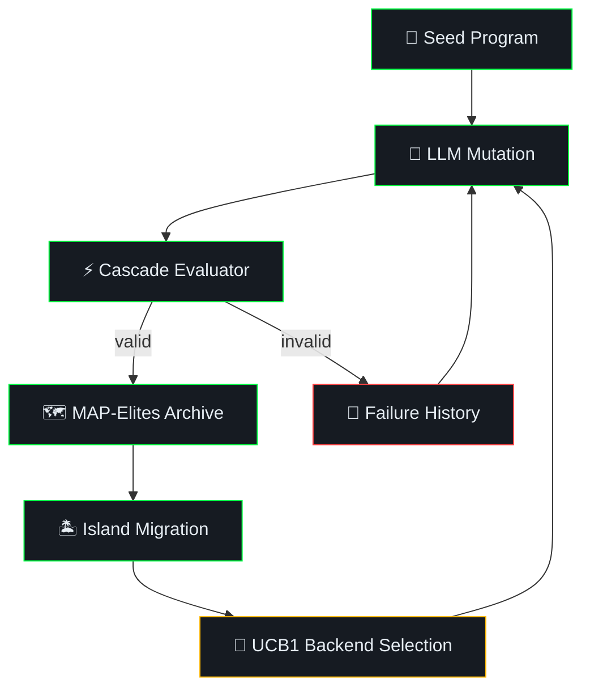

<p align="center">
  
</p>

<h1 align="center">LibreEvolve</h1>

<p align="center">
  <strong>Open-source AlphaEvolve alternative — LLM-guided evolutionary program discovery</strong>
</p>

<p align="center">
  <a href="LICENSE"></a>
  
  
  
  <a href="https://libreevolve.com"></a>
</p>

<br>

<p align="center">
  <em>Feed it a problem, a seed program, and any LLM — it evolves better solutions automatically.</em>
</p>

<br>

LibreEvolve is an open-source Python framework for **automated algorithm discovery** and **code optimization** using large language models and evolutionary computation. Inspired by [AlphaEvolve](https://arxiv.org/abs/2506.13131) (Google DeepMind, 2025), it evolves better programs through LLM-generated SEARCH/REPLACE diffs evaluated in a cascade pipeline.

Works with **OpenAI** (GPT-4o, GPT-5.4, o-series reasoning models), **Anthropic Claude** (Sonnet, Opus, Haiku), and **local models via Ollama** (Llama, Mistral, Qwen — any model).

Built by [Timothy Gregg](https://complete.tech) at [CompleteTech](https://complete.tech) | [libreevolve.com](https://libreevolve.com)

## Key Features

| | Feature | Description |
|:---:|---|---|
| 🧠 | **Multi-LLM support** | OpenAI (GPT-4o, GPT-5.4, o-series), Anthropic (Claude Sonnet/Opus), Ollama (any local model) |
| 🗺️ | **MAP-Elites archive** | 3D quality-diversity grid mapping performance, complexity, and TF-IDF diversity |
| 🏝️ | **5-island migration** | Parallel populations with ring-topology migration (70% exploit / 30% explore) |
| 🎰 | **UCB1 bandit ensemble** | Automatically routes mutations to the best-performing LLM backend |
| ⚡ | **Cascade evaluator** | Three-tier filtering (diff penalties → syntax → subprocess) — cheap rejects before expensive evals |
| 🔀 | **SEARCH/REPLACE diffs** | LLMs propose targeted code edits, not full rewrites — precise, composable mutations |
| 📜 | **Failure history** | Last 5 failed mutations shown in prompts to prevent repetitive dead ends |
| 🔌 | **Plugin system** | 4 lifecycle hooks (CausalEvolve, DeepEvolve, ImprovEvolve, ThetaEvolve) |
| ✅ | **115 unit tests** | Comprehensive test coverage across all components |

## LibreEvolve vs AlphaEvolve

| Feature | AlphaEvolve (Google DeepMind) | LibreEvolve |
|---------|-------------------------------|-------------|
| Source | Closed-source | **Open-source (MIT)** |
| LLM backends | Gemini only | **OpenAI, Anthropic, Ollama (any model)** |
| Population model | Proprietary database | **MAP-Elites with 5-island migration** |
| LLM selection | Not disclosed | **UCB1 multi-armed bandit** |
| Evaluation | Internal infrastructure | **Cascade evaluator (3 tiers)** |
| Extensibility | None | **Plugin system with 4 lifecycle hooks** |
| Local models | No | **Yes (Ollama)** |
| Research basis | 1 paper | **23 papers** |

## Getting Started

### Installation

```bash
pip install -e ".[dev]"
```

### Configuration

Create a `.env` file with your API keys:

```
OPENAI_API_KEY=sk-...
ANTHROPIC_API_KEY=sk-ant-...
OLLAMA_HOST=http://localhost:11434
```

### Run Your First Evolution

```bash
# OpenAI GPT-4o-mini
python -m libreevolve run libreevolve/problems/examples/circle_packing \
    --max-generations 15 --backends openai:gpt-4o-mini

# OpenAI reasoning models (GPT-5.4)
python -m libreevolve run libreevolve/problems/examples/hello_world \
    --max-generations 5 --backends openai:gpt-5.4-nano --reasoning-effort high

# Anthropic Claude
python -m libreevolve run libreevolve/problems/examples/sorting \
    --max-generations 10 --backends anthropic:claude-sonnet-4-6

# Local models via Ollama
python -m libreevolve run libreevolve/problems/examples/hello_world \
    --max-generations 20 --backends ollama:llama3
```

### Inspect Results

```bash
python -m libreevolve show runs/circle_packing
```

```
Total programs: 16
Best fitness:   25.000000 (generation 5)

--- Best program ---

def solve():
    return [(1.0 + i * 2.0, 1.0 + j * 2.0) for i in range(5) for j in range(5)]
```

## How LLM-Guided Evolution Works



<details>
<summary><b>Step-by-step breakdown</b></summary>

<br>

1. **Parent selection** — Sample a parent (70% exploit best, 30% explore random from MAP-Elites grid)
2. **Prompt construction** — Build a prompt with parent code, inspiration programs, and recent failure history
3. **LLM mutation** — LLM proposes a SEARCH/REPLACE diff (targeted edit, not full rewrite)
4. **Cascade evaluation** — Score the result (Tier 0: diff penalties, Tier 1: syntax check, Tier 2: subprocess execution)
5. **Archive update** — Valid programs enter the MAP-Elites archive; all programs are logged
6. **Failure tracking** — Failed mutations are tracked and shown in subsequent prompts to avoid repeats
7. **Backend reward** — UCB1 bandit rewards the LLM backend based on fitness improvement
8. **Island migration** — Periodic migration spreads good solutions across islands

</details>

## Example Runs

### Evolving a Greeting Function

Seed returns `"Hi {name}"` (0/3 tests). The LLM discovers `f"Hello, {name}!"` in generation 0, then explores alternative implementations:

```
gen  0  -0.10  def greet(name): return f"Hi {name}"                   <- seed (wrong format)
gen  0   1.00  def greet(name): return f"Hello, {name}!"              <- solved
gen  2  -0.10  def greet(name): return f"Greetings, {name}!"          <- wrong word
gen  7   1.00  def greet(name): return "Hello, {}!".format(name)      <- .format() variant
gen  8   1.00  def greet(name): return "Hello, " + name + "!"         <- concatenation variant
```

### Evolving a Sort Algorithm

Seed is a bubble sort (already passes all 8 test cases). The LLM discovers `lst.sort()` and explores multiple implementations, all scoring 1.0:

```
gen  0   1.00  bubble sort (seed)                                     <- O(n^2)
gen  0   1.00  lst.sort()                                             <- builtin in-place
gen  1   1.00  sorted(lst)                                            <- builtin new list
gen  2   1.00  lst.copy() + sorted()                                  <- copy variant
gen  3   1.00  [x for x in lst] + sorted()                            <- list comp copy
gen  4   1.00  sorted(lst, key=lambda x: (x is None, x))              <- None-safe sort
```

### Evolving Circle Packing (Optimization)

Seed places 16 circles in a 4x4 grid (spacing 2.5). The LLM evolves toward the provably optimal 25-circle 5x5 grid:

```
gen  0  16.00  4x4 grid, spacing 2.5                                 <- seed
gen  0  16.00  4x4 grid, spacing 2.0 (tighter but same count)
gen  5  25.00  5x5 grid, spacing 2.0                                 <- optimal (proven)
gen  7  -0.10  6x4 grid (out of bounds)
gen  9  -0.10  diagonal offset (overlap)
gen 10  -0.10  hex stagger with (j%2) offset (overlap)
gen 13  16.00  4x4 grid, offset 1.5 (exploring from non-best parent)
```

25 circles is provably optimal for this geometry ([1.0, 9.0]^2, min distance 2.0).

## Supported LLM Backends

| Provider | Models | Features |
|----------|--------|----------|
| **OpenAI** | GPT-4o, GPT-4o-mini, GPT-5.4-nano, GPT-5.4-mini, o-series | Chat Completions + Responses API for reasoning models |
| **Anthropic** | Claude Sonnet 4.6, Claude Opus 4.6, Claude Haiku 4.5 | Messages API |
| **Ollama** | Llama 3, Mistral, Qwen, any local model | Local inference, no API key needed |

Mix backends in a single run — the UCB1 bandit automatically learns which model produces the best mutations for your problem:

```bash
python -m libreevolve run my_problem/ \
    --backends openai:gpt-4o-mini \
    --backends anthropic:claude-sonnet-4-6 \
    --backends ollama:llama3
```

<details>
<summary><h2>Architecture</h2></summary>

```
libreevolve/
├── core/
│   ├── loop.py          # evolve() main loop + build_prompt()
│   ├── evaluator.py     # Cascade evaluator (Tier 0/1/2)
│   ├── diff.py          # SEARCH/REPLACE diff engine
│   ├── database.py      # ProgramDatabase facade
│   └── config.py        # Config dataclass
├── llm/
│   ├── ensemble.py      # UCB1-bandit LLM ensemble
│   ├── anthropic.py     # Claude backend
│   ├── openai.py        # OpenAI backend (+ Responses API for reasoning models)
│   └── ollama.py        # Ollama backend
├── population/
│   ├── program.py       # Program dataclass
│   ├── map_elites.py    # 3D MAP-Elites (TF-IDF char-4gram diversity)
│   └── islands.py       # 5-island ring migration (30% explore / 70% exploit)
├── plugins/
│   ├── base.py          # PluginBase ABC (4 lifecycle hooks)
│   ├── causal.py        # CausalEvolve — MAB outcome-factor guidance
│   ├── deep_research.py # DeepEvolve — pluggable web search
│   ├── modular.py       # ImprovEvolve — modular decomposition prompting
│   └── ttt_rl.py        # ThetaEvolve — GRPO training data accumulation
└── problems/
    ├── loader.py         # load_problem() + Problem dataclass
    └── examples/         # hello_world, circle_packing, sorting
```

</details>

## Creating a Custom Problem

A problem is a directory with four files:

```
my_problem/
├── task_description.txt          # What the LLM should optimize
├── metrics.yaml                  # Scoring metrics
├── validate.py                   # evaluate(code: str) -> dict
└── initial_programs/
    └── seed.py                   # Starting program
```

**metrics.yaml:**
```yaml
metrics:
  - name: score
    direction: maximize
    primary: true
    bounds: [0.0, 1.0]
  - name: is_valid
    direction: maximize
    primary: false
```

**validate.py** must define `evaluate(code: str) -> dict` returning a dict with all metric names. It runs in an isolated subprocess.

**Tip:** Make your seed program intentionally suboptimal. If the seed already scores perfectly, there's nothing to evolve.

## Plugin System

Plugins hook into 4 lifecycle events to extend LibreEvolve's behavior:

| Hook | When | Use case |
|------|------|----------|
| `on_generation_start(gen, db)` | Before each generation | Periodic web search, state setup |
| `build_extra_context(parent, inspirations)` | During prompt construction | Inject guidance into LLM prompt |
| `on_evaluated(program, score)` | After evaluation | Modify score, accumulate data |
| `on_generation_end(gen, best)` | After each generation | Logging, training data export |

Built-in plugins:
- **CausalEvolve** — Multi-armed bandit outcome-factor guidance
- **DeepEvolve** — Pluggable web search for research-augmented evolution
- **ImprovEvolve** — Modular decomposition prompting
- **ThetaEvolve** — GRPO training data accumulation

```bash
python -m libreevolve run my_problem/ --plugins causal --plugins deep_research
```

## CLI Reference

```
libreevolve run PROBLEM_DIR [OPTIONS]
  --max-generations, -g    Number of generations (default: 1000)
  --backends, -b           LLM backend as type:model (repeatable)
  --plugins, -p            Plugin name (repeatable)
  --reasoning-effort, -r   Reasoning effort for OpenAI models (none/low/medium/high/xhigh)
  --run-name               Custom name for this run (default: problem directory name)
  --seed                   Random seed

libreevolve show RUN_DIR
  Inspect history.jsonl from a previous run
```

## Tests

```bash
# Unit tests (115 tests)
pytest tests/ -m "not integration"

# Integration test (requires API key)
pytest tests/integration/ -m integration
```

<details>
<summary><h2>Benchmarks and Lessons from Live Testing</h2></summary>

<br>

**Model selection matters more than generation count:**
- gpt-4o-mini found optimal circle packing (25 circles) in **2 generations**
- gpt-5.4-mini took a longer path (16 → 23 → 25) but explored creative hex packing strategies

**Reasoning effort tradeoffs (gpt-5.4-nano on circle packing):**

| Effort | Reasoning tokens | Response tokens | Result |
|--------|:---:|:---:|--------|
| none   | 0 | 347 | Hex packing (invalid, floating-point boundary) |
| high   | 608 | 119 | **5x5 grid (optimal, 25 circles)** |
| xhigh  | 74,729 | 99 | 5x5 grid (same answer, 124x more tokens) |

> **Takeaway:** `high` reasoning effort hits the sweet spot — optimal result with minimal token cost.

**Prompt engineering for LLM-guided evolution:**
- Models wrap diffs in markdown fences — the diff engine strips them automatically
- Models add comments that cause diff matching failures — the prompt instructs "no comments"
- Without failure history, models repeat the same bad mutation 8+ times in a row
- A concrete diff example in the prompt prevents models from using angle-bracket placeholders literally

**Seeds determine the evolutionary landscape:**
- Suboptimal seeds (hello_world, circle_packing) produce rich evolutionary trajectories
- Already-optimal seeds (sorting's bubble sort) still evolve *different implementations* at the same fitness level

</details>

<details>
<summary><h2>Research Papers (23)</h2></summary>

<br>

Grounded in 23 research papers on LLM-guided evolutionary computation, program synthesis, and quality-diversity optimization.

**Core system papers:**

| Paper | Authors | Year | Role in LibreEvolve |
|-------|---------|:----:|---------------------|
| [**AlphaEvolve**](https://arxiv.org/abs/2506.13131) | Novikov et al. (Google DeepMind) | 2025 | Core architecture inspiration |
| [**GigaEvo**](https://arxiv.org/abs/2511.17592) | Khrulkov et al. | 2025 | Open-source framework patterns |
| [**CodeEvolve**](https://arxiv.org/abs/2510.14150) | Assumpção et al. | 2025 | Evolutionary coding agent design |
| [**ThetaEvolve**](https://arxiv.org/abs/2511.23473) | Wang et al. | 2025 | GRPO training data plugin |
| [**ImprovEvolve**](https://arxiv.org/abs/2602.10233) | Kravatskiy et al. | 2026 | Modular decomposition plugin |
| [**MadEvolve**](https://arxiv.org/abs/2602.15951) | Li, Zang & Münchmeyer | 2026 | Domain-specific evolution |
| [**CausalEvolve**](https://arxiv.org/abs/2603.14575) | Chen et al. | 2026 | Causal scratchpad plugin |
| [**DeepEvolve**](https://arxiv.org/abs/2510.06056) | Liu et al. | 2025 | Web search augmentation plugin |

**Foundational algorithms:**

| Paper | Authors | Year | Role |
|-------|---------|:----:|------|
| **MAP-Elites** | Mouret & Clune | 2015 | Quality-diversity archive |
| **UCB1** | Auer, Cesa-Bianchi & Fischer | 2002 | Multi-armed bandit selection |

See `docs/superpowers/specs/2026-03-17-alphaevolve-design.md` Section 15 for all 23 papers with roles.

</details>

## Contributing

Contributions welcome. Please run `pytest tests/ -m "not integration"` before submitting PRs.

## License

[MIT](LICENSE) — [Timothy Gregg](https://complete.tech) / [CompleteTech](https://complete.tech)
