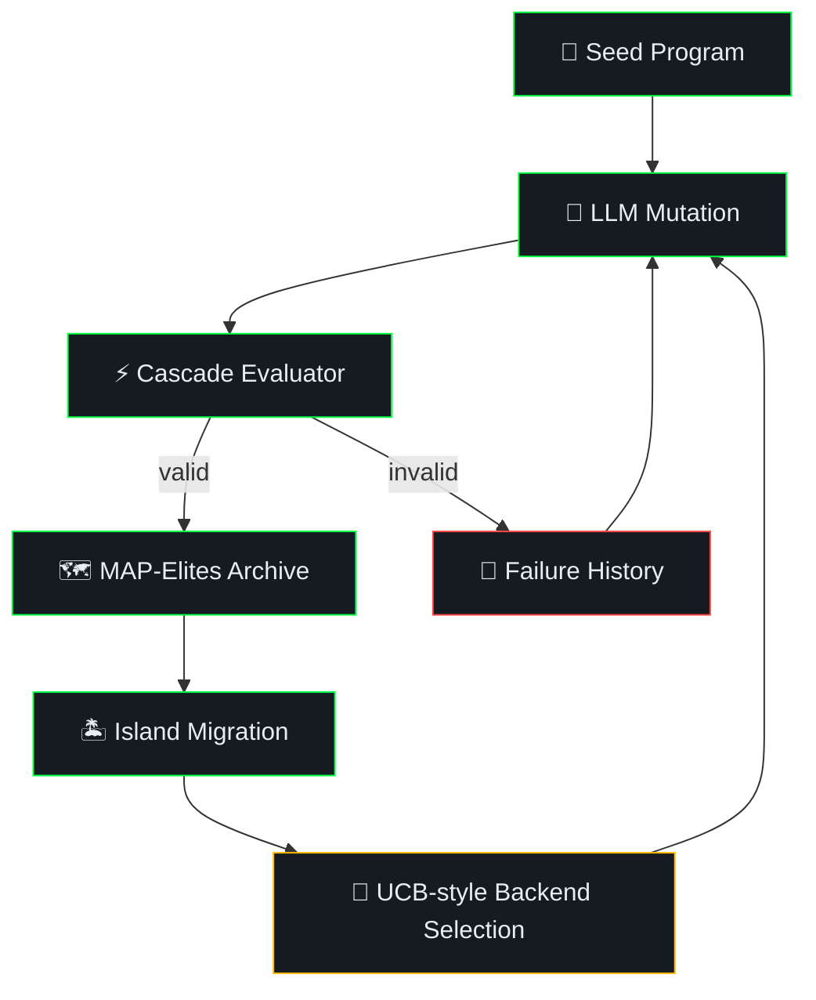

<p align="center">
  
</p>

<h1 align="center">LibreEvolve</h1>

<p align="center">
  <strong>Open-source framework for LLM-guided evolutionary program discovery</strong>
</p>

<p align="center">
  <a href="LICENSE"></a>
  
  <a href="https://github.com/romgenie/libreevolve/actions/workflows/tests.yml"></a>
  
  <a href="https://libreevolve.com"></a>
</p>

<br>

<p align="center">
  <em>Feed it a Python problem, seed program, and configured OpenAI/Anthropic/Ollama backend — it evolves candidate solutions automatically.</em>
</p>

<br>

LibreEvolve is an open-source Python framework for **automated algorithm discovery** and **code optimization** using large language models and evolutionary computation. It is inspired by [AlphaEvolve](https://arxiv.org/abs/2506.13131), [karpathy/autoresearch](https://github.com/karpathy/autoresearch), and related research on LLM-guided evolution, and evolves better programs through LLM-generated SEARCH/REPLACE diffs or full-block replacements evaluated in a cascade pipeline.

This repository is an independent implementation and is not affiliated with or endorsed by Google DeepMind, Andrej Karpathy, or the authors of the cited papers.

Works with **OpenAI** (Chat Completions by default; Responses API when `api_mode: responses` or `reasoning_effort` is configured), **Anthropic Claude**, and **local models via Ollama**. Model names in examples are provider-specific examples; LibreEvolve forwards them to the relevant SDK and does not validate current availability. Configured model identifiers must still be manifest-safe strings matching `[A-Za-z0-9][A-Za-z0-9_.:/+-]{0,191}` and must not look like credentials. Run manifests record this boundary under `policies.provider_capability_lookup`: local static validation only, no live provider model-registry, service/API-version, or account-availability lookup before the run. `validate_provider_capability_lookup_policy()` validates that static lookup boundary and rejects records that claim live model-registry, service/API-version, or account-availability discovery without evidence.

Built by [Timothy Gregg](https://complete.tech) at [CompleteTech](https://complete.tech) | [libreevolve.com](https://libreevolve.com)

## Documentation

- [Docs index](docs/README.md)
- [Roadmap](ROADMAP.md)
- [Architecture](docs/architecture.md)
- [Problem format](docs/problem-format.md)
- [Configuration](docs/configuration.md)
- [Plugins](docs/plugins.md)
- [Backends](docs/backends.md)
- [Run artifacts](docs/run-artifacts.md)
- [Development](docs/development.md)

## Key Features

| | Feature | Description |
|:---:|---|---|
| 🧠 | **Multi-LLM support** | OpenAI, Anthropic, and Ollama adapters with provider-specific model strings |
| 🗺️ | **MAP-Elites archive** | 3D quality-diversity grid plus retained elite list using archive selection score, complexity, and TF-IDF diversity |
| 🏝️ | **Configurable island migration** | Synchronous island archives with periodic ring-topology migration; defaults to five islands |
| 🎰 | **UCB-style ensemble** | Heuristic backend routing over archive-retained valid fitness improvements |
| ⚡ | **Cascade evaluator** | Default diff/syntax/subprocess filtering plus configurable staged validators |
| 🔀 | **SEARCH/REPLACE diffs** | LLMs can propose targeted edits, with full-block/full-code mode available when configured |
| 📜 | **Failure memory** | Failed/rejected mutations are logged to `failure_history.jsonl` and bounded recent examples are shown in prompts |
| 🧭 | **Proposal lifecycle evidence** | Completed manifests summarize generated proposal parsing, evaluation, admission/rejection, backend summaries, and failure-memory linkage |
| 🧾 | **Prompt programs** | Prompt templates are selected, scored, logged, and optionally mutated for meta-prompt evolution |
| 🧐 | **Optional LLM critique and feedback** | Critique can revise mutations before evaluation; feedback graders can add metrics, adjust fitness evidence, or discard candidates after evaluation |
| 🔌 | **Plugin system** | Lifecycle plus metadata/artifact hooks with paper-inspired plugins |
| ✅ | **Focused test suite** | Unit coverage for the current prototype surface, including workspace candidates, candidate blocks, mutation modes, evaluator results, metrics, archives, and CLI behavior |

## Comparison to AlphaEvolve

| Feature | AlphaEvolve (Google DeepMind) | LibreEvolve |
|---------|-------------------------------|-------------|
| Source | Closed-source | **Open-source (MIT)** |
| LLM backends | Published experiments use Gemini Flash/Pro; paper describes existing/custom LLM choices | **OpenAI, Anthropic, Ollama, and configured custom import-path backends** |
| Population model | Closed evolutionary database inspired by MAP-Elites/island models | **Small local MAP-Elites with configurable island migration, defaulting to five islands** |
| LLM selection | Fast/deep model scheduling described | **UCB-style heuristic plus bounded normalized throughput/depth metadata after pull-once initialization** |
| Evaluation | User-defined evaluators returning scalar metrics, optional cascades, feedback, and parallel execution | **Local subprocess evaluator with structured results, staged validator cascades, optional synchronous LLM feedback, and a reserved `is_valid` admission gate outside scored metrics** |
| Code scale | Entire code files, hundreds of lines, any language, and multi-component algorithms reported in Table 1 | **Python-primary workspaces and multi-file mechanics; no benchmark-backed hundreds-line or arbitrary-language codebase-scale parity yet** |
| Candidate abstraction | User-chosen solution abstractions, including raw strings, constructors, bespoke search algorithms, or paired solution/search representations | **Deliberate code-file-set abstraction with a primary text file; no first-class non-code serializer or paired solution/search API yet** |
| Extensibility | Task API, evaluators, prompt/context customization, LLM choices, evolve blocks | **Python problem format, plugins, prompt templates, evolve blocks** |
| Local models | Published experiments use hosted Gemini models; local model use is not discussed | **Yes (Ollama)** |
| Research grounding | Published paper | **24-paper local cache and implementation-status docs** |

## Getting Started

### Installation

```bash
py -3.12 -m pip install -e ".[dev]"
```

### Configuration

Create a `.env` file with your API keys:

```
OPENAI_API_KEY=sk-...
ANTHROPIC_API_KEY=sk-ant-...
OLLAMA_HOST=http://localhost:11434
```

The `run` command loads `.env` during run setup with `override=True`, before
provider backend preflight. Values in `.env` therefore take precedence over
same-named parent-process environment variables for evolution runs. Importing
`libreevolve.cli` and using `libreevolve show` do not load `.env`. Run manifests
record non-secret dotenv provenance under `manifest.provenance.dotenv`,
including status, override policy, source hash/byte count, and key names
without values.

### Run Your First Evolution

```bash
# OpenAI chat model example; replace the placeholder with a live model id
py -3.12 -m libreevolve run libreevolve/problems/examples/circle_packing \
    --max-generations 15 --backends "openai:<openai-model-id>"

# OpenAI reasoning model example; replace the placeholder with a compatible model id
py -3.12 -m libreevolve run libreevolve/problems/examples/hello_world \
    --max-generations 5 --backends "openai:<openai-reasoning-model-id>" --reasoning-effort high

# Anthropic Claude; replace the placeholder with a live model id
py -3.12 -m libreevolve run libreevolve/problems/examples/sorting \
    --max-generations 10 --backends "anthropic:<anthropic-model-id>"

# Local models via Ollama; replace the placeholder with an installed local tag
py -3.12 -m libreevolve run libreevolve/problems/examples/hello_world \
    --max-generations 20 --backends "ollama:<installed-ollama-model>"
```

LibreEvolve forwards backend model strings to provider SDKs and does not check
live provider or account availability. Replace placeholder model ids with
current provider/account model ids or installed Ollama tags before running.

Run-directory reuse is not resume. If the target run directory already
contains known artifacts, startup fails by default before appending history or
rewriting the manifest. Use a fresh `--run-name`, or pass `--overwrite` when
you intentionally want to replace the previous run artifacts. Unknown files in
the same run directory are preserved and are outside the run contract; the
manifest records their count and hashed immediate names/types so mixed
directories are visible without exposing raw filenames. If an existing run
directory cannot be listed, the manifest records a redacted unreadable-listing
diagnostic instead of echoing raw host exception text. Keep fresh runs in clean
directories when reproducibility matters.
Startup manifest payloads are serialized and checked before overwrite removes
old artifacts, so malformed direct provenance or context payloads fail without
deleting the previous run's known artifacts.
Before cleanup or writes, LibreEvolve resolves the final run directory and
rejects it if it would land outside the resolved `log_dir`; symlink or junction
run directories that escape the log root fail instead of being cleaned. Known
artifact paths that are themselves links or junctions, including
`best_workspace/`, `evaluator_artifacts/`, and `plugin_artifacts/`, are rejected
before `--overwrite` deletes any artifact.
History, failure, prompt, and plugin JSONL files use strict finite JSON and
reject non-string JSON object keys, tuple values, cyclic records, and
non-JSON-compatible values before writing. Runtime tuples must be converted to
explicit lists by the producing code rather than silently persisted as JSON
arrays. Strict-JSON exception and quarantine messages are bounded and
secret-redacted, and quarantine diagnostics preserve a bounded, secret-redacted
record representation even when the malformed record's `repr()` raises.
Rejected archive-admission metadata keeps diagnostic fields such as
`selection_score` JSON-safe, but it does not normalize a hook-mutated or
restored program's top-level non-finite `fitness` or metric values for
accepted history. If such a rejected record is passed to `ProgramDatabase.log()`,
the strict history writer rejects it and writes bounded diagnostics to
`history_invalid.jsonl`; a dedicated finite rejected-candidate stream remains
open work.
Valid strict JSON/JSONL writes create missing parent directories before
writing; if an intended parent path cannot be prepared, the helpers raise a
bounded, secret-redacted `StrictJsonlError` instead of surfacing a raw
filesystem exception. These JSONL streams are still best-effort append logs,
not crash-safe databases:
appends are not fsynced and do not include line checksums, sequence ids, or
automatic repair for a torn final record. `manifest.json` has separate atomic
replacement behavior.
Candidate `id`, `parent_id`, and `lineage[]` values are manifest-safe
identifiers matching `[A-Za-z0-9][A-Za-z0-9_.-]{0,127}` and are rejected when
they look like secrets. The database revalidates mutated program identities
before archive admission, history writes, and failure-history writes. Raw
MAP-Elites and island archive insertion also revalidate mutated ids, parent
ids, and lineage before live archive state changes. Direct archive admission
rejects duplicate ids before mutating the live MAP-Elites archive. Migration
uses canonical-id references rather than clone ids: the same program id may be
placed in multiple islands, and repeated migration skips target islands that
already contain that id. The run manifest stores archive cursor/counter state
and per-island MAP-Elites cell/elite snapshots that can restore current archive
placements from a previous manifest/history bundle, while ordered migration
event replay and controller resume remain future work.
Each run manifest records effective settings plus reproducibility provenance:
Git state resolved from the hashed `libreevolve/` source tree when available,
`libreevolve/` source-tree hashes, problem-tree hashes, direct evaluator
entrypoint hashes, the effective problem objective schema, plugin module file
hashes, problem-local `config.yaml` provenance when loaded by the CLI, Python
runtime/platform metadata,
`pyproject.toml` status/hash when present, selected package metadata
(`project.name`, `project.version`, `project.requires-python`, license,
authors/maintainers, keywords, classifiers, project URLs, optional dependency
groups, scripts, and arbitrary entry-point groups), bounded extra `[project]`
metadata for unselected/unknown keys, build backend metadata, installed
versions for declared runtime dependencies, and hash-only records for known
project-root lockfiles
(`requirements.txt`, `requirements.lock`, `uv.lock`, `poetry.lock`,
`pdm.lock`, and `Pipfile.lock`).
It also records a bounded `installed_packages` snapshot containing installed
distribution names, versions, parsed `WHEEL` metadata, and bounded source/install
metadata for the current
environment, including wheel versions, generators, `Root-Is-Purelib`, bounded
tag records, `direct_url.json` URL/hash/object hashes, `INSTALLER` values, raw
`RECORD` hashes/line counts, oversized metadata skips, redacted/escaped labels,
and an aggregate hash over the full uncapped record set.
`pip_freeze` records a bounded, redacted `python -m pip freeze --all`
snapshot with retained line hashes, a SHA-256 hash over the raw stdout text,
and timeout/error diagnostics when freeze capture is unavailable.
`pip_config` records a bounded, redacted `python -m pip config list` snapshot
with retained line hashes and a SHA-256 hash over the raw stdout text, so
private index/source configuration changes can affect manifest evidence without
storing raw credentials.
Numerical runtime provenance records NumPy version and a redacted, bounded
`numpy.show_config()` preview with a SHA-256 hash over the full captured config
text so BLAS/runtime changes can affect manifest evidence without storing an
unbounded diagnostic dump.
LLM provider SDK provenance records installed `openai`, `anthropic`, and
`ollama` package versions when present, plus the built-in adapter module and
adapter API modes; missing or failed version lookups are recorded with degraded
statuses.
Accelerator runtime provenance records selected CUDA/NVIDIA/ROCm/HIP/oneAPI/
SYCL/DirectML environment hints as redacted, bounded, hash-backed values and
degraded `nvidia-smi`/`rocm-smi` driver probe records when those tools are
available.
Readable in-budget lockfiles record path, status, bytes, SHA-256, and an
aggregate lockfile hash; unreadable, over-limit, non-regular, or linked
candidates are recorded with degraded statuses without copying lockfile
contents into the manifest.
`environment_reproducibility_policy` records a hash-backed audit-only policy
over package metadata, lockfiles, installed-package snapshots, `pip freeze`,
`pip config`, NumPy config, provider SDK versions, and accelerator probes. It
also lists unsupported surfaces: complete install-source/options
interpretation, broader non-project build provenance, live provider
service/API-version capture, provider cost, remote provider-side defaults,
accelerator budget accounting, private package-source identity/authentication
resolution, and remote package artifact verification.
This environment provenance is a bounded
package-name/version plus installed-distribution `WHEEL` tag and source/install metadata,
known-lockfile hash, `pip freeze` hash/preview, `pip config` hash/preview,
NumPy config summary, built-in LLM provider SDK-version summary, and bounded
accelerator runtime hint/probe summary, not a complete build-provenance record,
complete private package-index interpretation policy beyond redacted config evidence,
live provider service/API-version capture, provider cost or remote provider-side default
capture, accelerator budget/accounting record, or restore-checked proof that a
future evaluator runtime can replay the original build/package/hardware
boundary.
The effective config retains prompt-bearing fields through a redacted,
truncated, hash-backed manifest policy. `prompt_variants`,
`prompt_format_options` alternative text, `critique_prompt`, and
`llm_feedback[].prompt` remain visible when they are safe, but secret-like text
is redacted and each prompt-bearing value gets SHA-256, length, retained-length,
redaction, and truncation metadata. Raw prompt text can still appear when it is
not secret-like and within the retention bound, so manifests remain local run
records rather than public artifacts.
Completed and aborted runtime manifests also include
`runtime.wall_clock`, with UTC `started_at`, `updated_at`, `finished_at`,
status-specific `completed_at` or `aborted_at`, and the initial process segment;
monotonic budget accounting remains under
`runtime.consumed.runtime_seconds`. They also include `runtime.rng`, a
hash-backed `python.random.Random` state snapshot seeded from `Config.seed` and
validated as JSON-finite manifest data. `load_runtime_rng_state_snapshot()` and
`restore_runtime_rng_state_snapshot()` provide the checked manifest-reader and
direct restore boundary for that snapshot. Direct callers can pass a validated
snapshot back into `evolve(..., runtime_rng_state_snapshot=...)`; the snapshot
seed must match `Config.seed`, and the resulting manifest marks
`runtime.rng.resume_status` as restored. CLI runs can use
`--restore-rng-from-manifest path/to/manifest.json` to load the same checked
snapshot before run-directory preparation. `runtime.rng.replay_boundary`
documents that the snapshot restores only framework-owned RNG surfaces and
explicitly excludes LLM provider outputs, plugin internal randomness, and
validator subprocess randomness from that restore contract. Archive
cursor/counter snapshots can be loaded similarly
with `--restore-archive-cursor-from-manifest path/to/manifest.json`; that path
restores only the compact island assignment counters. Full archive restore is
available with `--restore-archive-from-manifest path/to/manifest.json`, which
combines the manifest archive snapshot with checked accepted-history rows to
restore MAP-Elites cells and elite lists. Ordered migration-event replay and
controller state remain outside that restore contract.
Dependency records redact secret-like requirement specs and names, preserve raw
dependency identity through `name_hash`, and mark `name_redacted`; when a
dependency name is redacted, installed-version lookup is suppressed and the
lookup label is stored only as a redacted/hash-backed value. Package and build
metadata fields from `[project]` and `[build-system]` are persisted for
`name`, `version`, `requires-python`, license, authors/maintainers,
keywords, classifiers, project URLs, optional dependency groups, scripts,
arbitrary entry-point groups, `build-backend`, and `build-system` `requires`,
and only as bounded/redacted strings. Extra `[project]` keys that are not part
of those selected fields are retained under `extra_project_metadata` as
bounded/redacted/hash-backed scalar, list, and table records. Broader
non-project build metadata is not captured. Secret-like text and Unicode format
controls are redacted or escaped and paired with field-specific hashes such as
`name_hash`, `version_hash`, `requires_python_hash`, and
`build_backend_hash`. Unsafe project names also suppress raw installed-version
lookup. Runtime environment
provenance also records hash-only metadata for
known project-root lockfiles and an aggregate `lockfiles.hash`; lockfile
contents are not copied into manifests. The bounded `installed_packages`
snapshot records installed distribution names, versions, bounded parsed
`WHEEL` metadata, redacted/hash-backed `direct_url.json` source URLs and object
metadata, `INSTALLER` values, and hash-only `RECORD` metadata. `pip_freeze`
records redacted retained requirement lines plus a raw stdout hash for source
URL/editable-install evidence without persisting raw private URLs. The
plugin module path field is not a raw absolute path: project-local plugin
files are `project_relative`, external files are basename-only
`external_file_name` records, and both include `path_hash` plus
`path_redacted` for comparison against the original resolved path. Unicode
format controls in the visible plugin path label are escaped as `[U+....]` and
flagged with `path_unsafe_chars_redacted`. File-backed
plugin records also include `max_file_bytes`; over-limit module files are
recorded as `skipped_max_file_bytes`, read failures as `read_error`, and no-file
modules as `missing_module_file`. The
source, problem, and Git provenance roots are stored as local labels such as
`<libreevolve-root>`, `<problem-root>`, and `<git-root>` with `root_hash`,
`root_scope`, and `root_redacted` metadata rather than raw absolute local paths.
Git dirty-status detail stores secret-redacted porcelain entries plus hashes of
the original entries, not raw secret-like status paths; Unicode format controls
in status entries are escaped and flagged as
`status_entries_unsafe_chars_redacted`. The
objective schema is persisted
under `manifest.problem.objective_schema` with normalized metric names,
directions, bounds, weights, source labels, effective primary flags,
`primary_metric`, `primary_bounds`, and `metric_count`. The database manifest boundary validates
and normalizes this schema for direct callers too; missing, boolean-bound, or
inconsistent objective schemas fail before startup manifests are written.
CLI `config.yaml` diagnostics use the stable `config.yaml` label plus
secret-pattern redaction for parser/key text instead of printing raw absolute
problem roots.
Configured `run_id` values are manifest-safe identifiers matching
`[A-Za-z0-9][A-Za-z0-9_.-]{0,127}` and are checked for secret-like values,
not arbitrary notes or resume handles.
Configured plugin names and plugin option keys use manifest-safe character
sets and are also checked for secret-like values before `manifest.json` is
written, including when a direct API caller mutates `Config.plugins` after
construction.
The database manifest boundary revalidates the full mutable `Config` before
directory preparation or manifest serialization, so post-construction mutation
of run names, IDs, scalar budgets, backend specs, or evaluator stages fails
before run artifacts are written.
Malformed or non-UTF-8 `pyproject.toml` files are recorded as degraded package
provenance with `package.pyproject.status` set to `invalid_toml` or
`invalid_encoding`; the manifest still includes the file hash and byte count.
Syntactically valid files with invalid dependency or build requirement schemas
are recorded as `invalid_pyproject_schema` with bounded diagnostics rather than
normal dependency rows. Pyproject read, decode, and parse diagnostics are
secret-redacted and bounded before manifest persistence.
If `pyproject.toml` is absent, `package.pyproject.status` is `missing` with
`path: pyproject.toml`; package name/version/build/dependency metadata are
omitted and `installed_version_name` records the fallback package name used for
installed-version lookup.
Explicit `context/` provenance includes selected source records plus the
effective context manifest policy: `context.yaml`/`context.yml` file hash when
present, include/exclude rules, per-source character budget, selected/skipped
counts, per-include pre-filter `matches` and post-filter `selected_matches`,
unmatched include patterns, and hashed diagnostics for unsupported,
not-included, and excluded context files.
Source/problem provenance does not follow symlinks or Windows junctions; linked
paths are skipped with `reason: link_not_followed` diagnostics in the manifest,
including hash-backed target identity, target scope, and whether the resolved
target is inside or outside the provenance root when the target can be resolved.
Problem provenance includes ordinary problem-owned fixture files even under
directories named `runs/`, but directories under `runs/` that contain known
LibreEvolve run-artifact markers such as `manifest.json`, `history.jsonl`,
`prompt_history.jsonl`, `best.py`, or `best_workspace/` are classified as
generated outputs and skipped with `reason: generated_run_artifacts`. The
active generated run directory is skipped with `reason: excluded_output_root`
when it resolves inside the problem tree. Direct `problem_provenance()` calls
resolve relative generated roots from the problem root, while the evolution
loop passes its effective run directory as an absolute path. The marker policy
is recorded in provenance as `generated_run_artifact_markers`.
Source/problem provenance paths are stored as NFC-normalized relative display
paths. If a filesystem spelling differs after normalization, the manifest keeps
the normalized `path` plus `filesystem_path`, `filesystem_path_hash`, and
normalization metadata; Unicode format controls in included and skipped path
labels are escaped as `[U+....]`, paired with `filesystem_path_hash`, and
flagged with `path_unsafe_chars_redacted`; included files whose normalized or
escaped labels collide are rejected before manifest writes. Secret-like path text is redacted and paired
with `path_hash` plus `path_redacted` so manifests keep comparison signal
without storing the raw credential-like name. `tree_hash` is scoped to included
file records and marked with `tree_hash_scope: included_files`; skipped
diagnostic records are hashed as `skipped_hash` with
`skipped_hash_scope: skipped_diagnostic_records_v2`; `provenance_hash`
combines the included-file digest, skipped-diagnostics digest, and exclusion
policy under
`provenance_hash_scope: included_files_and_skipped_diagnostics_v2` without
hashing excluded file contents.
Source/problem tree provenance
has a `max_file_bytes` cap: over-limit files are skipped with byte diagnostics,
read failures are recorded as skipped `read_error` diagnostics, directory
enumeration failures are recorded as skipped `directory_listing_error`
diagnostics with redacted error text, and binary files under the cap are hashed
as bytes.
It also records completed-run runtime accounting, including structured stop
reason, consumed local evaluation/generation budgets, evaluator subprocess
attempts, configured-stage samples, retry attempts, evaluator timeout and
sample/stage budget-exhaustion counts, logical LLM-call counts, history counts,
and run-artifact pointers with link/junction/broken-link diagnostics and
redacted inspection errors. Completed and aborted manifests also include
`runtime.llm_accounting`, an audit-only summary of scheduler role-accounting
counters, per-role scheduler audit state, configured reward-accounted roles,
the scheduler `reward_accounting_policy`, and configured LLM
call/retry/prompt/output limits. The runtime budget snapshot remains the
authoritative stop-policy record for logical-call, provider-attempt, token,
configured estimated-cost, and retained-latency caps.
`max_evaluations=0` is treated as an explicit dry budget point and
records that no seed or generated candidate was evaluated; zero
evaluator-second and zero runtime-second limits are rejected during config
validation. `max_evaluations` remains a seed/candidate evaluation cap, while
subprocess-attempt, sample, retry, timeout, and budget-exhaustion counters are
also available as optional cooperative run-stop limits in `config.yaml`.
`max_llm_calls=0` is the matching provider-free LLM dry point: seeds can be
evaluated, but provider construction and mutation calls are skipped. Positive
`max_llm_calls` values cap logical LLM `generate()` invocations cooperatively;
`max_llm_provider_attempts` can also stop before the next logical LLM call
after recorded adapter retry telemetry consumes the configured provider-attempt
cap. `max_llm_tokens` and `max_llm_cost_microusd` likewise stop before the next
LLM call after provider usage or configured cost telemetry consumes the cap.
Runtime budget snapshots can be restored from prior manifests. Direct callers
can pass `runtime_budget_state_snapshot` into `evolve()`, and CLI runs can use
`--restore-budget-from-manifest`; restored consumed counters are applied before
new seed or generation work, prior runtime seconds continue to count toward the
live wall-clock budget, and final manifests append a new wall-clock resume
segment. `validate_restored_budget_snapshot()` preflights persisted budget
snapshots before restore. `validate_controller_budget_state()` and
`validate_controller_budget_event()` define the controller budget-event replay
boundary: restored state must carry the local controller schema, a checked
runtime snapshot, and contiguous checked events; evaluation events must declare
`seed_evaluation` or `candidate_evaluation`, finite non-negative elapsed
seconds, and valid evaluator accounting before `apply_controller_budget_event()`
can mutate an in-memory `RunBudget`.
Live synchronous budget deltas are now emitted to
`controller_budget_events.jsonl` as contiguous rows for seed evaluations,
generation starts, LLM calls, candidate evaluations, generation completions,
and final stop reasons. LLM rows carry role-tagged provider attempts, tokens,
configured-cost estimates, and latency seconds when retained call telemetry
exposes them. Full-runtime restore replays those rows and verifies their
non-wall-clock consumed counters against the manifest budget snapshot before
passing the checked budget state back into `evolve()`. Async worker state,
pending-work resume, and provider-output replay are still future work.

### Inspect Results

If you ran the first example above, inspect the matching run directory under `runs/`:

```bash
py -3.12 -m libreevolve show runs/circle_packing
```

Or inspect one of the checked-in example histories:

```bash
py -3.12 -m libreevolve show examples/runs/hello_world_ensemble
py -3.12 -m libreevolve show examples/runs/sorting_ttt_rl
```

These checked-in examples are legacy history fixtures. They are useful for
testing `show`, but they do not include the current full run-artifact set such
as `manifest.json`, `archive_events.jsonl`, `llm_calls.jsonl`,
`prompt_history.jsonl`, `failure_history.jsonl`, or `best_workspace/`.
Current run artifacts are strict machine-readable local formats, but they are
now marked with explicit v1 schema metadata. `manifest.json` carries top-level
`schema_version` and `artifact_schema` fields, and current `history.jsonl`,
`failure_history.jsonl`, `archive_events.jsonl`, `llm_calls.jsonl`, and
`prompt_history.jsonl` rows carry `schema_version` plus `record_schema`.
Legacy checked-in histories
without those fields remain readable for `show` and accepted-history restore
helpers, but true migration and resume branching by schema remain future work.
Managed JSONL streams use complete-line local durability: accepted rows are
strict-serialized, newline-terminated, flushed, and fsynced before the append
helper returns. If a later append finds a non-empty final fragment without a
terminating newline, LibreEvolve treats it as a torn prior append, truncates
back to the previous complete line, and writes a bounded repair diagnostic to
the paired `*_invalid.jsonl` stream or to the same quarantine stream when the
stream repairs itself. Earlier complete lines remain the recovery unit; full
checkpoint replay and per-line checksums are still separate resume hardening
work.

`show` is a compact history view. For current histories that include
`metadata.archive_admission`, it selects the best archive-retained valid record
by archive selection score with fitness as the tie-break, then prints metrics
and archive cell/retention/descriptor diagnostics when present. When
`metadata.archive_admission.objective_vector` is present, it also prints the
finite normalized objective metrics and manifest-safe selection-policy type,
summarizing large metric vectors with a bounded preview and stable hash. In this
context retained can mean MAP-Elites cell admission or auxiliary elite-list
retention; `cell_admitted`, `elite_retained`, and `sampling_eligible`
distinguish those cases. For legacy histories without archive-admission
metadata, including the checked-in fixtures above, it falls back to the highest
top-level fitness row.
For the selected current-format row, `show` also prints bounded run-inspection
diagnostics when the fields exist: parent/lineage depth and tail, prompt
program id plus parent-selection metadata, evaluator stage/accounting counts,
LLM feedback outcome counts and weighted delta, and aggregate
`failure_history.jsonl` counts by admission reason and error. It does not print
raw prompts, raw feedback prose, or mutation payload text in these summaries.
Use `best.py` and
`best_workspace/` from the original run for the exact archived output. When a
selected history row contains `files` plus `primary_file`, `show` prints a file
manifest and every logged workspace file, with the primary file marked.
Core finalization stages the best-artifact pair under temporary paths and only swaps
`best.py` plus `best_workspace/` into place after workspace materialization
succeeds; failed replacement attempts roll back to the previous visible pair.
If rollback or cleanup also fails, the exporter reports the original export
failure first, keeps rollback/cleanup diagnostics as secondary redacted fields,
and preserves backup paths that could not be restored.
Direct best export also preflights the visible best-artifact paths plus
generated temporary and backup paths, rejecting symlinks or Windows junctions
before replacement or cleanup so export does not follow linked artifacts.
During normal runtime finalization, `manifest.json.runtime.best_artifact_export`
records `status: "completed"` or `status: "failed"`, bounded/redacted export
errors for failures, secondary rollback/cleanup diagnostics and preserved
backup labels when recovery is incomplete, and refreshed
`runtime.artifacts.best.py` / `runtime.artifacts.best_workspace` path records
with hashes when available. The CLI reads that manifest record and reports the
saved artifact paths, or returns a redacted command error when export failed.
The top-level `runtime.status` remains the core evolution result; inspect
`best_artifact_export` to confirm post-run materialization.
Runtime artifact pointers for regular files also include SHA-256 hashes of
file bytes, and directory artifact pointers include deterministic tree hashes
over relative file paths plus per-file SHA-256 hashes, while link-like entries
are reported without following their targets.
Mixed legacy/current histories are rejected with a line-numbered diagnostic
instead of treating one modern row as a migration for the whole file.
`show` reads `manifest.json.runtime` when present and prints whether the
displayed candidate is from a completed run, an aborted best-so-far run, or a
partial manifest without runtime finalization. Missing manifests keep legacy
history-only compatibility, while inconsistent
`runtime.history.programs_logged` counts fail instead of presenting a
completed-looking result.
`show` streams `history.jsonl` and fails fast with a line-numbered
diagnostic if the stream contains invalid UTF-8 bytes, a history row is
malformed JSON, is not a JSON object, or lacks a finite non-boolean numeric
`fitness`. While streaming it also requires every history `id` to be a
manifest-safe program identifier and rejects duplicate ids with the first-seen
line number. Any streamed `metrics` object must use the same manifest-safe
metric-name and finite-value policy as runtime `Program.metrics`, and printed
metric summaries use strict JSON. Before printing the selected best row it also
validates display fields such as `id`, `generation`, `code`, workspace file
paths/contents, metrics, and archive summary metadata. Workspace file paths use
the same candidate path grammar as runtime workspaces, including normalization
and traversal/control-character rejection. Current-format rows with
`metadata.archive_admission` must provide an object payload; `admitted=True`
rows with explicit archive-state flags need at least one true retention or
search-state flag before `show` can present them as retained. Present
current-history `evaluation` payloads must be objects, and any
`evaluation.is_valid` value must be boolean. Archive diagnostic fields are
validated while streaming current histories, so malformed unselected retained
rows cannot be hidden by a valid best row. If
`metadata.archive_admission.program_id` is present, it must be manifest-safe
and match the history row `id`; missing `program_id` remains compatible with
older current-format rows. Current MAP-Elites `cell`
diagnostics must be three non-negative integer coordinates. When
`manifest.json.config.map_elites_bins` is present, each coordinate must also be
less than that positive integer bin count; missing manifest/bin metadata keeps
legacy arity/type/non-negative validation only. Archive descriptor labels use
the same manifest-safe metric-name grammar as runtime metrics before display,
so secret-like labels, control characters, reserved `is_valid`, and
non-identifier names fail with a line-numbered diagnostic instead of being
echoed by `show`. Large descriptor maps or long descriptor labels are
summarized with descriptor count, bounded preview, omitted count, and a stable
hash rather than printed in full. Archive objective-vector metric names and
normalized values are validated with the same manifest-safe metric-name grammar
and finite `[0, 1]` normalized-score policy before display. Large selected
legacy source or workspace
file bodies are likewise truncated at 4,096 displayed characters per body by
default, with `--source-display-chars` for a different terminal budget and
`--full-source` for complete selected source output. `show` validates
non-archive display payloads while streaming every row: legacy `code` must be
text, workspace `files` must map safe candidate paths to text, and
`primary_file` must be a safe path present in `files`. Malformed unselected,
invalid, or non-admitted rows fail the inspection before any best-looking row
is printed. `--redact-source` applies secret-pattern redaction before source
display and truncation. Truncation notices include source length, rendered
length, displayed length, omitted character count, source hash, and a
`history.jsonl` full-source pointer.
`load_accepted_history_index()` provides a checked accepted-history reader for
future restore/query code: it validates UTF-8/JSON shape, duplicate JSON object
names, finite fitness, manifest-safe ids, metrics, and duplicate program ids
before returning an id-indexed map. Failure-history and prompt-history replay
helpers use the same duplicate-object-name strictness, and current plugin or
retrieval artifact readers reject duplicate JSON names before restoring TTT/RL
export counts or DeepResearch disk-cache snapshots. Current archive cells and
elite lists can be restored from the manifest archive snapshot plus checked
accepted-history rows; controller resume, ordered migration-event replay, and
provider/plugin output replay remain future work. Direct `Program`
construction uses the legacy `-inf` sentinel only when fitness is omitted; any
explicitly provided fitness must be finite, numeric, and non-boolean. Restored
or hook-mutated objects with invalid fitness are still rejected by archive
admission, accepted-history persistence, and `show`, or rendered as explicit
invalid-fitness markers before prompt use. Rejected archive-admission metadata
does not convert those top-level invalid values into accepted history rows.
Program identity validation rejects
self-parenting, duplicated lineage entries, the program id appearing in its own
lineage, and parent ids that disagree with the lineage tail. `Program.metrics` keys must be manifest-safe metric names using
the same ASCII identifier grammar as `metrics.yaml`, including optional dotted
namespaces. `is_valid` is the only boolean metric field, and all other metric
values must be finite numbers. Plugin-added metric side effects that violate
that policy are reverted and logged as `invalid_plugin_metrics`. Archive
insertion requires `evaluation.is_valid is True`. Unevaluated default programs
still use the legacy `-inf` sentinel until they receive an evaluator score.
Direct MAP-Elites construction validates positive integer `bins`, positive
integer `elite_archive_size`, and finite ordered `perf_bounds`.

```
Total programs: 11
Selection:      legacy highest-fitness
Best fitness:   1.000000 (generation 0)

--- Best program ---

def greet(name):
    return f"Hello, {name}!"
```

## How LLM-Guided Evolution Works



<details>
<summary><b>Step-by-step breakdown</b></summary>

<br>

1. **Parent selection** — Sample a parent with the configured policy; the default keeps the 70% exploit / 30% explore mix, while metric, novelty, and recency strategies are available
2. **Prompt construction** — Build a prompt with parent code, parent-excluding/deduplicated inspiration programs selected by the configured inspiration policy, and recent failure-memory hints
3. **LLM mutation** — LLM proposes a SEARCH/REPLACE diff by default, or full-block/full-code replacements when configured with `mutation_mode: full`
4. **Optional review** — Configured critique can revise the mutation before evaluation; malformed critique revisions fall back to the original mutation when it still applies cleanly, and no-valid-mutation cases preserve the original generated mutation as the traceable failure payload. After evaluation, feedback graders can add metrics, adjust fitness/reward evidence, or discard candidates.
5. **Cascade evaluation** — Score the result with structured stage outcomes, raw metrics, stdout/stderr, error, and elapsed time
6. **Archive update** — Valid programs can enter a MAP-Elites cell or the retained elite list; declared metrics are normalized into a first-pass selection score for archive ranking, and all programs are logged with metrics and evaluation details
7. **Failure memory** — Failed/rejected mutations are persisted with error causes, changed files, evaluator summaries, and bounded prompt-visible examples
8. **Backend reward** — UCB-style routing rewards the LLM backend based on fitness improvement from the captured mutation call id; each successful backend call can receive at most one scheduler reward
9. **Island migration** — Periodic migration spreads good solutions across islands
10. **Artifacts** — `best.py` preserves the primary-file compatibility view derived from the canonical workspace file set, `best_workspace/` contains the complete best candidate text file set plus encoded or verified source-copy static member bytes when present, static candidate sidecars are exported as `best_workspace/.libreevolve_static_files.json` metadata, and `manifest.json` records runtime stop/budget accounting, including aborted-run diagnostics after startup and CLI best-export success/failure after post-run materialization

</details>

Prompt construction can now be bounded by rendered characters and heuristic
estimated tokens. Large workspaces, context files, plugin context, and
inspiration sets are packed by section priority under those configured caps,
and mutation prompts can use automatic exact counts when all eligible mutation
backends share a local OpenAI tokenizer. Exact final-prompt counting is also
automatic at the ensemble boundary for roles whose eligible backends share that
counter; provider-token section-priority packing outside mutation prompts and
non-OpenAI exact counters remain open.
The current synchronous loop can generate and evaluate a sequential
`proposals_per_generation` batch inside each generation, with sibling-candidate
history accounting. Parallel LLM or evaluator workers remain future runtime
work.
Full-mode file and block section delimiters are line-start syntax: `<<<FILE`,
`>>>FILE`, `<<<BLOCK`, and `>>>BLOCK` are treated as envelope markers only when
they start a line. Marker-looking substrings inside ordinary replacement code
lines are preserved as candidate content.

LLM feedback graders receive bounded explicit problem context with source
provenance, full-workspace context with file paths, primary-file marking, basic
secret redaction, truncation notices, and compact evaluation diagnostics.
Future mutation prompts also receive bounded, redacted summaries of recent
execution output, retry/sample diagnostics, LLM grader feedback, and bounded
evaluator artifact path/hash summaries from the parent and selected
inspiration programs when that feedback is present. Persisted failed-trial
summaries also retain selected bounded LLM-grader fields for prompt-visible
failure memory. Copied UTF-8 evaluator
artifacts also carry a bounded, stored-content excerpt in evaluation metadata,
and prompt rendering includes that excerpt by default. When
`prompt_artifact_content_mode: bounded_file`, runtime prompts can also reopen
copied UTF-8 artifacts under the run directory with byte/character caps,
redaction, and path/link/binary diagnostics. Binary or non-UTF-8 artifacts are
marked as having no prompt excerpt or no renderable artifact content. Copied
and skipped artifact path diagnostics are rendered through the same bounded redaction path;
timeout cleanup command stdout/stderr/error metadata is also redacted and
truncated before persistence, separately from validator stdout/stderr caps. On
Windows, validator subprocesses are additionally assigned to a kill-on-close
Job Object when the OS allows it; timeout metadata records whether that
containment was attempted, assigned, and closed. If Windows `taskkill /T /F`
reports child PIDs it could not terminate, timeout cleanup attempts direct
per-PID termination and records those bounded diagnostics. Prompt feedback also
renders bounded validator execution metadata when available: validator
boundary, stdin policy, diagnostic-output decode/cap/redaction metadata,
resource-limit policy, timeout-cleanup context, configured stage threshold
checks, metric-threshold checks, and artifact/output gate checks.
Startup manifests record `policies.validator_execution`, including the
`validate_validator_boundary_consistency.v1` contract for checking that
attempt-level `evaluation.metadata.validator_boundary` records agree with the
startup execution, filesystem, network, resource, and secret-boundary claims.
proposal, evaluator, retry, artifact, and grader-feedback fields are rendered
as JSON strings under typed feedback sections. Parent and inspiration
workspaces are rendered as typed, length-counted, JSON-escaped file records
instead of markdown code fences, preserving embedded backticks and non-Python
file metadata as content rather than prompt structure.

The current mutation surface is still a fixed local edit grammar:
SEARCH/REPLACE diffs, configured full replacement, workspace file/block
sections, and topology commands. AlphaEvolve also emphasizes LLM-guided
mutation beyond handwritten mutation/crossover operator sets; LibreEvolve does
not yet report LLM-constructed operator families, adaptive operator-strategy
selection, or benchmark telemetry separating higher-level mutation strategy
from the parser grammar.

Explicit problem context bodies are also rendered as character-counted JSON
strings under source citation headers, and context entries render in
deterministic path order. Citation headers use bounded/redacted display
metadata for source labels, hashes, excerpt spans, page spans, character
counts, and extraction status.
Generated candidate metadata persists mutation prompts according to
`mutation_prompt_retention_mode` (`redacted` by default; also `full`,
`hash_only`, or `off`) and records `metadata.prompt_retention` with the
configured mode, retention policy, and available raw rendered-prompt hash/count
metadata. Provider calls still receive the rendered prompt; this setting
describes only what was kept in history.
Run manifests also include `policies.prompt_data_retention` with schema
`libreevolve.prompt_data_retention.v1`. It summarizes the current retention
surface: mutation prompts and critique prompt/mutation text are configurable,
feedback raw/parsed fields plus failure-memory LLM feedback are configurable,
validator artifact content rendering is configurable through
`prompt_artifact_content_mode`, successful LLM output text and provider error
text are configurable, plugin context text and meta-prompt evidence are
configurable, and DeepResearch retrieval bodies are plugin-configurable through
`retrieval_body_retention_mode`. LLM call prompt
text remains hash/count-only telemetry. Framework-owned quarantine record
snapshots are configurable through `quarantine_snapshot_retention_mode`.
`prompt_max_chars` can apply a run-level rendered mutation-prompt character
cap, and `prompt_max_estimated_tokens` can apply a heuristic token cap using
the same deterministic section packer. Mutation prompt diagnostics now also
include `section_budget`, a hash/count-only per-placeholder report with section
priorities, estimated token counts, required/optional section totals, template
overhead, and whether required sections fit the effective cap before final
truncation. `validate_prompt_section_budget_report()` validates persisted
`libreevolve.prompt_section_budget.v1` records for schema/policy shape,
section counts, required/optional totals, section hash shape, packing
decisions, cap-fit claims, and provider-counter boundary fields. When the uncapped prompt is too large, `PromptSampler`
deterministically omits oversized optional string sections by priority before
applying the final cap, leaving required channels intact and recording the
packing decisions. The same configured character/estimated-token prompt caps
are also enforced by `LLMEnsemble.generate()` before backend selection, so
critique, feedback, meta-prompt, registry-created, and custom backends cannot
receive oversized prompts through the normal ensemble path. Backend
context-window metadata can derive heuristic prompt-token capacity, and
role-scoped final-prompt exact token counting is automatic when all eligible
backends share a local OpenAI tokenizer. Automatic provider-token
section-priority packing outside mutation prompts and exact counters across
non-OpenAI provider families remain prompt-hardening gaps.
Prompt-visible evaluator stage summaries use tri-state status labels:
`passed`, `failed`, or `unknown` for missing/restored/malformed state.
Prompt feedback also renders bounded validator diagnostics for aggregate
syntax errors, metric-bound clamps, malformed metric payloads, sample
aggregation counts/policies, validator boundary, stdin policy, diagnostic
output metadata, timeout cleanup, configured stage threshold checks, and
artifact/output gate checks. JSON-safe validator metadata keys not already
covered by specialized prompt renderers are rendered through a bounded
`validator_metadata` fallback with stable JSON serialization, value hashes, and
omission counts; delimiter-like diagnostic text is JSON-escaped after
redaction/truncation.
LLM feedback outcomes are stored under `evaluation.metadata.llm_feedback` and
may add metrics, adjust final fitness, or discard a candidate. Each feedback
grader also appends an `llm_feedback:<name>` entry to `evaluation.stages` with
pass/fail, score, error/discard state, elapsed time, and provenance metadata
pointing back to the corresponding feedback record. Feedback `llm_call`
telemetry is normalized at the hook boundary: direct/custom LLM call records
are made strict-JSON-safe, secret-redacted, string/container-bounded, and
annotated with `telemetry_safety` diagnostics when values are stringified,
truncated, omitted, or redacted. Validator/diff/syntax stages remain distinct
from these reviewer stages by name and metadata kind.
Prompt-program archives validate direct reward policy and prompt-state inputs:
reward bounds must be strictly increasing, prompt reward mode is limited to the
documented modes, exploration coefficients must be finite and non-negative, and
prompt ids/counters/reward sums/metadata are checked before prompt-history
writes. Invalid prompt score metadata writes bounded quarantine diagnostics and
does not mutate prompt-arm `uses`, `reward_sum`, or selection state. Accepted
prompt score metadata is recursively strict-JSON-normalized, secret-redacted,
string-bounded, and checked for display-safe keys/string values before it
updates prompt state or prompt history; redacted or truncated metadata keys
include short SHA-256 suffixes for stable comparison.
Missing or invalid prompt ids supplied to prompt scoring or mutation, plus
duplicate prompt ids or unknown parent ids supplied to direct prompt-program
adds, write bounded `prompt_reference_error` diagnostics to
`prompt_history_invalid.jsonl` and raise `StrictJsonlError` instead of leaking
raw dictionary lookup failures or failing without durable prompt-history
evidence. Rejected meta-prompt template mutations persist bounded/redacted
template previews plus raw character counts, SHA-256 hashes, redaction flags,
and truncation flags in `prompt_history_invalid.jsonl`.
`prompt_history.jsonl` is the prompt-program archive stream for selection,
scoring, lineage, and invalid-mutation penalties. When a non-empty prompt
history already exists, `PromptDatabase` replays it before seeding configured
templates, restoring prompt ids, lineage, uses, reward sums, metadata, and
penalty state with reward-policy compatibility checks. Whole-run resume still
has separate archive/controller, restored-RNG integration, candidate-id, and
provider-output gaps.
Prompt programs also carry a validated
`libreevolve.prompt_context_policy.v1` policy separate from template text.
That policy can disable optional rendered prompt channels such as explicit
context, evaluator feedback, inspirations, failure memory, plugin
`extra_context`, and mutation-mode text, and it can override prompt section
priorities used by the deterministic prompt packer. It can also select a safe
`mutation_instruction_variant` (`default`, `minimal`, or `exploratory`) for the
rendered mutation-format instructions without accepting arbitrary instruction
text. `mutation_instruction_include_example` can keep or remove the built-in
mutation-format example block while preserving the core format rules, and a
`validate_meta_prompt_context_policy_capabilities()` check verifies that the
meta-prompt-visible `libreevolve.meta_prompt_context_policy_capabilities.v1`
map exactly covers the current structured prompt-context policy fields. A
nullable `parent_code_max_chars` cap can bound or suppress the required
parent-code channel while `parent_code_paths` selects and orders safe mutable
parent-workspace files before rendering. `parent_code_required_terms` and
`parent_code_excluded_terms` filter those files by safe path/content terms,
`parent_code_order_policy` can rank them by deterministic task term overlap,
and `parent_code_ranking_terms` can provide explicit safe ranking terms.
`parent_code_limit` can cap how many ordered mutable parent files render,
including `0` to suppress mutable parent file bodies while retaining
diagnostics. `parent_code_max_chars_by_path` can cap individual rendered
parent file bodies by safe candidate-relative path before the aggregate parent
code cap applies.
`parent_code_truncation` chooses deterministic `head` or `head_tail` retention
under that cap. Prompt diagnostics retain parent-code path, term, ordering,
limit, per-file content cap, hash, and truncation/count metadata. A
nullable `proposal_metadata_enabled` override can enable or disable proposal
metadata instructions and parsing for that prompt arm while `null` keeps the
run-level `capture_proposal_metadata` setting. A
validated `feedback_sections` allowlist controls which bounded
parent-feedback subsections render, such as stage summaries, execution output,
validator diagnostics/artifacts, program outputs, proposal metadata, and LLM
grader feedback. `feedback_section_order` can reorder those rendered
parent-feedback subsections deterministically while preserving safe defaults for
unspecified sections, and `feedback_section_max_chars_by_name` can suppress or
cap individual feedback subsections before the final aggregate feedback cap.
`inspiration_strategy` can override the upstream inspiration
sampling strategy for that prompt program using the same safe strategy enum as
config, and `inspiration_sample_count` can override how many inspirations are
sampled upstream before plugin context and prompt rendering.
`inspiration_required_metric` can filter the upstream inspiration pool to
programs carrying a manifest-safe metric name before plugin context and prompt
rendering. `inspiration_excluded_metrics` can filter out upstream inspirations
carrying any listed manifest-safe metric names before plugin context and
prompt rendering. `inspiration_fitness_threshold` can filter upstream
inspirations by finite fitness min/max bounds before plugin context and prompt
rendering. `inspiration_metric_thresholds` can require numeric inspiration
metrics to satisfy safe min/max thresholds before plugin context and prompt
rendering. `inspiration_metric_ranking` can rank the upstream pool by a
numeric metric in `maximize` or `minimize` order before final inspiration
selection. `llm_feedback_fields` can further select which safe
LLM-grader fields render inside that selected section, and
`llm_feedback_max_chars_by_field` can cap or suppress those selected
LLM-grader fields before rendering.
`proposal_fields` can select safe fields inside proposal metadata feedback, and
`proposal_max_chars_by_field` can cap or suppress those proposal fields before
rendering.
`stage_summary_fields` can select safe fields inside stage-summary feedback,
and `stage_summary_max_chars_by_field` can cap or suppress those stage-summary
fields before rendering.
`execution_output_fields` can select safe fields inside execution-output
feedback and stage-summary IO lines. `execution_output_max_chars_by_field`
can cap or suppress `stdout`, `stderr`, and `error` text independently before
those fields are rendered.
`sample_retry_fields` can select safe fields inside sample/retry diagnostics.
`sample_retry_max_chars_by_field` can cap or suppress selected sample/retry
diagnostic text fields before rendering.
`program_output_fields` can select safe fields inside program-output feedback.
`program_output_max_chars_by_field` can cap or suppress selected program-output
text fields before rendering.
`validator_artifact_fields` can select safe fields inside validator-artifact
feedback, and `validator_artifact_content_fields` can select nested bounded
artifact-content fields when artifact content rendering is enabled.
`validator_artifact_max_chars_by_field` can cap or suppress selected
validator-artifact text fields before rendering.
`validator_artifact_content_mode`, `validator_artifact_content_max_bytes`, and
`validator_artifact_content_max_chars` can override the configured
artifact-content rendering policy for that prompt program.
`validator_skipped_artifact_fields` can select safe fields inside skipped
artifact diagnostics, and `validator_skipped_artifact_max_chars_by_field` can
cap or suppress selected skipped-artifact text fields before rendering.
`validator_diagnostic_groups` can select which bounded validator diagnostic
groups render inside validator diagnostics, and `validator_metadata_keys` can
select safe keys inside the validator metadata summary.
`validator_metadata_limit` can cap or suppress the number of metadata-summary
items before rendering.
`validator_metadata_max_chars_by_key` can cap or suppress selected validator
metadata summary values before rendering. `evaluator_path_fields` can select
safe validator path provenance fields, and
`evaluator_path_max_chars_by_field` can cap or suppress selected path fields
before rendering. `evaluator_dependency_fields` can select safe validator
dependency-policy fields, including derived file paths, hashes, and redaction
flags, and `evaluator_dependency_max_chars_by_field` can cap or suppress
selected dependency fields before rendering. `evaluator_stage_fields` can
select safe derived stage-context fields, and
`evaluator_stage_max_chars_by_field` can cap or suppress selected stage fields
before rendering. `evaluator_workspace_fields` can select safe evaluated
workspace provenance fields, including primary file, file count, and bounded
file list, and `evaluator_workspace_max_chars_by_field` can cap or suppress
selected workspace fields before rendering. `syntax_error_fields` can select safe fields inside syntax-error diagnostics, and
`syntax_error_max_chars_by_field` can cap or suppress selected syntax-error
text fields before rendering. `metric_bound_fields` can select safe fields
inside metric-bound diagnostics, and `metric_bound_max_chars_by_field` can cap
or suppress selected metric-bound text fields before rendering.
`configured_stage_check_fields` can select safe fields inside configured-stage
check diagnostics, and `configured_stage_check_max_chars_by_field` can cap or
suppress selected configured-stage text fields before rendering.
`stage_metric_threshold_fields` and
`artifact_output_check_fields` can select nested fields inside configured-stage
metric-threshold and artifact-output checks. `stage_metric_threshold_max_chars_by_field`
can cap or suppress selected nested metric-threshold text fields before
rendering, and `artifact_output_check_max_chars_by_field` can cap or suppress
selected nested artifact-output check text fields before rendering.
`malformed_metric_fields` can
select safe fields inside
malformed-metric diagnostics. `malformed_metric_max_chars_by_field` can cap or
suppress selected malformed-metric text fields before rendering.
`metric_aggregation_fields` can select safe fields inside metric-aggregation
diagnostics, and `metric_aggregation_max_chars_by_field` can cap or suppress
selected metric-aggregation text fields before rendering.
`synthetic_metric_fields` can select safe fields inside synthetic failure
metric diagnostics, and `synthetic_metric_max_chars_by_field` can cap or
suppress selected synthetic metric text fields before rendering.
`materialization_error_fields` can select safe fields inside materialization
error diagnostics, and `materialization_error_max_chars_by_field` can cap or
suppress selected materialization error text fields, including typed `reason`
and `paths`, before rendering. `validator_boundary_fields` can
select safe fields inside validator-boundary diagnostics, and
`validator_boundary_max_chars_by_field` can cap or suppress selected
validator-boundary text fields before rendering. `validator_resource_limit_fields` can select nested resource-limit fields
inside that boundary diagnostic. `validator_resource_limit_max_chars_by_field`
can cap or suppress selected nested resource-limit text fields before
rendering.
`validator_budget_fields` can select stage/sample budget diagnostic fields
inside execution diagnostics, and `validator_budget_max_chars_by_field` can
cap or suppress selected budget fields before rendering.
`validator_env_fields` can select value-free validator environment diagnostic
fields, and `validator_env_max_chars_by_field` can cap or suppress selected
environment fields before rendering.
`execution_diagnostic_groups` can select safe execution-diagnostic subgroups
before the subgroup field allowlists are applied.
`validator_stdin_fields` can select safe fields inside validator-stdin
diagnostics, and `validator_stdin_max_chars_by_field` can cap or suppress
selected validator-stdin text fields before rendering.
`diagnostic_output_fields` can select safe fields inside
diagnostic-output diagnostics, and `diagnostic_output_max_chars_by_field` can
cap or suppress selected diagnostic-output text fields before rendering.
`timeout_cleanup_fields` can select safe fields
inside timeout-cleanup diagnostics, and `timeout_cleanup_max_chars_by_field`
can cap or suppress selected timeout-cleanup text fields before rendering.
`prompt_format_weights` can override configured stochastic prompt-format alternative weights for safe
configured markers, and
`context_source_paths` can select and order already-loaded local context
sources by safe problem-relative path. `context_source_max_chars` can cap
rendered text for each selected local context source, and
`context_source_truncation` can choose deterministic `head` or `head_tail`
truncation under that cap. `context_source_order_policy` can keep path order
or rank selected sources by deterministic task-term overlap against the
rendered source text, and `context_source_ranking_terms` can provide explicit
safe ranking terms instead of deriving them from the task description.
`context_source_required_terms` can keep only sources
whose loaded content contains every listed safe term, and
`context_source_excluded_terms` can omit sources whose loaded content contains
any listed safe term before ranking and limiting. `context_source_limit` can cap how many ordered
local context sources render after selection and ranking, including `0` to
suppress them for a prompt arm. `recent_failure_limit` can cap how many
retained recent failure-memory records render, including `0` to suppress that
failure-memory block for a prompt program. `recent_failure_selection_policy`
can choose `recent`, `oldest`, `lowest_score`, or `highest_repetition`
retained failure-memory records before that render cap is applied.
`recent_failure_required_errors`
can filter retained failure-memory records by exact safe `error` or
`diff_error` labels before selection and limiting. `recent_failure_excluded_errors`
can omit retained failure-memory records carrying exact safe `error` or
`diff_error` labels before score filtering, selection, and limiting.
`recent_failure_required_changed_files` can filter retained failure-memory by
safe exact `changed_files` paths before score filtering, selection, and
limiting. `recent_failure_excluded_changed_files` can omit retained
failure-memory carrying safe exact `changed_files` paths before score
filtering, selection, and limiting. `recent_failure_required_stage_names` can
filter retained failure-memory by safe exact evaluation stage names, and
`recent_failure_excluded_stage_names` can omit retained failure-memory carrying
safe exact evaluation stage names before repetition/score filtering, selection,
and limiting. `recent_failure_required_terms` can keep retained failure-memory
records whose evidence contains every listed safe term, and
`recent_failure_excluded_terms` can omit retained failure-memory records whose
evidence contains any listed safe term before repetition/score filtering,
selection, and limiting. `recent_failure_repetition_threshold` can
filter retained failure-memory by integer `repetition_count` `min`/`max`
bounds before score filtering, selection, and limiting.
`recent_failure_score_threshold` can filter retained failure-memory by finite
score `min`/`max` bounds before selection and limiting.
`recent_failure_max_chars_by_field` can cap or suppress selected recent
failure-memory fields before rendering.
`inspiration_limit` can cap how many
selected inspirations render, including `0` to render none; this render cap is
separate from upstream `inspiration_sample_count` and
`inspiration_required_metric`/`inspiration_metric_thresholds`/
`inspiration_metric_ranking`.
`extra_context_max_chars` can cap already validated/redacted plugin
`extra_context` text before rendering, and `plugin_context_enabled: false`
can suppress plugin prompt-context generation for a selected prompt arm while
recording disabled per-plugin provenance. `plugin_context_allowlist` can select
which plugin identity labels may run prompt-context hooks for that prompt arm,
and non-selected plugins are skipped with deterministic per-plugin provenance.
`plugin_context_excluded_labels` can omit selected plugin identity labels
before their prompt-context hooks run.
`plugin_context_order` can reorder selected plugin prompt-context sections by
safe plugin identity labels before aggregate prompt packing while appending
unspecified selected plugins in configured order.
`plugin_context_required_terms` and `plugin_context_excluded_terms` can filter
bounded plugin context text by safe terms before it becomes prompt-visible,
while preserving plugin hook provenance.
`plugin_context_ranking_terms` can rank prompt-visible plugin context sections
by deterministic term overlap before render-count limiting.
`plugin_context_limit` can cap how many ordered plugin context sections become
prompt-visible after allowlist, term filtering, and ordering.
`plugin_context_max_chars` can globally cap each plugin context section before
prompt visibility.
`plugin_context_max_chars_by_label` can cap rendered plugin prompt-context text
per plugin identity label before the aggregate `extra_context_max_chars` cap is
applied.
Rendered candidate metadata records `prompt_diagnostics.prompt_context_policy` with the policy hash, selected
instruction variant, selected feedback sections, selected LLM-grader feedback
fields, selected proposal fields, selected stage-summary fields, selected execution-output fields,
selected sample/retry diagnostic fields and caps,
selected program-output fields and caps, selected validator-artifact fields and caps, selected skipped-artifact fields,
selected validator diagnostic groups, selected validator metadata
keys, selected syntax-error fields, selected synthetic metric fields, selected
materialization error fields, selected validator budget fields, selected
artifact-content and configured-stage nested
fields, prompt-format weight overrides, context
source selection and content caps, execution-output field caps, recent failure-memory selection,
context-source ordering,
inspiration selection, required-metric filtering, and metric-threshold
filtering/ranking, execution-diagnostic subgroup selection, plugin extra-context cap diagnostics,
plugin-context generation and ordering policy, disabled sections, priority overrides, and
per-section replacement hashes.
Meta-prompt mutation requests include a bounded
redacted prompt-performance evidence block with reward policy, selected prompt
statistics, latest candidate outcome, prompt-arm summaries, and recent failure
summaries. Meta-prompt evidence values and dynamic evidence keys are
secret-redacted and bounded; redacted or truncated keys receive short SHA-256
suffixes so labels remain comparable without exposing the raw key. The current
template sent to the meta-prompt call is separately secret-redacted and capped,
and the prompt also includes the current placeholder list so required context
channels stay visible after truncation. Prompt-history metadata stores the
evidence hash, section list, selected prompt ids, and current-template
SHA-256/length/redaction/truncation provenance without storing the raw template
there.
Meta-prompt responses remain backward compatible with plain template text, but
may now return a strict JSON object with a revised `template` and optional
`context_policy`; accepted prompt-history rows persist both policy content and
`context_policy_sha256`.
Evaluator metadata stored in history uses problem-relative
`evaluation.metadata.validate_path` values, `validate_path_hash`,
`validate_path_scope`, and `validate_path_redacted`; nested configured-stage
metadata uses the same display policy so raw absolute problem paths are not
persisted there. Unicode format controls in visible evaluator path labels are
escaped while ordinary non-ASCII path text remains visible.
Feedback prompt input redaction covers explicit context text, workspace file
contents, evaluator diagnostics, and metric payloads rendered into feedback
prompts. Context, diagnostic stdout/stderr/errors, and metric keys/values are
redacted before prompt truncation. Feedback provider outputs persist according
to `feedback_retention_mode`: grader `raw_response` and parsed `feedback`
fields remain available for compatibility in `full`/`redacted` modes and are
suppressed in `hash_only` or `off`; companion retention metadata records mode,
policy, SHA-256 hashes when enabled, original/stored character counts, caps,
and redaction/truncation flags. Broader per-role retention modes for explicit
context, retrieval, and meta-prompt surfaces remain future work.

Mutation and critique prompts are different. Critique prompt construction
redacts and bounds the embedded mutation prompt, proposed mutation, and custom
critique instructions before the critique provider call. Generated-candidate
`metadata.critique` persists bounded redacted retained text for the critique
prompt plus original/revised mutations, with SHA-256 hashes, character counts,
truncation flags, parser diagnostics, and selection status for audit. When
`critique_reviewers` is configured, LibreEvolve runs a synchronous bounded
reviewer pool. Each reviewer has a manifest-safe `name`, optional instruction
`prompt`, and LLM `role` such as `critique:correctness`, so existing
`llm_role_backend_indices` and role budget telemetry can route reviewers to
different backends. `critique_aggregation_policy` selects the first or last
valid revised mutation (`first_valid` by default); all reviewer records are
retained under `metadata.critique.reviewer_pool.reviewers[]` with roles,
backend indices, parser status, and selected-reviewer provenance. When
`capture_proposal_metadata` is enabled, candidate `metadata.proposal` reflects
the selected post-critique mutation; `metadata.critique.original_proposal`,
`metadata.critique.revised_proposal`, and `metadata.critique.proposal_source`
retain the original/revised proposal provenance. When
both the original mutation and critique revision are invalid, the selector
retains the original generated mutation with
`fallback_reason="no_valid_mutation"` rather than selecting the rejected
revision. Parent and
inspiration metric keys/values
rendered into mutation prompts are limited to problem-declared metrics,
`is_valid`, `feedback_adjusted_fitness`, and manifest-safe feedback metrics
explicitly recorded by LLM graders. Declared metrics include primary/secondary
role, direction, bounds, normalized value, out-of-range status, and separate
validity status. Prompt-visible parent and inspiration fitness values are
rendered as finite normalized scores when possible, and as typed invalid
markers such as `<invalid_fitness:nan>` for malformed restored or direct
records. Prompt history can still store raw seed code, explicit context files,
plugin context, and candidate code. Keep those inputs free of secrets unless
you are comfortable sending and persisting that content.
Accepted `failure_history.jsonl` rows are also bounded diagnostic records, not
sanitized logs: mutation snippets, seed snippets, evaluator summaries, changed
paths, and error strings can still contain raw model/provider/user text.
`load_failure_history_records()` validates restored/query rows for safe
program ids, duplicate failed ids, non-negative generation, safe changed-file
paths and file-delta paths, mutation SHA-256 shape, mutation-payload text/type
consistency, and `failure_fingerprint` consistency. It keeps non-text mutation
payload evidence queryable, but annotates restored rows with
`mutation_payload_replay.policy = diagnostic_only_do_not_reapply` because
persisted `mutation_text` is a bounded/redacted diagnostic snippet rather than
an exact reapplyable mutation payload.
Failure-history repetition counters and `metadata.failure_record` mirrors are
updated only after strict JSONL persistence succeeds. Repetition counts are
keyed by a persisted `failure_fingerprint` built from the parent id,
diff/evaluator error hashes, full mutation payload hash, changed files, and
file-delta hash rather than by bounded display snippets. Failed `program_id`
values are run-local unique within `failure_history.jsonl`; the same candidate
id can also appear in `history.jsonl` for the evaluated candidate record.
Repeated failure patterns use distinct failed candidate ids with shared
fingerprints and incremented repetition counts.
Generated and seed failure rows include archive-admission reason/metadata when
the candidate has been evaluated against the archive policy.
Completed manifests also include
`runtime.history.proposal_lifecycle_report`, a bounded
`libreevolve.proposal_lifecycle_report.v1` summary that merges generated
candidate history with generated failure rows by candidate id. The report
links each generated proposal to backend/call summaries when available,
mutation payload hashes, evaluator validity, archive admission or rejection,
rejection reasons, execution-filtered counts, prompt-visible failure-memory
availability, and explicit false-acceptance/false-rejection review fields. It
is local execution-grounding evidence, not an independent benchmark rejudge or
audited error-rate claim.
Rejected workspace seed rows render all seed files into bounded `mutation_text`
and include `seed_workspace` per-file path, role, byte count, SHA-256, snippet,
and truncation metadata.
Rejected accepted-history rows, including duplicate program ids, are written to
`history_invalid.jsonl` before `StrictJsonlError` is raised; the accepted
`history.jsonl` stream and in-memory accepted-program indexes are left
unchanged.
Malformed evaluator stage summaries in failed-trial records are preserved as
compact `stages_diagnostic` metadata instead of aborting failure-history
persistence.
Strict JSONL quarantine files are diagnostic snapshots, not sanitized audit
logs. If a candidate, failure, prompt, plugin export, or manifest record fails
strict JSON serialization, the corresponding `*_invalid.jsonl` row stores a
bounded secret-redacted error message and a redacted Python `repr(record)`
snapshot. Common secret-like patterns are redacted in those diagnostic fields,
but the row can still include raw prompt, code, metadata, or provider-response
content that is not covered by the redaction patterns. Missing quarantine
parent directories are created before writing those diagnostics; invalid parent
paths fail with bounded, secret-redacted persistence errors.

Shared redaction uses the manifest-recorded `libreevolve.redaction.v2`
ordered regex grammar. It covers PEM private-key blocks, assignment values for
keys containing `api_key`, `token`, `secret`, or `password`, bearer headers,
URL userinfo passwords, standalone OpenAI/GitHub/GitLab/Hugging Face/Slack-like
provider token prefixes, and AWS `AKIA`/`ASIA` access-key ids. This is a
bounded credential-pattern scanner, not a semantic secret detector; it applies
only where the shared helper is used, and raw binary artifacts or explicitly
raw retention surfaces remain outside that guarantee.

Malformed LLM feedback responses and provider failures are recorded as
feedback-failure metadata. Grader config is
prevalidated at startup; feedback `name` and `metric` labels reject Unicode
format controls such as right-to-left override and zero-width joiner. Each
grader can set `failure_retries` up to `3` and choose `failure_policy`:
`ignore` records the exhausted failure without changing fitness or validity,
`penalize` subtracts `failure_penalty` from fitness, and `discard` marks the
candidate invalid. If `failure_penalty` is omitted, the grader `weight` is used.
Failure attempts, final policy decision, and any penalty delta are recorded in
feedback metadata and `llm_feedback:<name>` stage metadata. Feedback
responses are accepted as JSON objects or as explicit `score: <number>` /
`score=<number>` text; incidental numbers in prose, HTTP/status diagnostics,
percentages, multi-number text, non-finite values, and scores outside the
grader's configured bounds are treated as malformed feedback and ignored for
scoring. Feedback `weight` and normalized `min_score` values are constrained to
`[0, 1]`; optional `bounds` and `direction` convert raw reviewer scores into a
normalized score before computing `weighted_delta`. Successful feedback records
preserve raw `score`, `normalized_score`, configured `weight`, and the composed
`weighted_delta`; `feedback_adjusted_fitness` remains a top-level fitness and
prompt-reward signal. By default feedback metrics are reviewer-local. When a
problem declares a non-primary metric with `source: feedback`, a grader can set
`objective_metric: true` for that metric; the grader then inherits the
problem-declared bounds/direction, fills the metric after evaluator success,
and the filled value participates in `metadata.normalized_metrics` and
MAP-Elites `selection_score`.
Feedback graders run in configured order. Once a candidate is invalid, whether
from the evaluator or an earlier feedback discard, later graders are skipped
unless that grader sets `include_invalid: true`; skipped graders are recorded as
`llm_feedback_skipped_invalid` metadata and stages without making provider
calls.
Feedback metric names must use the same manifest-safe metric-name grammar as
`metrics.yaml` and runtime `Program.metrics`. Feedback metrics cannot use
reserved fields such as `feedback_adjusted_fitness` and cannot collide with
existing evaluator metrics or another feedback metric in the same grader list;
collisions are recorded as `invalid_feedback_config` before any provider call.

Run history logs candidates, and run manifests record the archive identity
policy for duplicate ids and migration references. `archive_events.jsonl`
persists migration placement events, and `load_archive_event_records()` can
validate those rows as a checked migration audit stream. Full archive
cell/island contents can now be restored from manifest snapshots plus checked
accepted-history rows; ordered migration-event replay remains audit-only and is
not a MAP-Elites restore engine. Accepted programs are snapshotted at archive/log boundaries;
mutating a
caller-held `Program` object or a program returned by `best()`, `sample()`,
`sample_diverse()`, or `all_programs()` does not rewrite stored in-memory
database facts.
History records include per-candidate `metadata.archive_admission` events with
threshold status, island id, MAP-Elites cell coordinates/descriptors, previous
occupant ids, explicit `cell_admitted` / `elite_retained` /
`search_state_changed` / `sampling_eligible` booleans, elite-list effects, and
an `objective_vector` audit record when normalized declared metrics are
available. The objective vector preserves the finite normalized metric values
and the scalar selection policy used to compute `selection_score`. Migration
placement rows in `archive_events.jsonl` carry the same objective-vector shape
when available, and the archive-event loader validates it while still accepting
legacy rows that omit it.
Auxiliary elite-only retention can affect best/exploit, migration, metric,
novelty, recency, selection, and mixed inspiration state, but is not a
MAP-Elites cell entry and is not part of the occupied-cell explore/random pool.
The island round-robin cursor advances only when an admission changes retained
search state (`search_state_changed`), so a threshold-passing candidate that is
not retained, such as `reason: "not_improving_cell"`, does not consume the next
island assignment. Final manifests persist this state under
`runtime.history.archive_state`, including the next island id, archive sequence
counters, migration sequence, metric-sampling cursor, archive sequence by
program id, compact per-island occupancy/elite counts, and replayable
per-island MAP-Elites cell/elite snapshots under `archive_contents`.
Archive-state snapshots also carry `migration_replay`, a validated policy that
marks migration events as `not_applied_as_restore_engine` while confirming that
`archive_contents` restores the current migrated placements.
Final manifests also include `runtime.history.archive_event_replay_audit`,
which validates and replays the final admitted migration placement rows enough
to compare them with `archive_contents`. This is audit evidence only:
normal archive admissions are not reconstructed from `archive_events.jsonl`,
and `archive_contents` remains the restore source.
`validate_archive_event_replay_audit()` checks that audit result for
schema/status, audit-only/no-restore-engine flags, count consistency, retained
mismatch shape and limits, status invariants, and required audit-boundary
limitations.
`load_runtime_archive_state_snapshot()` can validate it from `manifest.json`
before resume use. `IslandModel.restore_cursor_state()` can apply only the
compact cursor/counter portion, while `IslandModel.restore_archive_state()` can
restore the cursor plus per-island cell and elite contents when supplied with
checked `Program` snapshots. `load_archive_restore_bundle()` loads that
manifest snapshot with `history.jsonl` into the bundle accepted by
`ProgramDatabase(..., archive_state_snapshot=..., archive_programs_by_id=...)`,
and startup manifests report whether archive contents were restored. Direct
callers can pass the cursor snapshot into
`evolve(..., runtime_archive_state_snapshot=...)`, and CLI runs can use
`--restore-archive-cursor-from-manifest path/to/manifest.json` to load that
checked cursor/counter state before run-directory preparation, or
`--restore-archive-from-manifest path/to/manifest.json` to load the full
manifest/history bundle. Startup manifests also record
`policies.archive_identity.resume_status:
manifest_archive_state_restore_supported`, the restored archive surfaces, and
`migration_event_replay: audit_only_not_restore_engine`. Full migration
event-order restore and async controller/pending-work restore remain open.
Completed runtime manifests also include `runtime.history.controller_state`,
a terminal drained-state snapshot for the current single-process synchronous
loop. It records zero queued/running proposals, evaluations, in-flight LLM
calls, and pending archive admissions at finalization, plus the
`controller_budget_events.jsonl` stream summary.
`controller_state_artifact_inventory()` emits
`libreevolve.controller_state_artifact_inventory.v1` to verify that terminal
controller event stream against the manifest artifact record and disk file,
including safe relative path checks, file existence, SHA-256, byte count,
strict JSONL event count, last sequence/kind, per-record status, and a stable
records hash. This is not a mid-generation or async worker queue checkpoint.
Completed manifests also include
`runtime.history.alphaevolve_process_exhibit_report`, which maps AlphaEvolve
Figure 1/Figure 2 process nodes, edges, and Figure 2 displayed controller
steps to LibreEvolve components and run-artifact paths. The report records
source PDF page/caption locations, current single-process controller scope,
artifact cross-links, and `claim_ready: false` limitations for rendered
diagram hashes, exact diagram text, async controller topology, independent
evaluator-pool parallelism, and artifact-level step validation.
Accepted archive admissions prevalidate their strict history record before
mutating the live MAP-Elites/island archive, and direct admission thresholds
must be finite non-boolean numbers. Direct `ProgramDatabase.add()`/`admit()`
calls reject duplicate archive ids before island mutation, including attempts
to archive a different object with an id already logged in the same run.
`Program.evaluation` must be a JSON-safe mapping at construction and is
revalidated before archive admission, accepted-history logging, and
failure-history logging; malformed stage entries remain summarized with
diagnostics for compatibility. `EvaluationResult` and
`EvaluationStageResult` also revalidate direct or hook-mutated values before
serialization, so prompt/history payloads reject non-finite numbers,
non-string diagnostics, unsafe metrics, malformed stage labels, and
non-JSON-safe metadata.
Declared numeric metrics are normalized through `metrics.yaml` into
`metadata.normalized_metrics` and combined into `metadata.selection_score` for
MAP-Elites replacement and exploit/best sampling. The default is an
equal-weight mean; optional finite non-negative metric `weight` values in
`metrics.yaml` switch the policy to a weighted normalized declared-metric
score. The primary MAP-Elites cell grid still uses that scalar selection key,
but each archive also keeps declared-metric cell overlays that retain the best
program seen for each complete normalized objective metric in each descriptor
cell. Final manifests
also include `runtime.history.objective_frontier`, a bounded diagnostic Pareto
frontier over complete declared normalized metric vectors, so non-dominated
metric tradeoffs are visible. The `frontier` parent/inspiration sampling
strategy can surface non-dominated retained programs from the same declared
objective metric semantics. Final manifests also include
`runtime.history.objective_metric_leaders`, a diagnostic best-program view for
each declared normalized metric, and
`runtime.history.objective_metric_archives`, a bounded top-program archive view
for each declared normalized metric. `validate_objective_history_summary()`
checks those three runtime history records together for schema/policy values,
shared metric order, normalized metric ranges, retained counts, retention
limits, non-dominated frontier records, and explicit limitations that the
records are diagnostic rather than primary archive policy. Final manifests also include
`runtime.history.score_index`, a bounded diagnostic top-valid-programs view by
archive selection score and final fitness. Final manifests also include
`runtime.history.lineage_index`, a bounded diagnostic best-valid-programs view
grouped by root lineage, so lineage resurfacing evidence is inspectable from
run artifacts. `runtime.history.descriptor_index` similarly stores bounded
top-program views for finite archive-admission descriptor values, so MAP-Elites
diversity/complexity/performance coordinates are inspectable after the run.
`runtime.history.feedback_index` stores bounded feedback records grouped by
LLM feedback grader, including scores, weighted deltas, discard/error status,
retention summaries, and bounded text hashes/previews when feedback text is
retained.
`runtime.history.hypothesis_index` stores bounded redacted proposal
`idea`/`rationale`/`hypothesis` summaries for valid programs and can contribute
current-run hypothesis evidence to `runtime.history.resurfacing_index`.
`runtime.history.hypothesis_branch_report` groups generated candidates by
captured proposal idea/hypothesis/rationale hashes, includes rejected
candidates, and marks branches with rejected candidates and no accepted
candidates as `abandoned_evidence` while recording fallback-parent inference,
failure-memory linkage, and claim-readiness limits. Proposal scoring, semantic
proposal/hypothesis retrieval, controller-driven backtracking, and persisted
cross-run proposal-index tables remain future work.
Declared metric bounds must be finite,
strictly increasing, non-boolean numeric pairs before they can define
normalization semantics.
Parent and inspiration sampling are configurable via `parent_selection_strategy`
and `inspiration_strategy`, including metric-leader, novelty, recency,
frontier, lineage, selection-score, random, and mixed policies. Metric-leader
sampling uses the declared primary metric first, then the remaining
`metrics.yaml` order, then extra normalized metrics alphabetically. Metric
parent selection cycles through those metric targets so secondary-metric
leaders can become direct parents; `frontier` cycles non-dominated retained
programs with complete declared metric vectors; and `lineage` cycles the best
retained representative for each root lineage. Generated candidate history
records persist the selected parent strategy, parent id, target metric when
applicable, frontier metadata when applicable, and lineage-root metadata when
applicable under `metadata.parent_selection`. Inspiration
sampling records `metadata.inspiration_selection` with strategy, requested and
selected counts, selected ids, metric target/program pairs for metric
leader policies, frontier size and metric order for frontier policies,
lineage-root/program pairs for lineage policies, and any prompt-context-policy required-metric filter
or metric-threshold filter including pool size, matching count, filtered count,
threshold bounds, ranking policy, and selected ids.
Inspiration `mixed` is a deterministic priority cascade:
metric leaders, novelty-ranked candidates, selection-score leaders, then random
fill for any remaining slots.
Metric, frontier, lineage, novelty, recency, selection, and mixed strategies sample from retained
archive state, including auxiliary elite-only, Pareto-only, and metric-cell-only
programs; `explore` parent sampling and random inspiration sampling remain
occupied-cell sampling.
Recency uses a monotonic in-memory archive sequence before generation and score
tie-breaks; accepted history records persist that sequence in
`metadata.archive_sequence` and `metadata.archive_admission.archive_sequence`
for audit/provenance, but later metadata mutations do not change live recency
order. The sampling pool is still in-memory MAP-Elites state rather than a
full queryable local database; `runtime.history.lineage_index` is a bounded
diagnostic view and `runtime.history.descriptor_index` is a bounded
descriptor-coordinate view. `runtime.history.feedback_index` is a bounded
feedback evidence view, and `runtime.history.score_index` is a bounded
score-ranked view. `ProgramDatabase.resurface_by_metric()`,
`resurface_by_lineage()`, `resurface_by_descriptor()`,
`resurface_by_novelty()`, and `resurface_by_feedback()` can return defensive
run-local snapshots from those current-history views, but those indexes are
not persisted database tables or replayable sampling engines.
Generated candidate ids include a workspace hash for identity provenance, and
history/database paths reject duplicate program ids, but LibreEvolve does not
yet have a source/workspace deduplication or evaluation-cache policy. Identical
candidate workspaces can still consume evaluator budget unless a future
canonical hash/evaluator-cache scope explicitly skips, reuses, or deliberately
re-evaluates them with manifest-visible telemetry.
Seed baselines are persisted with `generation: 0`. Generated candidates use
completed-generation counts starting at `1`, while
`metadata.loop_generation_index` keeps the internal zero-based loop index for
debugging and compatibility with older traces. `proposals_per_generation`
controls a sequential proposal batch inside each generation; generated rows
share the same generation number and persist `metadata.proposal_batch` with the
proposal index, one-based proposal number, configured batch size, and global
loop proposal index. This is batch sampling/accounting, not parallel
LLM/evaluator execution.

LibreEvolve currently evolves code file sets, not arbitrary problem-defined
solution objects. A workspace candidate is a bounded UTF-8 text file map with a
declared primary file; `Program.code`, prompt rendering, mutation application,
materialization, history rows, `best.py`, and `best_workspace/` are all derived
from that file-set representation. Validators can interpret the primary code as
a solver, constructor, or search procedure, but there is no first-class
candidate-abstraction hook for raw non-code objects, custom serializers, or
paired solution/search representations. This is a deliberate current
divergence from AlphaEvolve's flexible solution-abstraction API.
Startup manifests include `policies.candidate_language` with schema
`libreevolve.candidate_language_policy.v1`, which declares this
Python-primary text-workspace boundary, fail-closed non-Python marker handling,
typed static-member support, and unsupported arbitrary-language/build-system
runner surfaces.

For workspace candidates, MAP-Elites defaults to performance, complexity, and
adaptive TF-IDF char-ngram diversity descriptors. Complexity and diversity use a
stable serialization of the full text workspace: sorted file paths,
primary/support role markers, and file contents. Supporting files therefore
affect the local archive descriptor input even when the primary-file
compatibility view is unchanged. `map_elites_descriptor_axes` can instead choose
any three axes from built-in performance/complexity/diversity, normalized
evaluator metrics, numeric evaluator metadata, or numeric candidate metadata.
Complexity is clamped against the configured
`map_elites_complexity_max_chars` bound, which is written to `manifest.json`.
The built-in diversity dimension is still adaptive to the current capped elite
list.
`runtime.history.archive_state.archive_contents` persists a
`descriptor_model` with a revision counter, current diversity reference ids,
and a no-rebin policy:
`no_rebin_existing_cells_cell_coordinates_are_insertion_time_snapshots`.
Existing cells are not re-binned when the reference list changes, so diversity
coordinates are documented insertion-time local heuristic coordinates rather
than stable learned descriptors; evaluator-provided behavior descriptor
contracts, learned descriptor models, and tested archive rebin semantics remain
future work.
Rejected non-admitted candidates also leave the island assignment cursor on the
same island for the next retained archive-state change.

## Example Runs

### Evolving a Greeting Function

Seed returns `"Hi {name}"` (0/3 tests). The checked-in `hello_world_ensemble` history reaches `f"Hello, {name}!"` in generation 0, then records several rejected variants:

```
gen  0  -0.10  def greet(name): return f"Hi {name}"                   <- seed (wrong format)
gen  0   1.00  def greet(name): return f"Hello, {name}!"              <- solved
gen  1  -0.10  def greet(name): return f"Hello, {name}! How are you today?"
gen  4  -0.10  def greet(name): return f"Hello, {name}!!!"
gen  7  -0.10  def greet(name): return f"Greetings, {name}!"          <- wrong word
gen  8  -0.10  def greet(name): return f"Hi there, {name}!"
```

### Evolving a Sort Algorithm

Seed is a bubble sort (already passes all 8 test cases). The checked-in `sorting_ttt_rl` history first produces a malformed `lst.sort()` edit, then explores multiple valid implementations:
This is a neutral plateau/diversity smoke fixture, not an
optimization-pressure benchmark: the seed already has `accuracy == 1.0`, so the
run can demonstrate mutation handling and same-fitness implementation variety
but not seed-to-best score improvement.

```
gen  0   1.00  bubble sort (seed)                                     <- O(n^2)
gen  0  -0.20  malformed lst.sort() edit                              <- syntax error
gen  1   1.00  lst.sort()                                             <- builtin in-place
gen 13   1.00  lst = sorted(lst)                                      <- builtin new list
gen 16   1.00  lst.copy(); lst.sort()                                 <- copy variant
gen 31   1.00  return sorted(lst)                                     <- direct builtin
gen 46   1.00  lst.copy(); lst = sorted(lst)                          <- copy + sorted
```

### Circle Packing in a Unit Square

The `circle_packing` example is now closer to AlphaEvolve's circle-packing benchmark: pack exactly 26 circles in the unit square while maximizing the sum of radii.

The seed is intentionally suboptimal but structured: a centered 26-circle hex-style layout with equal radii. This gives evolution room to improve radii, spacing, and row structure while staying in the same fixed-`n`, variable-radius problem family as the paper.

These example problems are useful smoke fixtures and teaching cases, not a
repeatable AlphaEvolve-scale benchmark suite. Benchmark hardening work is
tracked in `docs/todo/papers.md`.
For seed-to-best optimization pressure, use `hello_world` (invalid greeting
seed), `circle_packing` (valid but suboptimal radii), or
`matrix_multiplication` (valid 8-multiplication seed with a 7-multiplication
improvement target). Treat `sorting` as a neutral plateau/diversity fixture.
Their smoke validators enforce concrete output-type contracts for the checked
behavior: `hello_world` requires exact `str` greetings, `sorting` requires
exact `list` outputs, and `workspace_math` requires exact `int` results while
checking helper dependency across a nested package, declared JSON data, and a
binary static seed asset.

## Supported LLM Backends

| Provider | Models | Features |
|----------|--------|----------|
| **OpenAI** | Provider-specific model IDs | Chat Completions by default; Responses API when `api_mode: responses` or `reasoning_effort` is configured |
| **Anthropic** | Provider-specific Claude model IDs | Messages API |
| **Ollama** | Any installed local model tag | Local inference, no API key needed |

Mix backends in a single run — the UCB-style router tracks archive-retained
valid fitness improvements for each backend:

```bash
py -3.12 -m libreevolve run my_problem/ \
    --backends "openai:<openai-model-id>" \
    --backends "anthropic:<anthropic-model-id>" \
    --backends "ollama:<installed-ollama-model>"
```

Per-call LLM telemetry is logged at the ensemble boundary with role, backend,
API mode, prompt/output sizes and hashes, latency, status, and scheduler-count
snapshots. Built-in adapters expose safe provider usage counts, response IDs,
request IDs, and finish reasons when the SDK response provides them; those
fields are copied into call telemetry. Built-in adapters also expose safe
`adapter_retry` summaries for internal provider attempts plus bounded
`provider_diagnostics` for scalar provider-native details. String diagnostics
are secret-redacted, prefix-bounded, and hash-backed; nested provider payloads
are rejected rather than persisted. Backend specs can
set `cost_usd_per_million_tokens`; when provider usage exposes
`total_tokens`, call telemetry records an estimated cost and role accounting
accumulates `cost_microusd` for runtime budget reports. Live provider
pricing/default-rate capture beyond configured estimates, provider-output
replay, and async/pending-work budget composition remain backend-provenance
work. Synchronous
provider-attempt/token/configured-cost/latency stops and full-runtime budget
replay are already covered by runtime budget snapshots and controller-budget
events.
Backend specs can also set `prompt_max_estimated_tokens` as a local heuristic
model/context-window cap. `LLMEnsemble` combines the global
`prompt_max_estimated_tokens` cap with eligible backend caps before provider
calls and records the effective, configured, and selected-backend caps in call
telemetry. Direct `PromptSampler` callers can provide a manifest-safe
`prompt_token_counter` to pack optional prompt sections against exact provider
token counts before final prompt retention. The normal mutation path can
discover a shared local OpenAI tokenizer before constructing prompt sections,
and `LLMEnsemble` performs role-scoped final-prompt counter discovery before
provider calls. Automatic provider-token section-priority packing outside
mutation prompts and exact counters across non-OpenAI provider families remain
open.
Malformed provider outputs are failed calls, not successful proposals: empty,
non-text, oversized, refusal, and tool-call-only responses are categorized in
call telemetry before mutation parsing or candidate admission can see them.
Configured prompt text is separate from per-call prompt hashing: manifests
retain configured prompt templates, critique instructions, and feedback-grader
prompt strings through the prompt-config retention policy. Known
credential-shaped text is redacted, oversized retained values are truncated,
and SHA-256/length/redaction metadata is stored for the original text.
Prompt payloads and call-role labels are validated before scheduler selection:
prompts must be non-empty text and, when `prompt_max_chars` or
`prompt_max_estimated_tokens` is configured, must fit those local
character/heuristic-token caps before any backend call. Secret-like prompt text
is allowed as private run input, but call telemetry stores only prompt length,
estimated token count, and SHA-256, not raw prompt text. Roles must be
manifest-safe labels and must not look like secrets. The validated role is
passed to selected backends as
`generate(prompt, role=role)` on original, retry, and fallback attempts.
`llm_prompt_roles` can configure
bounded `system` and/or `developer` text per call role; omitted roles keep the
default single user message/input item. OpenAI Chat Completions and Responses
receive configured system/developer messages before the rendered user prompt,
Anthropic receives a provider-supported system field, and Ollama receives a
system message followed by the user prompt. Call telemetry stores the matched
role, message-role list, instruction field names, and instruction hashes and
lengths, not the raw configured role text. Built-in backend specs accept
validated request parameters: `temperature` and `top_p` for OpenAI,
Anthropic, and Ollama; `stop` for Anthropic, Ollama, and OpenAI Chat
Completions mode; and `seed` for Ollama and OpenAI Chat Completions mode.
OpenAI Responses mode
records and forwards only its supported sampling fields. Effective normalized
request parameters are copied into LLM call telemetry; omitted fields use
provider SDK defaults.
`llm_reward_accounted_roles` controls which validated call roles advance
ensemble scheduler counters and can receive rewards. The default is
`["mutation"]`, so critique, feedback, and meta-prompt calls remain
telemetry-only unless explicitly configured otherwise. Scheduler snapshots and
runtime accounting expose the effective `reward_accounting_policy`.
`llm_role_backend_indices` can route exact call roles such as `critique` or
`feedback:simplicity` to configured backend-index lanes before scheduler
selection; roles without an explicit route can still use backend `role`
metadata, then fall back to the global backend bandit. Each LLM call's
`scheduler_policy` records the selection scope, route source, configured
reward-accounted roles, and matched backend indices when a role lane applies.
When an exact feedback grader role such as `feedback:simplicity` is configured
as reward-accounted, successful feedback records call
`LLMEnsemble.record_reward()` with the grader's normalized score and persist a
`scheduler_reward` audit object. Telemetry-only feedback
records retain `scheduler_reward.applied: false`.
`llm_role_call_limits` can also cap logical `generate()` calls per validated
role before backend selection. The resulting `role_call_limits` scheduler
state records configured limits and consumed logical calls by role, is accepted
by `LLMEnsemble.restore_scheduler_state()`, and is copied into runtime
accounting and budget-report rows. `llm_role_provider_attempt_limits`,
`llm_role_token_limits`, and `llm_role_cost_microusd_limits` add run-budget
caps for matching roles; these stop before the next call for that role after
adapter attempts, provider-reported tokens, or configured estimated cost
consume the cap. These role-budget maps also accept manifest-safe prefix
scopes such as `feedback:*`; concrete calls and counters remain recorded under
their exact roles, but matching roles share the scoped cap. `max_llm_seconds`
and `llm_role_seconds_limits` similarly
consume retained LLM call `latency_sec` telemetry and stop before the next LLM
call once global or matching-role wall-clock latency caps are exhausted.
`llm_role_failure_quarantine_after` can opt roles into deterministic
backend-quarantine after a configured number of consecutive exhausted provider
failures for that role/backend pair. Quarantined backends are excluded on later
logical calls for that role, reward-accounted failed calls record an explicit
zero-reward scheduler penalty, and `provider_failure_policy_state` persists the
thresholds plus per-role/backend counters for scheduler restore.
Built-in adapters also expose LibreEvolve's effective local generation
defaults in each call as `backend_defaults`: output-token cap, provider
internal retry cap, configured request timeout or `null`, API mode, and OpenAI
reasoning/API-mode policy when relevant. This does not claim to capture remote
provider-side SDK defaults or pricing.
Backend specs may set `prompt_max_estimated_tokens` for a backend/model-specific
heuristic prompt budget. The ensemble enforces the minimum applicable global
and eligible-backend prompt-token cap before backend selection reaches a
provider call, and per-call telemetry records `max_prompt_estimated_tokens`,
`configured_max_prompt_estimated_tokens`, and
`backend_prompt_max_estimated_tokens`.
Backend specs may include `cost_usd_per_million_tokens` for an explicit local
pricing estimate. When provider usage metadata includes `total_tokens`,
`LLMEnsemble` records `cost_estimate` per call, role accounting accumulates
`cost_microusd`, and runtime LLM budget reports render the aggregate
`cost_usd`. Each cost estimate declares that the pricing source is configured
backend metadata, that the token count came from provider usage metadata, and
that the estimate is not live provider pricing. Each call also records
`cost_estimate_status`, including bounded not-estimated reasons such as a
missing configured rate or missing provider token total. Omitted rates keep cost
usage at zero and do not imply free provider calls. `max_llm_cost_microusd` can
stop runs from that configured estimate, but LibreEvolve still does not fetch
live provider pricing or provider default rates.
Built-in OpenAI, Anthropic, and Ollama backend specs also accept positive
`timeout_sec`, which is forwarded to provider client construction as a request
timeout. Run-level `llm_call_timeout_sec` adds an ensemble deadline around
each backend attempt, including custom backends; exceeded deadlines are logged
as `ProviderCallTimeoutError` timeout failures and can retry or fall back.
When `max_runtime_seconds` is configured, the evolution loop also clamps
deadline-aware `LLMEnsemble` calls to the remaining wall-clock budget before
the attempt starts. This is a local wait deadline, not a provider cancellation
token.
The same built-in specs accept `provider_max_retries` as a non-negative
adapter-internal retry cap. It defaults to `2`, preserving the historical
three provider attempts, and each call record captures the resulting
`adapter_retry` attempt/failure summary. `max_llm_provider_attempts` can stop
the run before the next LLM call after those adapter attempts are recorded; it
does not cancel an adapter's in-flight internal retry loop.
OpenAI `reasoning_effort` accepts `none`, `minimal`, `low`, `medium`, `high`,
and `xhigh` only after a conservative local model-compatibility check; unknown
future model ids may still fail provider-side capability checks.
Startup manifests make that boundary explicit under
`policies.provider_capability_lookup`: LibreEvolve performs no live model
registry, provider service/API-version, or account-availability lookup for
capability discovery before a run. The OpenAI static compatibility check is
linked to `policies.openai_api_mode`; provider-side capability failures can
still occur at call time.
Empty or non-text backend responses are
recorded as failed ensemble calls with
retry/fallback eligibility rather than successful pulls. Responses longer than
`llm_max_response_chars` / `--llm-max-response-chars` are handled the same way
before success accounting, output hashing, mutation parsing, prompt-history
retention, or candidate metadata capture; the default cap is `100000`
characters.
Direct `LLMEnsemble` construction validates the same scheduler strategy,
exploration coefficient, retry/fallback controls, accepted-response size
limit, total ensemble call-attempt limit, in-memory call-history retention
limit, optional ensemble call timeout, and JSON-safe backend metadata shape
used by config-created ensembles. Backend metadata `role` is now a live routing
hint: when one or more backends declare a role matching the current call role,
selection is restricted to those backends; roles with no matching backend keep
the global bandit selection path.
`LLMEnsemble.call_history` is a
bounded retained telemetry window controlled by `llm_call_history_max` /
`--llm-call-history-max` with default `500`; `call_history_retention` exposes
the retained, total, and dropped record counts. Config-created ensembles also
append strict run-scoped telemetry to `llm_calls.jsonl`: call rows include
sequence ids, role, backend provenance, API mode, request parameters, backend
defaults, client context, prompt/output digests, provider usage/id/finish metadata,
adapter-internal retry summaries, retry/fallback attempt state, scheduler
counters, role-accounting inputs, provider failure categories, safe provider
status codes when exposed by failed SDK exceptions, successful output text
retained according to `provider_response_retention_mode`, provider error text
retained according to `provider_error_retention_mode`, and status. Final
provider-diagnostics summaries aggregate those response/error retention modes,
policies, hash counts, retained-text counts, stored characters, and
redaction/truncation counts by backend/API mode without adding new raw provider
payload retention; reward rows
link backend reward accounting back to the successful call id. Rewarded
feedback grader calls use their normalized feedback score as the reward signal
when the exact feedback role is included in `llm_reward_accounted_roles`.
`load_llm_call_ledger()` validates durable call/reward streams for sequence
continuity, duplicate call ids, reward linkage, backend consistency, backend
name/API-mode/request-parameter/client-context/provider-response telemetry
safety, backend metadata/diagnostic shape, and scheduler counter shape before
returning replay metadata, including a derived per-role accounting summary and
a `provider_failure_policy_summary` grouped by role, provider-failure category,
retry/fallback decision, and explicit quarantine/penalty decision markers.
Full async worker/controller resume remain future work. Completed and aborted
runtime manifests record `runtime.llm_scheduler`: real `LLMEnsemble` instances
store a JSON-finite scheduler snapshot validated against
`LLMEnsemble.restore_scheduler_state()` with counts, wins, total pulls,
rewarded/unrewarded call ids, call-history retention diagnostics, and
validated `role_accounting` counters for successes, failures,
reward-accounted calls, telemetry-only calls, ensemble retry/fallback attempts,
adapter-internal provider attempts, provider-reported token totals, and
provider-failure category counts by role. Snapshots also include
`role_scheduler_state`, an audit/restoration record of per-role backend counts,
wins, total pulls, and rewarded/unrewarded call ids, plus `role_call_limits`
with configured per-role logical-call quotas and consumed logical role calls.
The global ensemble state remains the authoritative selection policy; role
routing can narrow eligible backends and role budget maps can stop matching
roles before later calls, but this per-role state does not yet implement
independent per-role scheduler configuration, reward calibration, or
quota/budget ownership. Runs
without a mutation LLM record `not_initialized`; non-ensemble LLM objects
without scheduler state record `unavailable`; and unvalidated or malformed
state records `invalid`. Direct callers can pass a validated scheduler snapshot
to `evolve(..., runtime_llm_scheduler_state_snapshot=...)`, and CLI runs can
use `--restore-llm-scheduler-from-manifest path/to/manifest.json`; final
manifests distinguish fresh scheduler snapshots from snapshots restored into
`evolve()`. Call `id` values are deterministic identifiers derived from the
ordered call span, backend/role/attempt coordinates, and prompt hash, so
matching deterministic call streams produce matching ids while repeated calls
inside one stream remain distinct. Provider nondeterminism and broader
run-resume boundaries remain separate replay gaps.
The companion `runtime.llm_accounting` field copies the validated
role-accounting counters into a compact manifest summary, adds aggregate totals,
copies `role_scheduler_state` plus aggregate scheduler totals, records the
active logical-call, per-role logical-call, retry/fallback, timeout, prompt,
accepted-output, and reward-accounted-role caps, copies the scheduler
`role_call_limits`, and copies the scheduler `reward_accounting_policy`.
Its policy is `audit_summary_not_budget_enforced`.
Scheduler metadata and counter reads return defensive copies; use
`restore_scheduler_state()` for validated direct bandit-state restoration,
including rewarded and unrewarded backend call ids so resume/replay paths
cannot credit the same successful call twice.
Provider call failures store redacted/truncated exception text plus a
normalized `provider_failure_category` in telemetry. When a failed provider SDK
exception exposes an integer HTTP-style `status_code`, telemetry also records
`provider_status_code`. Categories include
provider-response validation failures, timeouts, rate limits, transport
errors, provider client/server status errors, and unknown failures. Failures
can be retried and routed to fallback backends when configured, and role
accounting aggregates the categories as audit counters. Failed call records also
include `provider_failure_policy`, which records retry/fallback decisions plus
the ensemble's quarantine and penalty decision. When
`llm_role_failure_quarantine_after` is configured for a role, exhausted
role/backend failures can quarantine that backend for later calls in the same
role and can apply a zero-reward scheduler penalty for reward-accounted failed
calls; otherwise records explicitly mark quarantine and penalty as not applied.
Strict ledger replay aggregates those failed-call policy records into
`provider_failure_policy_summary` for audit-only role/category/decision
evidence.
Exhausted mutation
failures can still abort before candidate/evaluation logging; exhausted
critique failures fall back to the original mutation with bounded failure
metadata, feedback graders use their configured failure policy, and exhausted
meta-prompt failures record rejected prompt mutations instead of aborting
already-logged candidate work.
Provider endpoint/client context is an explicit, validated backend
configuration surface when a run should avoid inherited SDK/environment
defaults. OpenAI specs accept `base_url`, `organization`, and `project`;
Anthropic specs accept `base_url`; Ollama specs accept `host` and construct an
`ollama.Client(host=...)` when configured. Endpoint URLs must be `http` or
`https` URLs with hosts and no credentials, params, query, or fragment, and
organization/project labels must be manifest-safe non-secret strings. Accepted
values are persisted in `config.backends` and copied into each call record as
`client_context`; omitted fields still use provider SDK defaults.
Restored/replay backend spec lists can be preflighted with
`validate_restored_backend_specs()`, which applies the same model-id,
token-limit, request-parameter, client-context, custom-backend, and unsupported
field checks as live `build_llm()` construction before returning a defensive
normalized copy. Backend registry construction uses
`libreevolve.llm.backend_registry` and delegates to the same validation
boundary before creating provider constructors. No full run-resume path
consumes restored backend specs yet.
Restored/replay prompt payloads can be preflighted with
`validate_restored_llm_prompt()`, which delegates to the same non-empty text
boundary used by live ensemble and bundled direct-adapter calls. Oversized and
secret-like prompt policy remains separate future work.
`--llm-max-retries` controls only ensemble-level retries after a backend
raises. The built-in OpenAI, Anthropic, and Ollama adapters also have a
separate `provider_max_retries` cap for internal provider attempts, defaulting
to `2`, so `--llm-max-retries 0` is not a single provider request guarantee.
The ensemble-layer value must be between `0` and `10`.
`llm_max_call_attempts` / `--llm-max-call-attempts` caps total original,
retry, and fallback attempts for one logical ensemble call; the default and
maximum are `32`. `max_llm_calls` / `--max-llm-calls` caps logical LLM
`generate()` calls across the run and records consumed calls in runtime and
candidate budget snapshots. `max_llm_provider_attempts` caps run-wide provider
adapter attempts from call telemetry and records consumed attempts in the same
runtime and candidate budget snapshots. `--max-llm-tokens`,
`--max-llm-cost-microusd`, and `--max-llm-seconds` cap provider-reported total
tokens, configured estimated micro-USD cost, and retained LLM call latency
after each call returns.
Run wall-clock limits are checked between loop steps, not inside synchronous
provider calls. Mutation, critique, feedback, and meta-prompt requests can use
configured provider request timeouts and the ensemble `llm_call_timeout_sec`
wait deadline; deadline-aware `LLMEnsemble` calls are also clamped to the
remaining `max_runtime_seconds` budget. Hard provider cancellation handles and
role-specific timeout-stop policy remain future work. Runtime cancellation
policy records include observation evidence from the LLM scheduler snapshot:
timeout failures by role, configured quarantine thresholds, and quarantined
backend counts when those surfaces were observed.
Backend `role` labels, when configured, are manifest-safe live routing lanes:
matching call roles restrict selection to matching backend metadata, while
roles with no matching backend fall back to the global bandit path.
`llm_role_call_limits` can enforce logical call quotas for mutation,
critique, feedback, meta-prompt, or custom roles, including shared prefix
scopes such as `feedback:*`. With
`ensemble_strategy: throughput_depth`,
selectable metadata is min/max normalized on each selection with fixed weights
`depth: 0.10`, `cost: -0.05`, and `latency: -0.05`; equal-valued fields use
neutral `0.5`, and the effective policy is persisted in call telemetry.

<details>
<summary><h2>Architecture</h2></summary>

```
libreevolve/
├── core/
│   ├── loop.py          # evolve() main loop + build_prompt()
│   ├── candidate.py     # workspace candidates, evolve-block markers + mutation modes
│   ├── feedback.py      # optional LLM critique and feedback graders
│   ├── prompt.py        # prompt sampler + context/stage-feedback rendering
│   ├── meta_prompt.py   # prompt-program DB, scoring, lineage, mutation
│   ├── evaluator.py     # Local cascade evaluator + configured validator stages
│   ├── diff.py          # SEARCH/REPLACE diff engine
│   ├── database.py      # ProgramDatabase facade
│   └── config.py        # Config dataclass
├── llm/
│   ├── ensemble.py      # UCB-style LLM ensemble
│   ├── anthropic.py     # Claude backend
│   ├── openai.py        # OpenAI backend (+ explicit Responses API mode)
│   └── ollama.py        # Ollama backend
├── population/
│   ├── program.py       # Program dataclass
│   ├── map_elites.py    # 3D MAP-Elites (TF-IDF char-4gram diversity)
│   └── islands.py       # Configurable ring-topology island migration
├── plugins/
│   ├── base.py          # PluginBase ABC (lifecycle + metadata/artifact hooks)
│   ├── causal.py        # CausalEvolve-inspired outcome-factor guidance
│   ├── deep_research.py # DeepEvolve-inspired pluggable web search
│   ├── modular.py       # ImprovEvolve-inspired modular prompting
│   └── ttt_rl.py        # ThetaEvolve-inspired training data export
└── problems/
    ├── loader.py         # load_problem() + Problem dataclass
    └── examples/         # hello_world, circle_packing, sorting, matrix_multiplication, workspace_math
```

</details>

## Creating a Custom Problem

A problem is a directory with required files/directories and optional prompt
context:

```
my_problem/
├── task_description.txt          # Non-empty UTF-8 objective the LLM should optimize
├── metrics.yaml                  # Scoring metrics
├── validate.py                   # evaluate(code: str) -> dict
├── initial_programs/
│   ├── seed.py                   # Single-file starting program
│   └── workspace_seed/           # Optional multi-file starting program
│       ├── main.py
│       └── helper.py
└── context/
    ├── context.yaml              # Optional include/exclude/max-char policy
    ├── optional_notes.md         # Optional explicit prompt context
    └── paper.pdf                 # Optional local literature/context PDF
```

The problem root itself must be a real directory, not a symlink or Windows
junction. The required setup files and optional context manifest must be regular
problem-local files. Directory-shaped, symlinked, or junction-backed
`task_description.txt`, `metrics.yaml`, `validate.py`, `context.yaml`, and
`context.yml` paths are rejected before contents are read. Unreadable context
manifests fail problem loading with a path-aware diagnostic whose error text is
redacted before display. Read failures for `task_description.txt` and
`metrics.yaml`, plus inspection/stat failures for `validate.py`, also fail
problem loading with path-aware redacted diagnostics.

**metrics.yaml:**
```yaml
metrics:
  - name: score
    direction: maximize
    primary: true
    bounds: [0.0, 1.0]
```

Metric names are persisted as manifest/history keys, prompt labels, and archive
dimensions. They must use the safe ASCII identifier grammar
`[A-Za-z_][A-Za-z0-9_]*(\.[A-Za-z_][A-Za-z0-9_]*){0,7}`; `is_valid` remains
reserved for evaluator validity. The same metric-schema checks run for direct
Python `Problem(...)` construction, and the effective primary metric is marked
in `Problem.metrics`. `metrics.yaml` supports only the top-level `metrics`
field; unsupported root fields and non-string YAML keys are rejected so typoed
objective settings cannot be silently ignored.
Duplicate-key and unsupported anchor/alias YAML diagnostics for `config.yaml`,
`metrics.yaml`, and context manifests redact common secret-like key text before
CLI display.
Direct `Problem(...)` objects remain lightweight Python values, but `evolve()`
rechecks runtime-critical setup before database writes: task text must be
non-empty, at most 20000 characters, free of secret-like text and unsafe
control/surrogate characters, and at least one seed program or workspace must
be present. Valid direct task text is preserved exactly rather than stripped or
redacted; direct callers remain responsible for keeping private task content
out of prompts and run provenance. Direct
metric bounds and `primary_bounds` inputs must be finite, strictly increasing,
non-boolean numeric `[lo, hi]` pairs; YAML/Python booleans are rejected rather
than coerced to `0.0/1.0`. Direct `primary_bounds` must exactly match the
declared primary metric bounds. Problem metrics default to `source: evaluator`,
which means validators must return them. Non-primary metrics may use
`source: feedback`, `source: plugin`, or `source: final_fitness`; validators must not return those names.
`llm_feedback` graders can fill feedback-sourced metrics only with
`objective_metric: true`, while plugin hooks can fill plugin-sourced metrics as
validated metric side effects. Final-fitness metrics are synthesized from the
candidate's final composed fitness after plugin score hooks run.
Objective helper methods
(`metric`, `metric_bounds`, `metric_direction`, and `normalize_metric`) require
declared metric names; undeclared feedback or plugin metrics can still be
logged and rendered without declared objective semantics. The effective
`Problem.metrics` schema is frozen after validation, including nested bounds
and source labels, so caller-owned input dictionaries and returned
objective-schema snapshots cannot mutate runtime normalization semantics.
Direct `context_files`, when provided, must be a mapping of safe
problem-relative labels to text values before prompt rendering or `evolve()`
startup. Labels must use forward slashes, cannot be absolute, drive-rooted,
traversing, empty-segment, control-character, compatibility-confusable, or
secret-like strings, and values are bounded to 6000 characters. Content is
rendered as JSON text for delimiter safety; direct callers remain responsible
for not supplying secrets in context bodies. Prompt rendering sorts context
entries by path label for deterministic assembly. If multiple context-source
metadata records name the same path, the prompt header uses a canonical
order-insensitive selection; prompt diagnostics record context order, missing
or extra source metadata paths, duplicate source paths, and the rendered prompt
SHA-256 hash.

The `initial_programs/` root, seed files, and workspace-seed entries must be
real files/directories inside the problem package. Symlinks and Windows
junctions at the seed root or under it are rejected during problem loading
rather than followed as candidate files. If `initial_programs/` exists but
cannot be listed, problem loading fails with a path-aware diagnostic whose
error text is redacted before display.
Loaded seed files are UTF-8 text; invalid encoding and file read failures fail
with path-aware problem-load diagnostics whose host error text is redacted.
Inside visible seed workspace directories, non-UTF-8 files are skipped with
`reason: non_utf8_seed_workspace_file`, `bytes`, `sha256`, and
`hash_scope: file_bytes` rather than loaded as candidate text. A workspace whose
visible files are all skipped still does not count as a seed and records
`all_seed_workspace_files_skipped`.
Top-level `initial_programs/` entries whose names start with `.` or equal
`__pycache__` are skipped before seed loading, including hidden `.py` files and
hidden/cache seed directories. Other non-`.py` top-level files are skipped as
unsupported top-level seed files; place supporting files inside a workspace seed
directory when they should be part of a candidate workspace. Within visible seed
workspace directories, dot-prefixed path components and `__pycache__`
components are also skipped. Empty directories and directories whose files are
all skipped produce skipped-seed diagnostics. If no loadable seed remains, the
no-seeds diagnostic includes the skipped seed paths and reasons. Seed
workspaces are Python-primary: `main.py`, then `seed.py`, then the first `.py`
file by path is used as the primary compatibility view. A visible seed
workspace with no `.py` file is skipped with
`reason: no_python_seed_primary` until non-Python candidate modes are
first-class.
Loaded seed rows and seed-failure rows include safe source provenance:
`seed_source_path` under `initial_programs/`, `seed_source_kind`, and
`seed_index`. Run manifests also list these seed sources under
`problem.seed_sources`. Skipped hidden/cache seed entries, unsupported
top-level files, empty directories, and directories whose files are all skipped
are recorded under `problem.seed_skipped` when a run manifest is created; direct
in-memory `Problem(...)` seeds are identified as `seed_source_kind: inline`.
When no direct `initial_workspaces` are supplied,
direct `initial_programs` must be a list of UTF-8-encodable text seeds, each at
most 1000000 characters and with valid evolve-block markers; malformed inline
seeds fail before run-directory preparation or manifest writes. Direct
`initial_workspaces`, when supplied, must be a list of `CandidateWorkspace`
objects or workspace record mappings accepted by `CandidateWorkspace.from_dict`;
records are normalized and every text file is rechecked for UTF-8-safe
candidate text, safe paths, primary-file presence, and valid evolve-block
markers before run-directory preparation. Byte-valued workspace entries are
converted into immutable binary static members with byte count, SHA-256, and
bounded `content_b64` provenance; the primary file must remain text. Direct
`initial_workspace_sources` records, when
provided, must be mappings using only `seed_index`, `seed_source_kind`,
`seed_source_path`, `primary_file`, `file_count`, `files`, and optional
seed-idea metadata fields: `seed_variant_id`, `seed_idea_origin`,
`seed_idea_label`, `seed_idea_summary`, `seed_contribution_roles`,
`seed_prior_technique`, and `seed_background_refs`. Path labels are validated
with the candidate-path policy, `seed_index` must match the seed position,
`file_count` must match `files`, idea origins and contribution roles use fixed
allowlists, and malformed records fail before run manifests or seed history
rows are written.
Completed manifests include
`runtime.history.initial_program_idea_provenance_report`, which links
`problem.seed_sources` to generation-0 history rows, records seed idea-origin
metadata when present, reports seed variant ids, contribution roles, prior
technique/background references, evaluator metric linkage, and keeps
AlphaEvolve-style human-seeded benchmark parity false until equal-budget seed
variant result tables exist.
Seed evaluation defaults to `initial_program_validity_policy:
permissive_baseline`, which evaluates and records invalid generation-0 seeds as
optimization-pressure baselines. Set `initial_program_validity_policy:
alphaevolve_strict` to require every selected seed to be evaluator-valid and
to return all declared metrics before mutation; strict runs stop before
mutation with `runtime.stop_reason: "invalid_initial_programs"` when any seed
fails that complete-initial-program contract. Completed manifests include
`runtime.history.initial_program_validity_report`, which records seed
evaluator validity, declared metric presence, archive admission state, strict
policy status, and whether the run is claim-ready for AlphaEvolve-style
complete initial-program parity.
Prompt context under `context/` follows the same problem-local boundary:
symlinks and Windows junctions, including linked `context.yaml` manifests, are
rejected instead of being read as context sources. Run manifests record both
the selected context-source hashes and the effective selection policy, including
manifest hash, include/exclude rules, per-include pre-filter matches and
post-filter selected matches, unmatched include patterns, selected/skipped
counts, and hashed diagnostics for
unsupported, excluded, or not-included files. This records which
local context was made available to prompts. Dot-prefixed supported context
files, such as `context/.notes.md`, are skipped by default with
`hidden_not_included` diagnostics; include them intentionally with an include
pattern containing a dot-prefixed component such as `.notes.md` or
`.papers/*.md`. Unreadable context directories are skipped with
`reason: directory_listing_error` and redacted error text while readable
sibling context remains available. Context source stat failures are skipped
with `reason: stat_error`, null hash/byte fields, and redacted error text.
Unreadable selected context sources are skipped with `reason: read_error`;
unreadable unsupported, excluded, hidden, or not-included context sources keep
their original skip reason and record `read_status: read_error`, null
`sha256`, null `bytes`, and redacted error text. Context
manifest include/exclude patterns must be non-empty problem-relative globs using
forward slashes, with no traversal, absolute or drive-style roots, backslashes,
ASCII control characters, Unicode format controls such as right-to-left
override and zero-width joiner, or secret-like text. Selected context source
paths and skipped context diagnostic paths are also rejected if their relative
labels look like secrets, so those labels cannot enter prompts or run
manifests. Valid UTF-8 `.txt`, `.md`, and `.py` context is preserved exactly
after decoding, including leading/trailing whitespace. Selected text that
cannot be decoded, PDFs with no extractable text, and PDF extraction failures
are skipped from prompt context and retained as hashed `context_policy.skipped`
diagnostics with `failed_extraction_count`.
Files matched by an explicit `include` pattern must extract successfully by
default. Set `on_explicit_context_failure: warn` in `context.yaml` only when a
degraded context load is intentional; the manifest then records
`explicit_context_failure_count`, matched include patterns, and skipped-source
diagnostics.
Context globs are path-segment aware: `*.md` matches only root context files,
`nested/*.md` matches one segment under `nested/`, and `**/*.md` recursively
matches root and nested Markdown files.
Context policy `include_patterns[].matches` counts supported files that matched
an include pattern before hidden, exclude, stat, and resource filters;
`selected_matches` counts files from that pattern that were actually selected
for prompt context.
Context manifests can bound ingestion separately from prompt excerpts with
`max_bytes_per_source`, `max_total_bytes`, `max_pdf_pages`, `max_pdf_chars`,
`max_context_entries`, `max_context_depth`, `max_skipped_diagnostics`, and
`max_context_provenance_chars`; over-budget sources are skipped with manifest
diagnostics before prompt rendering, and skipped-diagnostic retention records
total versus retained/omitted counts. `excerpt_policy: head_tail` can keep
deterministic first/last source spans under `max_chars_per_source`, and
`excerpt_policy: term_ranked` can keep the highest task-term-overlap window
under that same cap while recording ranking/query/chunk provenance. The
default `head` policy preserves prefix excerpts. `source_selection_policy:
term_ranked` can rank successfully extracted local context sources by
deterministic task-term overlap against those rendered excerpts, and
`max_selected_context_sources` can retain only the highest-scoring sources for
prompt context. Loader provenance records source-selection candidate counts,
selected/omitted source paths, scores, hashes, query-term hash/count, and the
selected policy. The default `path_order` selection policy keeps all readable
sources in existing path-order behavior.
Successfully extracted PDFs record the page spans for the rendered excerpt in
manifests and prompt citation headers.
When page-level excerpt spans are available, prompt headers render exact
`page:start-end` citations instead of collapsing non-contiguous pages into a
single range.
Context ingestion does not yet provide learned semantic ranking, external
embedding retrieval, or provider-token prompt packing.

Each startup `manifest.json` also includes a partial AlphaEvolve task-spec
bundle at `task_specification`. It cross-links the run-defining inputs already
present elsewhere in the manifest: initial programs, evaluator code or embedded
evaluator stages, prompt template/config metadata, backend choices, optional
background context, optional human problem-formulation metadata, candidate
representation, and objective metrics. The bundle records field statuses,
manifest paths, ids/hashes/counts, explicit remaining gaps, a deterministic
`task_spec_id`, and embedded validation; it is not yet a standalone task-spec
file with full evolvable-span and score-link evidence.
Completed manifests additionally include
`runtime.history.task_spec_artifact_resolution_report`, which validates those
task-spec manifest paths and cross-links each field to runtime evidence such as
candidate history, prompt history, LLM calls, controller-budget events,
evaluator artifacts, and best exports. This is still partial evidence:
evolvable component span ids, score-field-to-candidate-path links,
embedded-only task definitions, standalone task-spec examples, and deeper
per-id history resolution remain open.
Problem fixtures can optionally add `formulation.yaml` or `formulation.yml`;
direct callers can set `Problem.formulation_metadata`. The manifest normalizes
this to `problem.formulation_metadata` with fixed vocabularies for problem
origin, contributor roles, and review status, plus bounded non-secret text for
formulation notes, objective/evaluator rationale, parameter-scope decisions,
background-knowledge refs, and review labels. Completed manifests include
`runtime.history.problem_formulation_provenance_report`, which reports whether
expert contributor roles, objective/evaluator rationale, parameter-scope
decisions, background-knowledge linkage, and expert review or domain-owner
signoff are present before marking AlphaEvolve-style expert-guided formulation
parity claim-ready. Context-source provenance alone is still not treated as
expert formulation evidence.
Completed manifests also include
`runtime.history.candidate_abstraction_choice_report`, which records the
current selected abstraction as a Python-primary code-file set, links it back
to `policies.candidate_language`, summarizes runtime workspace shape, and
marks constructor-function, bespoke-search-algorithm, and paired
solution/search representations as not yet typed or supported alternatives.
It is explicit negative-boundary evidence for AlphaEvolve's flexible
abstraction-selection claim: abstraction rationale, symmetry/structure
assumptions, problem-defined abstraction hooks, paired representations, and
equal-budget comparisons across direct, constructor, and search-algorithm
formulations remain open.

**validate.py** must define `evaluate(code: str) -> dict`,
`evaluate(code: str, workspace_path: str) -> dict`, or
`evaluate(code: str, workspace_path: str, stage: dict) -> dict` returning a dict
with string keys, every declared scalar metric, and boolean `is_valid`.
`is_valid` is a reserved validity gate, not a `metrics.yaml` optimization
metric. Completed manifests include
`runtime.history.paper_evaluator_metric_contract`, which lists declared
paper-facing evaluator metric names, excludes local validity/output/feedback
fields, records raw, maximized, and normalized observed metric values, and
documents minimize-to-maximize direction transforms for AlphaEvolve-comparable
scalar metric evidence. Completed manifests also include
`runtime.history.paper_metric_table_export`, a stable single-run table view
with metric/program rows, raw/maximized/normalized value columns, display
precision policy, excluded declared metrics, and a deterministic table hash.
Cross-run metric-contract diff reports remain future work. The evaluator rejects non-string result
keys before JSON transport and rejects missing declared metrics, undeclared
return keys, bad metric types, non-finite values, and non-boolean `is_valid`;
rejected contracts record a
bounded `evaluation.metadata.malformed_metrics` reason/message. The reserved
`outputs` or `program_output` return keys may carry non-scalar evaluator
evidence beside the declared scalar metrics. These attachments are validated as
strict JSON before subprocess transport, redacted for common secret patterns,
hashed, size-accounted, and stored under
`evaluation.metadata.program_outputs`; values at or below the 4,000-character
JSON cap are persisted inline, while larger outputs keep a bounded preview,
SHA-256 digest, source key, and omission metadata. Other undeclared return keys
remain malformed metrics. The evaluator
contract is preflighted before run-directory overwrite cleanup or manifest
creation: default and staged validator files must import cleanly, expose a
callable `evaluate`, and bind to the runner's current positional dispatch. The
completed manifest also records `runtime.history.evaluator_oracle_registry`,
which registers the default validator or configured cascade stages plus any
LLM feedback graders as evaluator/oracle records with ids, oracle types, task
authority, input/output schema, metric ownership, failure policy, merge policy,
prompt-feedback linkage, and runtime counts. That registry is provenance for
the current local composition boundary; it remains `claim_ready: false` for
general independent multi-oracle arbitration because LibreEvolve still lacks
configurable cross-oracle authority and conflict-resolution policy.
The intended public call shapes are `evaluate(code)`,
`evaluate(code, workspace_path)`, and `evaluate(code, workspace_path, stage)`;
async and generator-style `evaluate` functions are rejected during startup
preflight, as are variadic, keyword-only, and extra-parameter signatures.
Preflight import/signature checks run in a bounded subprocess with a temporary
working directory and the same default-plus-allowlisted validator environment
policy as evaluation startup. Preflight does not call `evaluate()` and does not
collect evaluator artifacts; it exists to reject invalid validator modules
before run artifacts are mutated. The
same contract preflight also runs once for direct `CascadeEvaluator.evaluate()`
use after diff/syntax rejection and before any validator subprocess execution.
Direct evaluator callers therefore get the same unsupported-signature rejection
as CLI and `evolve()` runs, without changing diff and syntax failure handling.
Direct `CascadeEvaluator` construction also validates the same finite positive
global timeout and display-safe artifact option schemas used by config-loaded
runs, so invalid top-level artifact patterns, negative limits, and non-boolean
redaction flags fail before subprocess execution or history metadata writes.
Preflight diagnostics display evaluator paths as problem-relative labels when
possible, or outside-problem labels otherwise, and include a stable path hash
instead of raw absolute roots. This keeps missing-callable, import, syntax,
unsupported-signature, missing-file, and configured-stage path failures useful
without echoing credential-like local directory names.
The evaluator runs in a temporary local subprocess, and its raw metrics and
diagnostics are stored with each candidate. Three-argument validators receive
the active evaluation-stage context when staged cascades are configured. That
stage context is passed through JSON to the subprocess and contains the
validated configured-stage fields plus stage/sample/attempt metadata. Stage
seeds are operational: when `stage["seed"]` is not `null`, LibreEvolve derives
a deterministic 32-bit `stage["rng_seed"]`, sets subprocess `PYTHONHASHSEED`
before launch, and seeds Python `random` plus NumPy before importing the
validator module.
Configured stages use external problem validators by default. A stage can set
`mode: embedded_evaluate` to import the materialized candidate primary file and
call a candidate-owned `evaluate(eval_inputs)` function instead. The optional
`eval_inputs` stage field must be JSON-safe config data; evaluation metadata
records the candidate callable, `evaluator_mode=embedded_evaluate`, and
eval-input type/size/SHA-256 provenance without retaining the raw input object.
Completed manifests summarize executed embedded stages under
`runtime.history.embedded_evaluator_entrypoint_report`, including program/stage
ids, entrypoint, callable, signature, eval-input provenance, dependency scope,
metric names, and remaining Figure 3 parity gaps.
Embedded stages still require the problem to include the normal `validate.py`
file for loading, but that validator is not run for the embedded stage.
For `eval_stages`, `timeout_sec` is a per-validator-subprocess-attempt timeout.
`samples` and `retries` each create additional attempts. To bound each sample,
set `max_sample_seconds`; to bound a whole configured stage, set
`max_stage_seconds`. LibreEvolve clips each attempt to the smallest remaining
sample or stage budget, stops additional retries/samples once the relevant
budget is exhausted, and records `sample_budget_exhausted` /
`stage_budget_exhausted` plus `metadata.sample_budget` or
`metadata.stage_budget` when a wall-clock budget determines the stop.
Each structured evaluation also carries `accounting` counters for subprocess
attempts, configured-stage samples, retry attempts, validator timeouts, and
sample/stage budget exhaustions; these counters roll into candidate budget
metadata and the final runtime manifest. Optional
`max_evaluator_subprocess_attempts`, `max_evaluator_stage_samples`,
`max_evaluator_retry_attempts`, `max_evaluator_timeouts`,
`max_evaluator_sample_budget_exhaustions`, and
`max_evaluator_stage_budget_exhaustions` limits stop the synchronous loop after
the evaluation that consumes the configured counter budget.
Completed manifests summarize configured-stage promotion and attrition under
`runtime.history.evaluation_cascade_report`. The report aggregates
candidate-local `configured_stage_results` into stage candidate counts,
pass/fail/threshold-fail counts, failure reasons, sample/retry/subprocess/
timeout totals, elapsed seconds, promotion rates, main-test exposure, and
early-prune counts. It also records `claim_ready: false` until stage
difficulty/scale labels, evaluator test-set hashes, denominator policy, and
cost-savings evidence are added.
Configured stages can also declare evaluator workload provenance with
`workload: {type: simple_check|inner_search|ml_training|custom, ...}`.
LibreEvolve validates optional dataset/split hashes, budget fields,
checkpoint policy, artifact policy, and score-field names, passes the
declaration to three-argument validators as `stage["workload"]`, and aggregates
executed stage evidence under `runtime.history.evaluator_workload_report`.
That report is a paper-facing provenance boundary, not a workload-specific
runner: it remains `claim_ready: false` until training/search protocol
execution, checkpoint completeness, and score-field-to-artifact checks are
enforced.
Configured stage `retries` are capped at `10`; the total subprocess attempts
for a stage remain `samples * (retries + 1)` before early success/stop.
Retries are threshold-aware when `min_score` or `metric_thresholds` is
configured: a locally valid attempt below a minimum threshold or above a
maximum threshold can consume retry budget. Retry-attempt metadata records
`local_valid`, legacy score `threshold`, full `threshold_result` including
per-metric checks, `threshold_passed`, and final `passed` separately.
Configured stage names are required manifest-safe identifiers, and `diff`,
`syntax`, and `validate` are reserved for evaluator-generated stages.
Synthetic diff/mutation failures use `diff_error_v1` metadata. Known parser and
runtime mutation reasons keep their canonical error code and configured penalty;
unknown string reasons are stored as `unknown_diff_error` with bounded/redacted
detail, and non-string direct evaluator inputs are stored as
`malformed_diff_error` instead of raw error values.
Multi-sample stage aggregation can be configured per metric with
`metric_aggregation`: numeric metrics use `mean` by default and can use `min`,
`max`, `last`, or `{policy: quantile, q: <0..1>}`; boolean metrics use `all`
by default and can use `any`; other values fall back to `last`. Quantiles use
deterministic linear interpolation over sorted sample values. If any sample is
invalid, the aggregate result is invalid and uses penalty fitness even when
averaged raw metrics remain high. A `min_score` or `metric_thresholds` failure
likewise marks the top-level result invalid with `stage_threshold_not_met`
after threshold-aware retries are exhausted, while the underlying local stage
row can still show that its validator subprocess passed.
Configured stages can also require evaluator evidence directly:
`require_program_output: true` requires a retained `outputs` or
`program_output` payload, and `min_artifacts` requires at least that many copied
evaluator artifacts after the stage artifact include/exclude and budget policy.
`program_output_checks` can compare retained output values at dotted paths
against scalar expected values, and `required_artifacts` can require copied
artifact path/glob matches.
Configured cascades also retain every configured stage's selected result under
`evaluation.metadata.configured_stage_results[]`. Each record includes the
stage name/index, local validity, legacy score threshold, full
`threshold_result` with per-metric and artifact/output checks, pass/stop
decision, metrics, elapsed time, stdout/stderr/error, flattened stage rows, and
that stage's own metadata such as metric aggregation policy, attempts, samples,
artifacts, validator environment, and stage policy. The legacy top-level
`evaluation.metadata.stage` and
`evaluation.metadata.artifacts` fields still describe the selected final stage,
or the stage where the cascade stopped.

Declared metric bounds are used for normalization, not as hard validity
constraints. If a validator returns an out-of-range scalar metric, LibreEvolve
keeps the raw value and records `metric_bound_diagnostics` metadata showing the
declared range and clamped normalized value.
Strict declared-metric validation applies to validator-returned JSON. Internal
synthetic evaluator failures such as diff, syntax, timeout, subprocess, or
malformed-output failures fill every declared metric with the finite failure
penalty, set `is_valid=False`, and record
`evaluation.metadata.synthetic_metrics` with the policy, penalty, and metric
names. These rows preserve metric-vector shape for history, prompts, and
archive normalization while remaining distinguishable from real validator
scores through `evaluation.error`, `evaluation.stages`, and failure metadata.
Configured stage-threshold stops are not synthetic evaluator scores: they keep
the validator's real complete declared metric vector, mark the cascade result
invalid, and record the failed threshold checks in
`evaluation.metadata.configured_stage_results`.

Generated evaluator files can be retained when `evaluator_artifact_include`
patterns are configured. Matching files written under the candidate workspace
are copied to `evaluator_artifacts/` with hashes and stage/sample/attempt
metadata. Artifact include/exclude patterns must be non-empty display-safe glob
strings with no Unicode format controls or secret-like text, because selector
patterns are persisted as run configuration. They are workspace-relative POSIX
patterns: traversal components, dot/empty path components, absolute or
drive-style roots, leading backslashes, and Windows backslashes are rejected.
They are path-segment aware over candidate-relative POSIX paths: `*.txt`
matches only root files, `reports/*.json` matches one segment under
`reports/`, and `**/*.txt` recursively matches root and nested files.
UTF-8 text artifacts receive the shared versioned secret-pattern grammar by
default, covering assignment-style secrets, bearer headers, URL userinfo
passwords, common provider-token prefixes, PEM private-key blocks, and AWS
access-key ids; binary or non-UTF-8 artifacts are copied raw. Direct evaluator callers get the same top-level artifact pattern,
limit, and redaction-flag validation before any validator subprocess starts.
Matched symlinks are skipped with `link_not_followed` metadata before target
resolution or reads, and regular artifact source sizes are checked against the
remaining `evaluator_artifact_max_bytes` budget before file bytes are read.
Artifact file records include both the legacy `artifact_path` rooted at the
artifact directory's parent and `artifact_relative_path` rooted at the artifact
directory itself.
Files that do not match the configured patterns are discarded with the
temporary workspace.

That subprocess uses a minimal environment by default, so provider keys loaded
from `.env` are not visible to validators unless their names are explicitly
listed in `validator_env_allowlist`. Allowlist names are canonicalized to
uppercase manifest-safe environment labels and deduplicated before persistence
or evaluator use. Validator stdout/stderr is captured as bytes, decoded with
explicit UTF-8 replacement, then passed through the shared versioned
secret-pattern grammar and capped by `evaluator_output_max_chars` (`20000` by default) before it is
stored in result, stage, retry, and history records. Decode byte counts,
replacement counts, malformed-stream flags, redaction, and truncation metadata
are recorded under `evaluation.metadata.diagnostic_output`. Prompt-visible
summaries are truncated separately; write large diagnostics to configured
evaluator artifacts instead of stdout/stderr when possible. Validator network
access is not OS-sandboxed. By default, `validator_network_policy: host` leaves
Python network APIs on the inherited host network. Setting
`validator_network_policy: deny` installs a Python-level socket denial hook
during validator preflight and evaluation, but this is not a kernel, VM,
container, subprocess, or native-extension network sandbox.
Startup manifests persist the effective `config.validator_network_policy` and
`policies.validator_network`, including allowed modes, inherited-host versus
Python-socket-denied egress, denial scope, and the remaining OS/container
network-sandbox gap. They also persist `policies.validator_execution`, a
startup-level local-subprocess boundary record covering unsupported
sandbox/container status, candidate-root plus declared-problem-file filesystem
scope, `filesystem_capabilities` with the candidate-root, declared-problem-file,
artifact, and unsupported host-filesystem capability boundary, wall-clock-only
limits, `resource_limit_policy`, unsupported CPU/memory/GPU/disk/process-count
quotas, and the per-evaluation metadata field that repeats the boundary.
`validate_validator_execution_policy()` validates that startup policy record,
including schema, local subprocess execution, unsupported sandbox/container
claims, candidate-root plus declared-problem-file filesystem scope, Python
socket network modes, wall-clock-only limits, unsupported CPU/memory/GPU/disk/
process-count quotas, and the required pointer to
`evaluation.metadata.validator_boundary`.
`evaluation.metadata.validator_boundary` records the current local-subprocess
boundary, `security_sandbox: "unsupported"`, `container: "unsupported"`,
the effective `network_policy`, `network_egress`, `network_denial`,
`network_denial_scope`, the candidate-root plus declared-problem-file
filesystem policy, structured `filesystem_capabilities`, wall-clock-only
timeout policy, structured `resource_limit_policy`, unsupported CPU/memory/GPU/
disk/process-count limits, and the minimal-environment/redacted-diagnostic
secret boundary. The filesystem and resource records are audit evidence for the
current local runner, not an OS/container security sandbox. Validator standard
input defaults to `subprocess.DEVNULL`;
interactive prompts are unsupported by default, `input()` receives EOF, and
direct `sys.stdin.read()` returns an empty string. Problem config may set
`evaluator_stdin_text`,
`evaluator_stdin_file`, or per-stage `stdin_text` / `stdin_file`, to pass
bounded UTF-8 fixture input into validator stdin. Raw fixture text is not
retained in metadata; `evaluation.metadata.stdin` records policy, byte and
character counts, SHA-256 hashes, source-file provenance when applicable,
redaction status, `interactive_input`, and `generated_input`. Generated or
interactive stdin streams are explicitly unsupported by the current
fixture-only policy. Startup manifests also record
`policies.validator_stdin`, and raw configured stdin text/file fields are
replaced by hash/count metadata under `config.evaluator_stdin` and configured
stage `stdin` metadata.
Validator timeouts attempt process-tree termination and record cleanup
metadata. On Windows, validators are also assigned to a kill-on-close Job
Object when supported so descendants are tied to the validator lifetime; on
POSIX the evaluator uses a new session and kills the process group. This is
still a local process boundary, not a container or general resource sandbox.
The pre-validator syntax check covers candidate `.py` files and reports all
Python syntax errors across the workspace with file, line, offset, and message
metadata.

`validate.py` is loaded by file path from a temporary runner. The validator's
directory is added to `sys.path`, so sibling helper modules in the problem
directory can be imported normally. A `validate_path` may also point at a
problem-local package directory containing `__init__.py`; package validators are
imported as packages, so relative imports such as `from .helper import X` work
during preflight and evaluation. The candidate workspace is also importable,
but the validator directory has precedence when both sides contain the same
module name, so generated files do not silently shadow problem-local evaluator
helpers. Direct evaluator entrypoint files, including package `__init__.py`
entrypoints, are recorded in `manifest.json` with problem-relative path labels,
path hashes, redaction flags, SHA-256 source hashes streamed in fixed-size
chunks, byte counts, read-error status when a configured source cannot be read,
and stage usage metadata. Each entrypoint also records a bounded
`companion_sources` snapshot for sibling `.py` and common data/text files under
the evaluator directory, with streamed file hashes, byte/count caps,
skipped-file diagnostics, and a deterministic aggregate hash. The validator
subprocess enforces that same problem-local dependency policy at runtime:
problem-owned files may be imported or opened only when they are the configured
entrypoint, included in captured `companion_sources`, or included in captured
`declared_data_sources`. Undeclared or over-budget problem-local helper/data
access fails during preflight or evaluation instead of running without
manifest provenance.
Use `evaluator_data_include` / `evaluator_data_exclude`, or per-stage
`data_include` / `data_exclude`, to declare evaluator data files relative to
the validator directory. Matching files are hashed in `manifest.json` under
`declared_data_sources` and passed to three-argument validators as
`stage["evaluator_data"]["files"]`; the validator subprocess `cwd` remains the
candidate workspace.

For multi-file candidates, `workspace_path` points at the materialized file set.
The validator subprocess runs with that candidate root as `cwd` and adds it to
`sys.path`, so candidate-local imports and relative file reads work by default
when they do not collide with problem-local evaluator helper modules.

Seed programs may mark evolvable regions while preserving surrounding skeleton code:

```python
# EVOLVE-BLOCK-START solve
def solve():
    return 1
# EVOLVE-BLOCK-END
```

The start marker must be exactly `# EVOLVE-BLOCK-START` with an optional
whitespace-separated block name; prefix typos such as
`# EVOLVE-BLOCK-STARTED` are rejected. Marker detection is source-aware for
Python candidates: marker-like lines inside strings or docstrings are treated as
literal program text, not block boundaries. If Python tokenization fails while
raw evolve-block marker lines are present, marker validation fails closed
instead of treating the file as unmarked. Problem loading prevalidates marker
pairing, nesting, names, and duplicate names for seed files before evaluation.
Completed manifests include
`runtime.history.marker_spelling_provenance_report`, which records the
AlphaEvolve Section 2.1 canonical marker spelling and the Figure 3 extracted
space variant `# EVOLVE-BLOCK START`, plus local parser probes. The current
compatibility decision is canonical hyphenated markers only: the space variant
is documented as a source variant or extraction uncertainty, not supported
syntax, and paired with `# EVOLVE-BLOCK-END` it fails as `orphan_end`. Source
screenshots/exact excerpt hashes and final OCR-versus-typo classification
remain open.
Evolve-block skeleton preservation is currently supported only for `.py` files
using Python `# EVOLVE-BLOCK-*` comment markers. Non-Python workspace files can
still be evolved as whole files, but marker-like declarations such as
`// EVOLVE-BLOCK-START`, `/* EVOLVE-BLOCK-START`, `<!-- EVOLVE-BLOCK-START`,
or `# EVOLVE-BLOCK-START` in non-`.py` files are rejected with
`unsupported_evolve_block_marker_syntax` instead of being silently treated as
unmarked full-file candidates.
Block names are prompt-visible persisted labels. They must use the ASCII
manifest-safe block-name grammar, must not contain Unicode format controls, and
must not look like secrets; unsafe names fail as malformed evolve-block markers
before mutation or seed loading proceeds.
Successful workspace mutations revalidate marker structure across the full
resulting file set, including newly created files and untouched siblings, before
returning a mutated candidate.
Completed manifests include
`runtime.history.existing_codebase_integration_report`, which inventories
runtime candidate workspaces for Python marker spans, stable span ids, skeleton
hashes with evolved block content replaced by placeholders, unmarked-file
hashes, seed-source references, and the current marker grammar. The report is
bounded evidence for local workspace marker preservation, not proof of
AlphaEvolve's existing-codebase integration claim: original upstream codebase
identity, pre-marker source hashes, marker-only setup diffs, evaluator call
paths before/after marker insertion, portable release/source-root identity, and
setup-change counts remain open.
Completed manifests also include
`runtime.history.candidate_abstraction_choice_report`, which keeps the current
candidate representation scoped to direct Python workspace solutions while
diagnosing unsupported abstraction alternatives and missing bias evidence.
Unmarked seed programs remain fully supported.
For current multi-file mutation prompts, `<<<FILE ... >>>FILE` paths are routed
through the same safety normalizer as candidate workspaces, including nested
paths, hyphens, spaces, Unicode filename characters, and Windows-style
backslashes. Ambiguous spellings with empty path components, `.` components,
leading `./`, redundant separators, or trailing separators are rejected rather
than silently canonicalized. Traversal, drive-letter, colon-component, POSIX
absolute, and UNC-style leading-backslash paths are rejected rather than
rewritten into relative candidate files. ASCII control characters,
Windows-reserved device names, wildcard/quote/pipe characters, and trailing
spaces or dots are also rejected. Generated candidate paths cannot contain
dot-prefixed or `__pycache__` components, so `.env`, `.git/config`,
`pkg/.hidden.py`, and `__pycache__/cached.py` are rejected before mutation,
evaluation, or export. Candidate path components are limited to 255 characters,
and normalized relative paths are limited to 1024
characters before materialization. Unicode names are NFC-normalized; ordinary
non-ASCII letters are allowed, but Unicode format controls such as
right-to-left override and zero-width joiner are rejected. Path labels must
also be stable under Unicode compatibility normalization, so compatibility
forms such as fullwidth Latin letters, Kelvin-sign aliases, non-ASCII separator
spaces, and surrogate code points are rejected. Candidate path labels that look
like secrets are rejected before direct workspace construction, seed loading,
mutation application, prompt rendering, history logging, or export.
Collision checks are still incomplete: distinct
input names that normalize to the same relative path are rejected during
candidate workspace construction, and materialization preflights case-folded
host-path collisions. During evaluation, materialization failures such as
case-folded host-path collisions return invalid `materialization_error`
results with bounded redacted diagnostics. Known candidate-path collisions,
unsafe linked roots or ancestors, linked nested root entries, file write
failures, backup/swap/restore/cleanup failures, and static source-copy
failures also record structured `reason` values and bounded `paths`, and can
be logged in failure history instead of aborting the run.
Materialization is an exact snapshot operation for a normal target directory:
after preflight succeeds, the candidate file set is written to a temporary
sibling workspace and swapped into place only after all files are written.
Existing visible roots are preserved if a file write fails.
Link or junction target roots, ancestors, and existing nested entries are
rejected rather than followed or deleted.
Candidate workspaces require string file paths, string file contents, and a
`primary_file` that names a present file. File contents must be UTF-8
encodable text before workspace construction, mutation acceptance, evaluation,
or export. Empty `Program` records are canonicalized to an empty default
primary file before history/database use, so persisted rows keep `files` and
`primary_file` coherent.
Candidate workspaces enforce a reject policy for text and static-member size:
`max_candidate_workspace_files` defaults to `256`,
`max_candidate_file_chars` defaults to `1000000`, and
`max_candidate_total_chars` defaults to `2000000`; static members also enforce
`max_candidate_static_file_bytes: 2000000` and
`max_candidate_total_static_bytes: 10000000`. `max_candidate_workspace_files`
counts text files plus static sidecars. The same limits are recorded in
`manifest.json` under config plus `policies.candidate_workspace_size`.
Oversized seeds, direct workspace records, mutation-created workspaces, and
database admissions fail instead of spilling full source into
`history.jsonl`, prompts, validators, or `best_workspace/`.
Static candidate sidecars are protected by mutation policy. `<<<FILE ...>>>FILE`
sections cannot edit, delete, create text over, or move text files onto static
member paths. `<<<FILE STATIC path ... >>>FILE` and
`<<<FILE BINARY path ... >>>FILE` sections create generated static/binary
members, or replace existing static members marked `llm_editable`, when their
body is bounded base64 content. Immutable and metadata-only static members
remain rejected. Static records with `source_copy_path` are materialized by
copying that source file only after link checks plus byte-count and SHA-256
verification. Raw byte values in direct workspace file maps are normalized into
immutable binary static members with bounded encoded bytes for persistence.
Duplicate edit sections for the same `<<<FILE path ...>>>` target are rejected
before partial application. Workspace topology commands are prevalidated before
partial application: duplicate topology sources, duplicate move targets, edits
that collide with delete/move sources or move targets, chained move/delete
sources, host/case-folded file or move-target collisions, duplicate `PRIMARY`
commands, and non-empty command bodies are rejected before the original
workspace is replaced.
File/block mutation envelopes are not represented as a complete mutation AST
yet, but unmatched, orphaned, nested, duplicate-name, empty-name, and
invalid-name envelopes now fail before partial edits are applied. Same-line
section envelopes such as `<<<FILE main.py>>>FILE` and
`<<<BLOCK core>>>BLOCK` are malformed; section headers must end with a newline
before the body or closing marker. Multi-block full replacement also rejects
named `<<<BLOCK ...>>>` targets that do not exist in the current candidate.
Named `<<<BLOCK name ...>>>BLOCK` replacements work for both single-block and
multi-block candidates; one-block candidates also keep the raw-body shorthand.
When block sections are present, non-whitespace text outside those sections
must be proposal metadata or the mutation is rejected as
`malformed_block_sections:unconsumed_text`.
Proposal metadata is recognized only as a leading contiguous preamble before
the first mutation payload line; marker-like `IDEA:`, `RATIONALE:`, or
`HYPOTHESIS:` lines inside file/block/full-code payloads are preserved as
candidate content. Proposal metadata accepts either one-line `IDEA:`,
`RATIONALE:`, or `HYPOTHESIS:` fields, or bounded multiline blocks such as
`[IDEA]...[/IDEA]`. Wrapped colon-style continuation lines before a later
proposal marker are rejected before mutation application as
`malformed_proposal_metadata:multiline_continuation`; unterminated multiline
blocks are rejected as `malformed_proposal_metadata:unterminated_section`.
In `mutation_mode: diff`, each SEARCH payload must match exactly one target in
the current scope. Duplicate matches in a whole file, inside one evolve block,
or across multiple evolve blocks fail with `ambiguous_search_match` before any
partial edit is committed. SEARCH/REPLACE matching is line-ending tolerant:
patch text and candidate text are compared through an LF-normalized view, and
accepted replacements are written back using the matched candidate span's
dominant line ending while leaving surrounding text unchanged. When
SEARCH/REPLACE blocks are present, non-whitespace text outside those blocks
must be proposal metadata or the mutation is rejected as
`malformed_diff:unconsumed_text`. Direct prompt construction validates
`mutation_mode` against the same `diff`/`full` enum before rendering labels or
instructions. Direct `PromptSampler` construction also validates configured
variant containers as lists of renderable template strings, and direct
`capture_proposal_metadata` values must be booleans before they alter the
expected output envelope. Direct `extra_context` must be text; it is redacted
and capped before prompt rendering. Direct parent and inspiration prompt inputs
must be `Program` objects, with inspirations supplied as a list. Direct
mutation helper payloads must be text; non-text payloads return
`non_text_mutation_payload` and are logged as failed mutations with payload
type evidence instead of raising raw parser errors.
Prompt-program state validates its template at construction and revalidation
time, so prompt archive records cannot carry non-string, unknown-placeholder,
or incompatible-format templates as valid selected/scored prompt programs.
Configured prompt variants are compatibility inputs, not proof of
AlphaEvolve-style prompt fidelity unless they pass the configured semantic
policy. By default, `prompt_variant_semantic_policy: alphaevolve` requires
task, parent code/workspace, mutation instructions, at least one evaluator
feedback channel, and at least one context/inspiration channel. Set
`prompt_variant_semantic_policy: compatibility` only for minimal or externally
managed templates such as `Task: {task}`. Prompt variants can also include
weighted stochastic formatting markers such as `[[prompt:tone]]`;
`prompt_format_options` supplies non-empty string or `{text, weight}`
alternatives, selects via the run-local RNG, reuses a marker's selected text
within one rendered prompt, and records selection indexes/weights/text hashes in
prompt diagnostics. The built-in prompt does tell the model to keep
same-response edits consistent, including matching new helper/config/file/import
or block references with their definitions or topology changes. Minimal
templates can be useful for externally managed context, but they require the
explicit compatibility policy and remain the user's responsibility for
preserving the code-edit channels needed by the run.
Workspace mutations can edit existing files and create new files in `full`
mode; an empty body creates an intentionally empty new file, while final
newlines and blank lines in full-mode bodies are preserved. In full mode,
file-section bodies are complete file replacements only for files without
evolve blocks; file sections that target files with evolve blocks use the same
raw one-block body or named `<<<BLOCK ...>>>BLOCK` rules as single-file
full-block replacement. When file sections are present, non-whitespace text
outside those sections must be proposal metadata or the mutation is rejected.
They can also express file topology operations with command file
sections. Topology command sections must have empty bodies, and a mutation may
contain at most one `PRIMARY` command. `PRIMARY` is validated against the final
same-mutation file set, so it can target a file created or moved by the same
mutation. Deleting the current primary file requires an explicit replacement
`PRIMARY` command.

```text
<<<FILE DELETE old_helper.py
>>>FILE

<<<FILE MOVE old_module.py -> package/new_module.py
>>>FILE

<<<FILE PRIMARY package/new_module.py
>>>FILE
```

If an ordinary file path starts with a topology keyword, prefix the header with
`PATH` so it is parsed as a file edit rather than a command:

```text
<<<FILE PATH DELETE helper.py
replacement for the file literally named DELETE helper.py
>>>FILE
```

**Tip:** Make your seed program intentionally suboptimal. If the seed already scores perfectly, there's nothing to evolve.

## Plugin System

Plugins hook into lifecycle events plus metadata/artifact hooks to extend
LibreEvolve's behavior:

| Hook | When | Use case |
|------|------|----------|
| `on_generation_start(gen, db)` | After parent selection, before inspiration sampling and prompt construction | Periodic web search, state setup |
| `build_extra_context(parent, inspirations)` | During prompt construction | Inject guidance into LLM prompt |
| `prompt_context_metadata()` | During plugin-context construction, even when no prompt text is emitted | Attach plugin provenance to candidate metadata |
| `on_evaluated(program, score)` | After evaluation | Modify score, accumulate data |
| `on_generation_end(gen, best)` | After each generation | Logging, training data export |
| `run_artifacts_metadata()` | Manifest finalization | Summarize plugin artifacts in `manifest.json` |

The `gen` hook argument is a completed-generation count starting at `1`.
Persisted generated candidates use the same count; seed baselines remain
generation `0`.

Direct `evolve(..., plugins=[...])` calls validate plugin objects before run
directory setup. `PluginBase` subclasses are accepted. Duck-typed plugins are
accepted when their provided hook attributes are callable and they expose the
hooks required by the selected run mode: mutation-capable runs require
`on_generation_start`, `build_extra_context`, `on_evaluated`, and
`on_generation_end`; zero-generation runs may use artifact-only hooks such as
`run_artifacts_metadata`. Invalid objects are rejected before manifest/history
creation or overwrite cleanup.
`Config.plugins` may contain built-in labels such as `"causal"` or structured
specs such as `{name: deep_research, options: {search_every: 2}}`. The core
`evolve()` path resolves configured built-in plugin specs and the special
entry-point form `{name: entry_point, options: {group: libreevolve.plugins,
name: my_plugin, paper_inspiration: AlphaEvolveExtension,
constructor_options: {...}}}` when explicit plugin instances are not passed.
Entry-point targets must load a `PluginBase` subclass from the
`libreevolve.plugins` group, optional `constructor_options` are manifest-safe
JSON keyword arguments, and external plugin classes may publish
`libreevolve_constructor_option_schema` to enforce declared option names and
types before instantiation. Optional `paper_inspiration` labels describe the
paper-facing plugin scope. The CLI validates those specs before destructive
run-directory preparation. Runtime manifests record
`runtime.plugin_state` with
configured labels, loaded plugin identities including sanitized version
records when a plugin instance, class, or module exposes `__version__`,
built-in loaded-plugin constructor specs, and mismatch diagnostics such as
`configured_without_loaded_instances` and `loaded_without_configured_labels` so
a configured plugin name is not mistaken for an executed hook. Built-in plugin
spec records use `libreevolve.plugin_spec.v1`; path-valued parameters are
hashed and only shown relative to the run directory when in scope.
Entry-point plugin specs record group/name/value plus distribution
name/version plus hashes when available, configured paper-inspiration label,
hash-only distribution `RECORD` / `WHEEL` metadata when available,
manifest-safe or declared-schema constructor options, and constructor signature
shape. Custom direct plugins record constructor signature shape only: parameter
names, kinds, required flags, and default/annotation presence, with no
constructor values or instance attributes captured. Each non-built-in direct
or entry-point spec also includes `libreevolve.direct_plugin_policy.v1`, which
marks entry-point constructor options as manifest-safe/config-captured and
marks direct-instance constructor values as explicitly excluded with
module-identity/file-hash/version-only package scope. Versioned custom plugin
registries, direct-instance constructor value/schema attribution, and richer
custom package provenance remain future work.

`build_extra_context()` must return `str` or `None`. Returned text is treated
as untrusted prompt evidence: LibreEvolve redacts common secret patterns,
caps it before prompt injection/history persistence, renders it as a
JSON-string plugin-context section, and records original size, stored size,
SHA-256, redaction, truncation, `context_visibility`, and `metadata_visibility`
diagnostics under `metadata.plugin_context`. Persisted plugin context text
uses `plugin_context_retention_mode` (`redacted` by default; also `full`,
`hash_only`, or `off`); mutation prompt retention separately controls persisted
rendered prompts that may include prompt-visible plugin context. Metadata can
therefore be recorded as `provenance_only` when no plugin text was
prompt-visible. Every
plugin-context record also includes the sanitized plugin version record and
`plugin_spec`, which reuses the manifest-level built-in constructor-parameter
schema from `runtime.plugin_state.loaded_specs`; custom direct plugins use the
same signature-only, no-values policy.

Metadata returned by `prompt_context_metadata()` and `run_artifacts_metadata()`
is persisted in history rows or manifests. `prompt_context_metadata()` may
return `None` or `{}` to emit no metadata; any non-empty return must be a
mapping or the run aborts during plugin-context construction with structured
plugin-failure provenance. Recursive metadata keys must be strings and reject
Unicode format controls such as right-to-left override and zero-width joiner;
ordinary non-ASCII key text is allowed. Secret-like or oversized metadata keys
are persisted as bounded hash-suffixed labels, using a neutral redacted label
for credential-shaped keys so raw key text is not stored in history or
manifests. Metadata values must be JSON-safe finite primitives, lists, or
dictionaries. String values are bounded, reject Unicode format controls, and
receive the shared versioned secret-pattern grammar before persistence.

Plugin artifact manifest entries are wrapped with runtime-derived plugin
identity instead of trusting plugin-reported attribution. Each
`runtime.plugin_artifacts[]` entry contains `plugin`, `module`, `class`,
`index`, run-local `instance_id`, and a nested validated `metadata` object
returned by `run_artifacts_metadata()`. Runtime plugin identity labels are
NFC-normalized, reject Unicode format-control ambiguity by escaping unsafe code
points, redact common secret patterns, and add hash-backed raw identity fields
when a label changes. The normal `instance_id` format
(`plugin:{index}:{module}.{qualname}`) is used in startup plugin provenance,
prompt-context records, score-composition entries, artifact records, and
plugin-failure records; if unsafe labels are redacted, the persisted
`instance_id` uses the redacted class label and carries `instance_id_hash` for
raw-identity comparison. Repeated same-class plugin instances remain
distinguishable by index. That hook may return `None` or `{}` to emit no artifact entry;
non-mapping non-empty returns abort completed runs. During aborted-run
finalization, LibreEvolve still attempts to collect plugin artifact summaries
and records schema or hook failures under `runtime.plugin_artifact_failures[]`
without hiding the original abort exception.

Direct plugin snapshot APIs return defensive copies for nested retrieval events
and queued TTTRL training rows, so inspecting returned metadata or training
examples cannot mutate live plugin state.

Plugin hook failures are fail-fast run aborts. When `on_generation_start()`,
`build_extra_context()`, `prompt_context_metadata()`, `on_evaluated()`,
`on_generation_end()`, or `run_artifacts_metadata()` raises, the original
exception is re-raised and `manifest.json` records bounded/redacted provenance
under `runtime.abort.plugin_failure` and `runtime.plugin_failures[]`: plugin
class, module, list index, hook name, fatal policy, generation/parent/candidate
ids when available, exception type/message, truncation flags, and
`continued: false`.

Plugin score hooks can change final top-level fitness. Per-plugin before/after
score provenance is stored in `metadata.score_composition`, and archive
admission remains gated by evaluator/feedback validity. MAP-Elites cell
competition, elite ordering, and parent sampling continue to use
`metadata.selection_score`, which is computed from declared objective metrics
before plugin hooks, including feedback-sourced objective metrics after their
graders fill them; plugin-adjusted top-level fitness affects threshold
gating, history/logging, backend reward, and prompt reward, not archive ranking
unless a future plugin-metric selection policy is added. Plugin mutations to
candidate metrics and metadata are validated before archive admission and
history logging. Valid JSON-safe metadata additions persist; unsafe metric or
metadata side effects are rolled back, the plugin score change is rejected,
and the score-composition entry records `invalid_plugin_metrics` or
`invalid_plugin_metadata` with a bounded redacted diagnostic.

Built-in plugins are paper-inspired approximations, not full reproductions:
- **CausalEvolve-inspired** — token-pattern outcome-factor guidance
- **DeepEvolve-inspired** — pluggable arXiv/web-search context
- **ImprovEvolve-inspired** — modular decomposition prompting
- **ThetaEvolve-inspired** — clipped-reward JSONL export, not training

The causal plugin's factor detector uses the shared diff parser for diff-mode
mutations, so compact local SEARCH/REPLACE fences and canonical AlphaEvolve
fences are both visible to factor guidance. For full-mode replacement payloads,
it scans the replacement text directly for the same token-pattern factors. The
plugin is still a lightweight token-pattern heuristic, not CausalEvolve's causal
scratchpad. Its factor selector uses deterministic pull-once initialization
across the fixed factor list before falling back to the UCB-like reward score.
Its factor reward baseline uses the selected parent's score from
`metadata["causal_reward_baseline"]` when available, falls back to
`metadata["parent_score"]` for direct plugin use, and records the baseline
score, source, and parent id with each causal-history row. Legacy direct calls
without baseline metadata still fall back to previous history or zero; the
baseline is parent-aware but still not a causal counterfactual.
Plugin hook scores must be finite numbers; malformed restored causal history is
quarantined before prompt guidance is rendered so `nan`/`inf` values do not
enter future prompts. Causal outcome history is retained as a bounded in-memory
recent window (`history_limit=500` by default); aggregate factor counts and
rewards still cover all plugin observations. Missing diff evidence falls back
to the deterministic default factor, while non-text diff evidence is counted as
malformed mutation evidence instead of crashing the parser. Manifest plugin
metadata reports retained, dropped, quarantined, malformed-evidence, and total
history counts, plus `factor_selection_policy: "pull_once_then_ucb1_like"`.

The DeepEvolve-inspired retrieval plugin injects best-effort live arXiv
summaries into prompts. Its default query uses the current best program's
fitness, manifest-safe metric names, bounded code/file identifier terms,
bounded task-description terms, bounded explicit-context terms, and bounded
local paper manifest title/id terms, so
different code domains and problem statements can produce different retrieval
queries. Later retrieval queries also include bounded terms from recent failure
history and captured proposal hypotheses. It is still not a full
hypothesis-refinement loop or semantic literature selector over the local paper
corpus. Candidate history records
retrieval query/status,
generation, best-program context, timestamps, result length, synthesis hash,
bounded/redacted source IDs/URLs/titles/authors/timestamps/excerpts, source
metadata retention/redaction counters, summary hashes, and bounded/redacted
`libreevolve.retrieval_source_content_snapshot.v1` source-content snapshots
when retained sources expose summary/content text. Retained source rows also
include `query_term_overlap_audit_v1` relevance scores. The default
`source_ranking_policy` keeps provider order and treats those scores as
audit-only; opt-in `query_overlap_score_desc_v1` can make them affect retained
source order, and `source_ranking` hashes the selected order plus score
metadata. Available provider errors plus structured error types are recorded
when available. Provider error text is
redacted for common secret patterns and truncated before metadata
persistence. Successful retrieval bodies from dict, string, or arbitrary-object
custom providers are also redacted and bounded before prompt rendering; metadata
keeps raw result length/hash plus redaction/truncation flags, and the prompt
header labels the retrieval provider/source kind. Provider request URLs are
persisted as `request_url` summaries with scheme, host, path, query-parameter
count, and URL hashes rather than raw query strings. Direct arXiv helper calls
validate non-empty safe query text and bounded integer `max_results` values,
and the default arXiv request uses HTTPS. Live arXiv responses are read with a
1,000,000-byte cap before XML parsing; exact-limit payloads are allowed, while
oversized payloads become structured `oversized_response` retrieval errors and
do not enter prompt context. Retrieval events and run summaries record
transport status plus payload limit/observed-byte/hash metadata. Successful
retrieval text is rendered inside an explicit untrusted-evidence wrapper with
`BEGIN_UNTRUSTED_RETRIEVAL_EVIDENCE` / `END_UNTRUSTED_RETRIEVAL_EVIDENCE`
delimiters and a note not to follow instructions inside the retrieved text;
history and manifest summaries record `trust_policy`, `prompt_boundary`, and
`authoritative: false`. Empty or error
refreshes clear the prompt-visible retrieval text instead of silently reusing stale synthesis;
when context is active, metadata records a compact
`libreevolve.deep_research_active_context.v1` link under `active_context` with
the source generation/event index, synthesis and raw-result hashes, query hash,
cache snapshot fields, retained-source ranking hash fields,
`relevance_affects_order`, and transport policy status for the exact retrieval
text injected into the prompt.
DeepResearch keeps a bounded in-memory retrieval
event history (`max_events`, default `100`) and prompt metadata records
`retrieval_retention` counters for retained, emitted, total, and dropped
events plus the retrieval body retention mode. The run manifest records a
bounded retrieval summary. DeepResearch uses `cache_mode="cached"` by default,
reuses identical query snapshots within a run, supports `live` and
`offline` modes for direct plugin construction, and stores CLI-loaded
DeepResearch cache snapshots under `plugin_artifacts/deep_research/`.
Cache metadata records mode, key, hit/miss, source, no-expiry staleness fields,
and snapshot hash. Plugin artifact metadata now summarizes configured
DeepResearch cache snapshots with counts, byte sizes, per-file hashes,
retention/skipped counters, provider-result snapshot counts/hashes, and an
aggregate hash. When a cache directory is configured and retrieval-body
retention allows payload text, DeepResearch also writes
`libreevolve.retrieval_payload_artifact.v1` sidecars under
`plugin_artifacts/deep_research/payload_artifacts/` for the full
secret-redacted provider payload and retained source-content payloads that fit a
64,000-byte artifact budget; oversized payloads are represented by
metadata-only omitted artifacts. Retrieval events, cache snapshots, and plugin
artifact metadata link those sidecars by path and SHA-256.
`retrieval_payload_artifact_inventory()` emits
`libreevolve.retrieval_payload_artifact_inventory.v1` to verify those event or
plugin-metadata sidecar references against an artifact root, including safe
relative paths, file existence, SHA-256 hashes, byte counts, artifact schema,
selected sidecar metadata, per-record statuses, aggregate
missing/mismatch/invalid counts, and a stable records hash.
`retrieval_source_ranking_provenance()` emits
`libreevolve.retrieval_source_ranking_provenance.v1` to verify event,
metadata, or cache-snapshot retained-source ranking records by recomputing the
selected-source and query-relevance hashes, checking retained-rank sequence and
source counts, and comparing synthesis hashes when retained synthesis text is
available. Retained source rows
also carry `libreevolve.retrieval_source_content_trust_policy.v1`, which
classifies each source as verified redacted sidecar evidence, metadata-only
oversized sidecar evidence, bounded snapshot-only evidence, hash-only evidence,
or no content evidence; event metadata rolls those records up and transport
policy limitations distinguish redacted replay evidence from missing semantic
content evidence. Query events also carry
`libreevolve.retrieval_evidence_boundary_policy.v1`, an explicit boundary
record stating that raw provider/source payloads and TLS certificate chains are
not retained, semantic content is not verified, and reproducibility is limited
to redacted byte-budgeted artifacts, hashes, and bounded transport metadata.
Successful query events also include
`libreevolve.retrieval_context_audit_policy.v1`, which classifies the exact
prompt-visible retrieval context as audit-grade bounded replay evidence,
audit-grade bounded snapshot evidence, degraded evidence, or unauditable
context while keeping `authoritative: false` and recording that semantic
verification is unavailable. Active-context metadata carries the same compact
classification so candidate prompts can be linked back to the retained
transport, source-content, grounding, and evidence-boundary states.
Retrieval events and cache snapshots retain bounded/redacted provider-result
snapshots with raw/stored hashes and redaction/truncation metadata by default.
Set
`retrieval_body_retention_mode` on `deep_research` to `full`, `redacted`,
`hash_only`, or `off` to control persisted provider-result snapshot,
payload-sidecar, and cached-synthesis bodies; prompt-visible retrieval
synthesis remains secret-redacted and bounded before injection. By default,
DeepResearch uses `source_ranking_policy="provider_order_retained_v1"` and keeps
provider source order while recording deterministic query-overlap scores as
audit evidence. Set `source_ranking_policy="query_overlap_score_desc_v1"` to
rank retained sources by query-overlap score with provider rank as a
tie-breaker; retrieval events, active prompt context, cache snapshots, and
runtime plugin state record the policy and whether relevance affected order.
The ranking-provenance validator can independently check those deterministic
retained-source hashes for event records and cache snapshots.
Cache keys include the ranking policy so cached/offline replay cannot mix
differently ordered source metadata for the same query. LibreEvolve does not yet persist unbounded raw provider/source
payloads, unbounded source-content artifacts,
learned or externally
scored semantic ranking beyond deterministic query-overlap ranking, true semantic
source-content verification, or a systematic DeepEvolve-style debug/refinement loop. This is
best-effort retrieval
provenance, not audit-grade source integrity: transport/failure handling is
classified in bounded event metadata, retained under-budget payloads can be
checked through secret-redacted sidecar artifacts and inventory hashes, but run
records still cannot prove unbounded raw provider/source payload availability,
semantic source correctness, or a replayable transport/TLS decision tree.
If the
current best candidate has non-finite or nonnumeric fitness,
DeepResearch records a skipped retrieval event with
`skip_reason: non_finite_best_fitness` instead of querying a provider or
persisting a non-finite `best_fitness`.

The ImprovEvolve-inspired modular plugin is static prompt guidance. It does
not select, execute, or log a `generate_config`/`improve`/`perturb` operation
for each candidate. Candidate metadata records per-plugin prompt-context text,
hashes, parent/inspiration ids, and a static strategy-policy record with
`operation_selected: static_modular_guidance`, the described operation names,
and false `operation_executed` / `interface_enforced` flags. Plugin versions
are included when exposed through `__version__`; real strategy-operation
choices are not yet first-class provenance.

The ThetaEvolve-inspired export writes clipped-reward training data under the
active run's `plugin_artifacts/ttt_rl/` directory when loaded by the CLI, stores
both `raw_score` and `reward = max(0.0, raw_score)`, appends only examples not
already exported by that plugin instance, exports on completed-generation
cadence (`train_every=1` after the first mutation generation), and links export
counts, retained/pending/dropped-retained example counters, paths, hashes, and
byte counts from `manifest.json` under `runtime.plugin_artifacts[].metadata`.
Export examples are queued only when both `metadata["prompt"]` and
`metadata["diff"]` are non-empty strings; malformed prompt/response metadata is
skipped and counted in `skipped_malformed_examples` and
`malformed_example_reasons`. Export scores must be finite non-boolean numbers,
and accepted `raw_score`/`reward` values are JSON-native floats; malformed
score values raise before an example is queued and are counted as
`invalid_score`, so malformed direct hook calls do not park the export cursor
or block later valid examples. Run finalization flushes any pending examples
before artifact metadata is returned, so completed manifests should not report
exportable training examples that exist only in memory. On construction, the
plugin counts valid rows already present in `grpo_data.jsonl`, reports
`restored_exported_examples`, `restore_invalid_lines`, and `restore_policy`,
and appends only new examples after the existing file contents.
Direct in-code `TTTRLPlugin(log_dir=...)` construction is intentionally
user-managed and may point outside a run directory; inspect the manifest
`log_dir`/`path` metadata before treating such datasets as run-contained.
Prompt and response payloads are passed through shared secret-pattern
redaction, then capped by per-field and combined prompt/response character
budgets before queueing. Manifest metadata reports the payload policy, max
field/total character caps, original/stored character counts, and redacted,
truncated, and aggregate-truncated payload counters.
`max_retained_examples=500` bounds in-memory retained training examples; when
pending examples exceed the cap, the plugin exports them immediately and then
prunes exported records from memory. It is still not a real GRPO/RL trainer,
does not restore model optimizer state, and the restored export counts are
replay/artifact continuity rather than a resumable training checkpoint.

```bash
py -3.12 -m libreevolve run my_problem/ --plugins causal --plugins deep_research
```

Plugin names are validated during startup before run-directory overwrite
cleanup. Whitespace, control-character, secret-like, and unknown plugin aliases
fail without deleting existing run artifacts.

## CLI Reference

```
libreevolve run PROBLEM_DIR [OPTIONS]
  --max-generations, -g    Number of generations (default: 1000)
  --max-evaluations        Maximum seed/candidate evaluations
  --max-evaluator-seconds  Maximum cumulative evaluator elapsed seconds
  --max-runtime-seconds    Maximum wall-clock seconds checked between evaluations
  --proposals-per-generation
                           Sequential mutation proposals to evaluate inside each generation
  --backends, -b           LLM backend as type:model (repeatable)
  --plugins, -p            Plugin name (repeatable)
  --reasoning-effort, -r   OpenAI reasoning effort
                           (none/minimal/low/medium/high/xhigh; model-aware checks apply)
  --llm-max-retries        Retry attempts on the same selected LLM backend
                           after provider-adapter internal retries are exhausted
                           (0..10)
  --llm-max-call-attempts  Maximum total original/retry/fallback attempts per
                           logical LLM call (1..32)
  --llm-fallback / --no-llm-fallback
                           Enable or disable fallback to another LLM backend
  --llm-max-response-chars Maximum accepted LLM response characters before
                           retry/fallback failure
  --llm-call-history-max   Maximum retained in-memory LLM call telemetry records
  --llm-call-timeout-sec   Optional ensemble-level timeout seconds for each LLM backend call
  --max-llm-calls          Maximum logical LLM generate calls before stopping the run
  --max-llm-provider-attempts
                           Maximum provider adapter attempts before stopping the run
  --max-llm-tokens         Maximum provider-reported total tokens before stopping the run
  --max-llm-cost-microusd  Maximum configured estimated LLM cost in micro-USD before stopping
  --max-llm-seconds        Maximum cumulative LLM call latency seconds before stopping
  --prompt-max-chars       Maximum rendered mutation prompt characters before
                           deterministic truncation
  --prompt-max-estimated-tokens
                           Maximum heuristic estimated prompt tokens before
                           deterministic truncation
  --mutation-mode          Mutation mode: diff or full
  --explore-ratio, -e      Probability of exploration vs exploitation (default: 0.3)
  --parent-selection-strategy
                           Parent sampling: mixed, exploit, explore, metric, frontier, lineage, novelty, or recency
  --inspiration-strategy   Inspiration sampling: mixed, random, selection, metric, frontier, lineage, novelty, or recency
  --run-name               Custom name for this run (default: problem directory name)
  --restore-runtime-from-manifest
                           Restore all compatible runtime surfaces from one
                           previous manifest plus sibling history/controller
                           event streams; provider outputs and pending work are
                           not replayed
  --restore-archive-cursor-from-manifest
                           Restore compact archive cursor/counter state only
  --restore-rng-from-manifest
                           Restore framework RNG state from a previous manifest
  --restore-llm-scheduler-from-manifest
                           Restore LLM ensemble scheduler state from a previous manifest
  --restore-archive-from-manifest
                           Restore MAP-Elites archive cells/elites from a previous manifest
                           and sibling history.jsonl; migration events/controller queues are not replayed
  --restore-budget-from-manifest
                           Restore consumed runtime budget counters from a previous manifest
  --overwrite              Delete existing known run artifacts before starting
  --seed                   Random seed

libreevolve show RUN_DIR
  Inspect history.jsonl from a previous run
```

`--run-name` must be a single portable path component; nested paths,
parent-relative names, Windows-reserved device names, leading/trailing
whitespace, trailing dots, invalid filename characters, control characters, and
non-NFC Unicode spellings are rejected before artifacts are prepared. Unicode
format controls such as right-to-left override and zero-width joiner are also
rejected in run names. Secret-like assignment strings and provider-token-shaped
values are rejected before filesystem or manifest writes, so run names remain
share-safe provenance labels as well as portable path components. The resolved
run directory must also stay under the
resolved `log_dir`, so
symlink/junction escapes are rejected before `--overwrite` cleanup or manifest
writes.
The configured `log_dir` still controls filesystem writes, but manifests do
not expose absolute local log roots: absolute values are recorded as
`<absolute-log-dir>` with SHA-256 metadata, while safe relative values such as
`runs/` remain readable. Configured log roots reject control characters,
Unicode format controls, non-NFC spellings, invalid filename characters,
traversal components, leading/trailing whitespace, trailing dots, and
Windows-reserved device names before run-directory setup.
Run-directory containment, existing-artifact, and linked-artifact startup
diagnostics use scoped path labels plus stable path hashes rather than raw
absolute roots, so those setup failures follow the same secret-safe display
policy.
`--max-generations 0` evaluates and exports seed programs without constructing
configured LLM provider clients, so it can be used as a provider-free baseline
smoke run. If every evaluated seed is invalid, the run manifest records
`runtime.stop_reason: "no_valid_programs"`, the CLI exits with
`Evolution produced no valid programs.`, and no `best.py` or
`best_workspace/` export is written.
Under `initial_program_validity_policy: alphaevolve_strict`, an invalid seed
population stops earlier as `invalid_initial_programs` after seed diagnostics
are written and before any mutation call is made.
For runs where a mutation LLM can execute, configured backend clients are
constructed before `--overwrite` cleans existing artifacts and before seed
evaluation. The CLI also checks OpenAI and Anthropic credentials as non-blank
after trimming. This preflight is conservative: a positive-generation run with
all-invalid seeds can fail for provider setup before the core loop would
discover that no mutation LLM is needed.

The seed controls LibreEvolve's framework-owned Python-random choices without
reseeding or advancing the host process's global `random` module. Prompt
variants enter a prompt-program database whose initial untried selection
follows configured template order; restored prompt histories use replayed
prompt event order.
Stochastic `prompt_format_options` choices inside the selected template use the
same run-local RNG and persist their selected alternative indexes, weights, and
text hashes in prompt diagnostics.
Duplicate configured prompt variants and duplicate evolved prompt templates are
kept as separate prompt arms with deterministic database-created ids, usage
counts, rewards, and lineage; accepted prompt-history records include
`template_sha256` so identical template text can still be audited by content
identity. Runtime manifests persist the final run-local RNG state under
`runtime.rng`, and the CLI can restore that framework RNG snapshot with
`--restore-rng-from-manifest`. `runtime.rng.replay_boundary` records the
framework-owned stochastic surfaces and explicitly excludes provider outputs,
plugin internal randomness, and validator subprocess randomness. The CLI can
also restore compact archive cursor/counter state with
`--restore-archive-cursor-from-manifest` and prior consumed runtime budget
counters with `--restore-budget-from-manifest`. For current run artifacts,
`load_full_resume_bundle(manifest.json)` and CLI
`--restore-runtime-from-manifest manifest.json` compose the compatible restore
surfaces in one checked bundle: runtime RNG, LLM scheduler, full archive
contents from sibling `history.jsonl`, budget counters, and
`controller_budget_events.jsonl` replay verified against the manifest budget
snapshot. The same bundle now exposes the validated runtime RNG replay boundary
and includes the manifest `runtime.lineage_replay_policy`, preserving the
explicit provider-output non-replay boundary as checked restore metadata.
`bundle_validation` uses schema
`libreevolve.full_resume_bundle_validation.v1` to revalidate the composed
runtime RNG, LLM scheduler, archive restore, runtime budget, controller-budget
replay, lineage boundary, and unsupported-surface list before returning the
bundle. Full run replay still depends on controller pending-work restore,
provider/plugin output replay, ordered migration-event replay, and
resumed-trace lineage proof.
`runtime.lineage_replay_policy` records the deterministic loop-owned candidate,
prompt, and LLM call id policy, explicitly excludes direct `Program()` and
`PromptProgram()` UUID4 defaults from the replay contract, and states that LLM
call ids do not prove identical provider outputs. LLM call telemetry ids are
replay-stable for matching ordered call streams; broader resumed-trace lineage
and provider-output replay remain open.

## Tests

```bash
# Unit tests
py -3.12 -m pytest tests/ -m "not integration" --tb=short

# Integration test (requires API key)
py -3.12 -m pytest tests/integration/ -m integration
```

The GitHub Actions `Tests` workflow runs on manual dispatch and path-scoped
`push` / `pull_request` changes for source, tests, docs, TODO ledgers,
agent-facing instructions, workflow config, and paper-index files. Before
relying on local changes, run the checks in [Development](docs/development.md),
including `git diff --check`, `py -3.12 -m pre_commit run --all-files`, and the
non-integration pytest command above; paper-index edits also require the local
manifest/index verification documented there:
`py -3.12 -m libreevolve.tools.paper_manifest --require-local-pdfs`.

<details>
<summary><h2>Example Lessons from Live Testing</h2></summary>

<br>

**Model selection matters more than generation count:**
- The same benchmark can reward very different mutation styles: conservative constant tweaks, geometric row edits, or more aggressive rewrites.
- Fixed-`n` packing tasks are a good stress test for the evaluator because many plausible-looking layouts fail on boundary or overlap checks.

**Prompt engineering for LLM-guided evolution:**
- Models wrap diffs in markdown fences — the diff engine strips a single outer response wrapper automatically while preserving fence text inside replacement code
- Models add comments that cause diff matching failures — the prompt instructs "no comments"
- Without stronger failed-proposal memory, models can repeat the same bad mutation many times
- A concrete diff example in the prompt reduces observed placeholder-copying mistakes, but placeholder/example copying is not rejected by a dedicated validator yet

**Seeds determine the evolutionary landscape:**
- Optimization-pressure seeds (`hello_world`, `circle_packing`, `matrix_multiplication`) start with measurable headroom
- Already-optimal seeds (`sorting`'s bubble sort) are neutral plateau/diversity fixtures that evolve *different implementations* at the same fitness level
- The matrix multiplication example is a 2x2 smoke fixture; its inverse-count metric is normalized over the full `1/count` range so counted multiplication improvements remain ordered, and its validator rejects known import/library delegation, dead-code counter, and fixed-three-case lookup shortcuts, but it is not a tensor-rank benchmark

</details>

<details>
<summary><h2>Local Paper Cache (24)</h2></summary>

<br>

LibreEvolve is informed by a local cache of 24 papers on LLM-guided evolutionary computation, program synthesis, and quality-diversity optimization. The PDF cache lives locally under `papers/`, while the PDFs themselves are gitignored; the committed source tracks `papers/README.md` plus CSV/JSON download manifests with canonical SHA-256 digests. Manifest `title` fields are inventory/display slugs derived from cache names, not authoritative bibliographic titles; use `papers/README.md` for paper-facing titles, implementation status, and benchmark coverage decisions. Rehydrate the ignored PDF cache on a fresh checkout with `py -3.12 -m libreevolve.tools.paper_manifest --rehydrate`; the command downloads manifest URLs, verifies byte counts and SHA-256 hashes before installing files, and reports network/integrity failures explicitly. Validate the committed index with `py -3.12 -m libreevolve.tools.paper_manifest`; add `--require-local-pdfs` when the ignored PDF cache is present and should be checked for byte/hash match, `%PDF-` header shape, and lightweight `pypdf` page readability. Manifest/read diagnostics are emitted with repository-relative labels and secret-redacted exception text, including JSON/text CLI output. Local PDF stat/read failures are reported as structured, redacted validation issues rather than raw filesystem exceptions.
The paper-manifest validator also checks
`libreevolve/problems/benchmarks/alphaevolve_appendix_a_matrix.json` when
present. That registry records the 54 AlphaEvolve Appendix A Table 3 target
identities, dimensions, best-known ranks, AlphaEvolve ranks, outcome
categories, and exact-algorithm flags, while preserving the boundary that it
is target/outcome coverage rather than construction or curation evidence.
The same validator checks
`libreevolve/problems/benchmarks/alphaevolve_appendix_b.json` when present.
That registry enumerates the thirteen AlphaEvolve Appendix B constructive-math
families, marks the checked-in unit-square circle-packing fixture as a smoke
example only, and requires unimplemented families to carry explicit objective,
target/baseline, construction-artifact, certification, rationale, and citation
coverage. It is a coverage ledger, not the paper's accompanying-Colab evidence:
it does not yet export the reported construction data or runnable verification
code needed to reproduce Appendix B construction claims. It is also not a
Section 3.2 aggregate outcome ledger: LibreEvolve does not yet enumerate the
paper's over-50 mathematical problem instances, branch taxonomy, previous-best
references, matched/improved/failed statuses, or aggregate percentages for
best-known rediscovery and SOTA improvement. The registry also does not yet
preserve Appendix B result-version provenance: for example, Appendix B.4
reports an uncertainty-inequality bound and then notes a post-first-version
refinement to a stronger constant. LibreEvolve does not yet store manuscript
version, superseded/current status, update notes, attribution, or
verifier-artifact linkage for revised mathematical constants. Matrix-result
publication metadata has a separate
`libreevolve.matrix_result_report.v1` contract in
`libreevolve/problems/benchmarks/matrix_results.py`; it validates target
identity, dimensions, seed count, best rank, hit fraction, per-seed best-rank
records, exactness certificate status, coefficient domain, and artifact
paths/hashes. For the known `alphaevolve_appendix_a` target suite, it checks
`target_id` and `dimensions` against the 54-row Appendix A Table 3 registry in
`alphaevolve_appendix_a_matrix.json`. It rejects reports whose top-level best
rank or hit fraction does not match the per-seed rank records. Reports must explicitly set
`alphaevolve_comparable`; exploratory `rational` and `float` coefficient-domain
reports are valid only when that flag is false. AlphaEvolve-comparable matrix
claims require integer or half-integer coefficients, verified exactness, exact
per-seed results, and algorithm/certificate/notebook artifacts.
Matrix search-time near-integrality evidence uses
`libreevolve.matrix_near_integrality_evidence.v1`; it validates declared
prompt-instruction provenance for near-integral matrix tensor decompositions,
nearest rounding to integer or half-integer domains, raw-versus-rounded
coefficient diagnostics, maximum rounding-error consistency, and links from
rounded candidate coefficients to exactness certificates. It validates emitted
evidence after a run records it; it does not yet make the local matrix smoke
fixture inject that instruction or emit those diagnostics during search.
Matrix scalar-field evidence uses
`libreevolve.matrix_scalar_field_evidence.v1`; it validates declared field
claims for real, complex, finite-field, and any-field applicability, including
field characteristic, exact coefficient representation, complex real/imaginary
component domains, real-versus-complex applicability, finite-field
characteristic/order, paper complex-row caveats for `mm_3x4x7`, `mm_4x4x4`,
and `mm_4x4x8`, and certificate scope. It validates emitted evidence after a
run records it; local matrix benchmark runners still do not emit exact complex
decomposition/certificate artifacts for those claims.
Matrix tensor-rank evidence uses
`libreevolve.matrix_tensor_rank_evidence.v1`; it validates declared rank
claims that distinguish matrix-multiplication tensor decompositions from
non-tensor multiplication algorithms, including tensor-identity certificate
scope, recursive applicability, target-tensor links, exactness-certificate
links, and source-note caveats for algorithms that cannot be applied
recursively. It validates emitted evidence after a run records it; local matrix
benchmark runners still do not emit target-tensor/certificate artifacts or
footnote-level non-tensor caveat records for those claims.
Matrix sweep-space evidence uses
`libreevolve.matrix_sweep_space_evidence.v1`; it validates declared Figure
9-style search-program provenance for the `sweep` function, user-provided
`hyper` library identity, hyperparameter ranges, sampled configuration rows
with losses and ranks, winning configuration identity, and links from selected
sweep configurations to final decomposition and exactness-certificate
artifacts. It validates emitted evidence after a run records it; local matrix
benchmark runners still do not emit those sweep-space records during search.
Appendix A matrix target-suite curation uses
`libreevolve.alphaevolve_appendix_a_matrix_curation.v1`; the built-in record
preserves the paper's rough `2 <= m,n <= 5` selection wording, unspecified
reasonable `p` cutoff, sorted representative policy under matrix-tensor axis
permutation symmetries, included-target rationales, and the derived ledger of
omitted symmetry-equivalent target ids. It is curation provenance for the
reported suite, not target tensor/decomposition evidence, and it still does
not justify every possible excluded non-equivalent target or capture the
local larger-target OOM/resource frontier.
Appendix A matrix subset-scope evidence uses
`libreevolve.alphaevolve_matrix_subset_scope.v1`; the built-in record separates
`appendix_a_full` (`54` rows: `38` matched, `14` surpassed, `2` fell behind),
`main_text_mnp_le_5` (`20` rows: `17` matched, `3` surpassed, `0` fell
behind), and `table_2_selected` (`16` displayed rows: `2` matched, `14`
surpassed, `0` fell behind). It validates inclusion predicates, exact target
ids, outcome counts, out-of-scope rows, and Table 2/Table 3 source linkage so
the main-text all-matched-or-surpassed claim is not confused with the full
Appendix A aggregate. It is subset metadata only; local reports and rendered
table artifacts still do not emit these scope records.
Appendix A matrix row-note evidence uses
`libreevolve.alphaevolve_appendix_a_matrix_row_notes.v1`; the built-in record
preserves the Table 3 note that concurrent work `[49]` also found a rank-90
algorithm for `mm_4x5x6` (`<4, 5, 6>`), matching AlphaEvolve's rank for that
row. It validates the target, dimensions, AlphaEvolve rank, concurrent rank,
reference id, source page/table, note text, relationship, and a docs caveat
that marks exclusive-priority claims unsafe unless the concurrent work is
mentioned. It is row-note metadata only; local table exports and matrix reports
still do not emit this caveat artifact.
Appendix A matrix resource-frontier provenance uses
`libreevolve.alphaevolve_appendix_a_matrix_resource_frontier.v1`; the built-in
record preserves the paper's page 34 statement that sizes beyond `<5,5,5>`
with 1000 random seeds on single-GPU evaluators often ran out of memory and
needed further optimization. It is paper-source boundary evidence only: it
does not claim local execution evidence or declare local OOM artifacts.
The paper-manifest validator also checks the shipped example-scope registry,
keeping `hello_world`, `sorting`, `workspace_math`, `matrix_multiplication`,
and `circle_packing` marked as smoke-only rather than AlphaEvolve-comparable
benchmark evidence.
The paper-manifest validator checks source-row identity before trusting cached
PDFs: arXiv source URLs must carry an arXiv id matching the manifest `id`, and
local PDF filenames must begin with the manifest id before any `__` title
suffix. Non-arXiv source rows use the same local filename source-prefix rule,
so the UCB1 foundational slug cannot silently drift to a different file label.
This proves base id/URL/file consistency; source-version and rights metadata
remain separate evidence layers.
AlphaEvolve source-PDF version evidence uses
`libreevolve.alphaevolve_source_pdf_version.v1` in
`libreevolve/problems/benchmarks/paper_source_versions.py`; the built-in record
pins the cached `papers/2506.13131__AlphaEvolve.pdf` manifest row to the
first-page header `arXiv:2506.13131v1 [cs.AI] 16 Jun 2025`, records the
floating arXiv PDF URL, versioned arXiv URLs, category, posted date, byte
count, SHA-256 digest, and audit policy that treats an unversioned arXiv
refresh as a source-version event. The standard paper-manifest gate validates
that built-in record, but the CSV/JSON manifests still do not store version
fields per row or propagate source-version ids into every claim artifact.
AlphaEvolve source-PDF rights evidence uses
`libreevolve.alphaevolve_source_pdf_rights.v1` in
`libreevolve/problems/benchmarks/paper_source_rights.py`; the built-in record
preserves the cached PDF page 1 rights line `© 2025 Google DeepMind. All
rights reserved`, the rights holder/year, source page/location, local
manifest row hash/bytes, and the boundary that paper-derived artifacts must
carry third-party source-rights metadata distinct from LibreEvolve's MIT
license and the companion repository's Apache/CC licensing. The standard
paper-manifest gate validates that record against the current cached PDF text.
Richer excerpt/table/figure reproduction policy rows for generated artifacts
remain open.
AlphaEvolve References-section evidence uses
`libreevolve.alphaevolve_references_section.v1` in
`libreevolve/problems/benchmarks/paper_bibliography.py`; the built-in record
validates that the cached PDF References section spans pages 23-32, contains
contiguous reference ids `[1]` through `[120]`, preserves the page-by-page
marker ranges, and includes source anchor phrases for selected entries. The
standard paper-manifest gate validates those markers against the current
cached PDF text. Full author/title/venue/year normalization, local-cache
linkage for cited works, and per-claim citation-use links remain open.
AlphaEvolve paper artifact-role provenance uses
`libreevolve.alphaevolve_paper_artifact_roles.v1` in
`libreevolve/problems/benchmarks/paper_artifact_roles.py`; the built-in record
preserves the PDF page 23 contribution evidence for the paper-figure creator
initials and the accompanying Google Colab assembler initials. It validates
artifact ids, artifact types, creator/assembler roles, exact initials and
ordering, source section/page metadata, and the role source phrases. It is
attribution evidence, not proof that local rendered figures or a companion
notebook export exists.
AlphaEvolve companion Colab source evidence uses
`libreevolve.alphaevolve_companion_colab_source.v1` in
`libreevolve/problems/benchmarks/companion_sources.py`; the built-in record
pins `google-deepmind/alphaevolve_results` at commit
`4226acbf237ff9ad10ba7673a2af127a2d8a5971`, records
`mathematical_results.ipynb` with its raw URL, Colab URL, SHA-256 digest, byte
count, nbformat, cell count, and readability status, and preserves claim
mappings for matrix and constructive-math source evidence. It also records the
companion repository's improved-results-only selection policy, matched-result
exclusion, absence of AlphaEvolve runtime code, Apache-2.0 software /
CC-BY-4.0 materials license split, AS-IS disclaimer, and non-official-product
boundary. This is external DeepMind source evidence, not a LibreEvolve-generated
Colab-equivalent notebook or local reproduced result export.
Follow-on AlphaEvolve mathematical-discovery source evidence uses
`libreevolve.alphaevolve_follow_on_math_source.v1` in
`libreevolve/problems/benchmarks/follow_on_sources.py`; the built-in record
tracks arXiv `2511.02864v3`, `Mathematical exploration and discovery at
scale`, last revised 2025-12-22, and pins the live
`google-deepmind/alphaevolve_repository_of_problems` repository snapshot at
commit `bfd224d0e7763f89eb4a8efe93ac126091f85ed9`, including README digest,
declared 67-problem count, many-but-not-all Colab notebook coverage, prompt /
verifier / initial / final-program artifact kinds, hosted problem-page URL
pattern, runtime-code absence, Apache-2.0 software / CC-BY-4.0 materials
license split, citation requirement, and live-repository snapshot policy. This
is later math-source evidence for the original paper's Section 3.2 handoff,
not the original `2506.13131` AlphaEvolve specification, not a local cached
PDF row, and not proof of per-problem notebook/status coverage yet.
Follow-on problem-repository coverage evidence uses
`libreevolve.alphaevolve_follow_on_problem_coverage.v1`; the built-in record
pins the same repository snapshot and validates root-level `status.json`,
`status_grid.png`, and `result_distribution.png` hashes. It parses the
`status.json` buckets into 43 listed problem ids, preserves the 24 problem ids
not listed in `status.json` as `not_listed_in_status_json`, records browser
problem-page and many-but-not-all Colab notebook access modes, and captures the
snapshot boundary that the repository declares 67 problems while 68 numbered
HTML pages are present. This is status-artifact and bucket-membership evidence;
per-page hashes, notebook path/hash or absence reasons, prompt/verifier/final
artifact flags, and classification of page 68 remain open work.
Matrix headline historicity evidence uses
`libreevolve.matrix_headline_historicity_evidence.v1`; it validates declared
provenance for the `mm_4x4x4` complex rank-48 headline, including dimensions,
rank and multiplication count, characteristic-zero scope, the 56-year
first-below-49 claim flags, recursive Strassen rank-49 comparison, finite-field
Fawzi rank-47 caveat, source refs, and links to matrix result, scalar-field,
tensor-rank, Figure 4, Figure 9, and companion Colab evidence. It validates
the declared evidence shape; local matrix benchmark runners still do not emit
the headline record or the linked decomposition/certificate/source artifacts.
Matrix-rank table exhibit evidence uses
`libreevolve.alphaevolve_matrix_rank_table_exhibit.v1`; it validates declared
Table 2 and Appendix A Table 3 table exhibits, including stable table ids,
source page/caption links, selected-row versus full-table membership, row order,
best-known and AlphaEvolve rank values, outcome counts and color semantics,
complex-valued row annotations, `mm_4x5x6` concurrent-note linkage, rendered
table/source/OCR artifact hashes, and links to registry, subset-scope,
row-note, scalar-field, matrix-result, and companion Colab evidence. It does
not render or emit those table artifacts during local runs yet.
`write_strassen_2x2_publication_bundle()` helper emits a concrete checked
Strassen bundle for the registered `mm_2x2x2` target, including canonical
algorithm, certificate, notebook, report, and artifact-inventory files with a
1.0 per-seed rank-hit fraction. This is a reproducible baseline artifact, not
evidence that LibreEvolve has discovered or exported the full Appendix A target
suite.
LibreEvolve still does not emit local Appendix A matrix scaling-frontier runs:
larger target attempts, measured accelerator/GPU memory profiles, OOM or
resource-exhaustion artifacts, reduced-seed tradeoffs, and target-exclusion
rationale for matrix sizes beyond the reported suite are still missing.
The checked-in
2x2
`matrix_multiplication` example remains a smoke fixture until a
real tensor-decomposition benchmark emits validated algorithm, certificate,
and notebook artifacts for those targets.
Paper-level result certification metadata uses the separate
`libreevolve.paper_result_certification.v1` contract in
`libreevolve/problems/benchmarks/result_certification.py`; it distinguishes
local validator records from paper-claim-ready independent certifications and
requires claim scope, verifier identity/independence, verdict, passed evidence,
hashed artifact records, and artifact kinds matching the passed evidence kind.
This contract does not run independent verifiers or create deployment/reviewer
evidence by itself.
`libreevolve.paper_result_certification_artifact_inventory.v1` verifies the
certification report's evidence and artifact records against concrete files
under an explicit artifact root, checking safe relative paths, existence,
SHA-256 hashes, and byte counts. It proves that named certification evidence
files are present, not that an independent verifier, deployment measurement,
or human review has been performed.
Systems-style benchmark reports use
`libreevolve.systems_result_report.v1` in
`libreevolve/problems/benchmarks/systems_results.py`; the contract requires
separate optimization, held-out, and reference-correctness gates with case-set
hashes, sample counts/seeds, finite metrics, artifacts matching passed gate
kinds, explicit rationale when a gate is not applicable, and optional
certification links that cannot contradict `alphaevolve_ready` claims. It is a
readiness/report schema only, not a compiler, kernel, scheduling, or
deployment benchmark implementation. Scheduling reports also still need
domain-specific evidence for mission-critical deployment suitability, such as
interpretable heuristic structure, debuggability/operator review,
predictability checks, rollout-risk evidence, and comparison against less
interpretable learned-policy baselines.
The generic finite-metrics requirement is also not a calibrated
result-claim schema: reports do not yet require metric units, denominators,
baselines, aggregation windows, runtime/deployment/synthesis context, or
explicit mapping to AlphaEvolve Section 3.3 magnitudes such as resource
recovery percentages, kernel speedups, training-time reductions, RTL PPA
deltas, or compiler pre/postprocessing speedups. Compiler-IR reports also do
not yet identify XLA-IR origin, debugging-only versus direct-editing
boundaries, or compiler-generated/already-optimized baseline provenance.
Hardware reports also do not yet identify RTL-stage workflow placement,
standard-Verilog trust/adoption evidence, upcoming-chip integration, or
time-to-market impact.
`libreevolve.systems_result_artifact_inventory.v1` verifies the declared
systems report artifacts against concrete files under an explicit artifact
root, including safe relative paths, existence, SHA-256 hashes, and byte
counts. It proves report artifact availability, not that unseen workloads,
reference-code checks, deployment evidence, or independent certification have
been generated.
LibreEvolve also does not yet provide AlphaEvolve Discussion-style
self-improvement evidence. No report currently identifies a LibreEvolve
runtime, provider, evaluator, compiler, benchmark, or infrastructure component
as an evolved optimization target for the tool itself, links an accepted
candidate to measured before/after improvements in that execution path, or
records deployment/adoption, rollback, and safety-review evidence. There is
also no distillation dataset, training run, or model-evaluation artifact that
would support claims about uplifting base models from evolved programs.
Benchmark anti-gaming coverage uses
`libreevolve.benchmark_hardening.v1` in
`libreevolve/problems/benchmarks/benchmark_hardening.py`; advertised benchmark
records must declare protected score/correctness/artifact signals, shortcut
threat categories, detector strategy, links from each threat to the protected
signals it defends, passed negative fixtures, and hashed hardening artifacts.
Smoke-level records can be valid without full coverage, but benchmark- and
paper-claim-level records require a passed negative fixture for every declared
shortcut threat.
`libreevolve.benchmark_hardening_artifact_inventory.v1` verifies negative
fixture and hardening artifact records against concrete files under an explicit
artifact root, checking safe relative paths, existence, SHA-256 hashes, and
byte counts. It proves the named anti-gaming evidence files exist, not that a
real benchmark runner has generated them.
Executed ablation curves use `libreevolve.alphaevolve_ablation_report.v1` in
`libreevolve/problems/benchmarks/ablation_results.py`; the contract validates
the AlphaEvolve Figure 8 full-system baseline plus the five component
ablations, declared targets, exactly three seeds per variant/target, required
equal-budget fractions, finite scores, consumed budget consistency, consistent
budget unit/limit across each seed's fraction curve and across all
variants/seeds for each target, passed component assertions, and hashed curve
artifacts. It now also requires the two Figure 8 target families,
`matrix_tensor_decomposition` and `kissing_number_sphere_packing`,
target-metric identity, higher-is-better direction, normalization policy, and
per-target/variant/fraction mean and standard-deviation curve summaries checked
against the three seed records. It still does not prove the
`No evolution` condition: the registry row now carries a validated
`paper_scope_boundary` that marks current zero-generation/seed-only labels as
`prompt_history_unproven`, but it still has no executed prompt/history records
showing the same initial program and absent evolutionary database parent,
inspiration, previous-candidate, and archive-feedback context. It also does not prove the
`No context in the prompt` condition with executed prompt-history evidence:
the registry row now carries a validated `paper_scope_boundary` that marks the
current parent/inspiration/failure/plugin section-disable scope as
`over_broad_not_equivalent` to AlphaEvolve's explicit-problem-context removal,
but it still does not prove that explicit context sources were absent while
normal evolutionary prompt ingredients were handled separately. It also does
not prove the `Small base LLM only` condition with backend telemetry: the
registry row now carries a validated `paper_scope_boundary` that marks current
single-backend/small-base labels as `telemetry_unproven`, but it still has no
call-ledger evidence that every mutation-generation call used one configured
small/base-capable model with no large-model routing or fallback. It also does
not prove the `No meta prompt evolution` condition: the registry row now
carries a validated `paper_scope_boundary` that marks current
meta-prompt-disabled labels as `lineage_unproven`, but it still has no
prompt-history, call-ledger, or prompt-program lineage evidence that meta-prompt
calls and prompt-template mutations were disabled for the ablation but enabled
in the full-system comparator. It validates report shape only; it
does not run ablation experiments or add accelerator/async-worker budget stops
beyond the current live provider-token and configured-cost LLM budget surfaces.
`libreevolve.alphaevolve_ablation_artifact_inventory.v1` verifies declared
ablation report artifacts under an explicit artifact root, checking safe
relative paths, existence, SHA-256 hashes, and byte counts for variant reports,
curve summaries, raw records, and plots. It proves artifact availability for a
report, not that the ablation experiment was executed.
Figure 8 visual exhibit metadata uses
`libreevolve.alphaevolve_figure8_exhibit.v1`; it validates the stable exhibit
id, two panel ids, matrix/kissing target-family mapping, exact paper legend
labels such as `Full method`, axis metadata, std-band style declarations,
rendered artifact hashes, and links to report/curve/raw-trace artifacts. It
does not render a plot or prove that benchmark scripts emitted the linked
artifacts.
Figure 4 matrix-discovery exhibit metadata uses
`libreevolve.alphaevolve_figure4_matrix_discovery_exhibit.v1`; it validates
the main-text Figure 4 exhibit id, paper page 11, caption linkage, 15-mutation
caption count, `mm_4x4x4` rank-48 target mapping, left diff outline plus the
top-right optimizer/initialization, middle-right loss, and bottom-right
hyperparameter-sweep highlight regions, source-diff/rendered-region artifact
hashes, semantic component coverage, and links to Figure 9, matrix result,
sweep-space, certificate, and companion notebook evidence. It validates
declared exhibit metadata once artifacts exist; it does not render or check in
the Figure 4 panel artifacts or prove the accepted 15-mutation lineage.
Appendix A Figure 9 matrix-diff exhibit metadata uses
`libreevolve.alphaevolve_figure9_matrix_diff_exhibit.v1`; it validates the
three magnified Figure 9a/9b/9c panel ids, paper pages 35-37, Figure 4
caption linkage, `mm_4x4x4` rank-48 target mapping, ordered line spans,
source-diff/rendered-image/OCR artifact hashes, semantic component coverage
for optimizer, initialization, noise, clipping, loss, discretization, and
sweep changes, and links to matrix result, sweep-space, certificate, and
companion notebook/source evidence. It validates declared exhibit metadata
once artifacts exist; it does not render or check in those appendix panels.
LLM feedback-grader calibration reports use
`libreevolve.llm_feedback_calibration.v1` in
`libreevolve/llm/feedback_calibration.py`; the contract validates declared
graders, at least two calibrated tasks for readiness, per-grader/task scored
records, finite normalized expected/observed scores, exact absolute-error
consistency, and declared calibration artifacts. The companion
`libreevolve.llm_feedback_calibration_artifact_inventory.v1` verifies those
calibration report, raw-record, grader-config, and plot artifacts under a safe
artifact root. It validates calibration evidence once a report exists; it does
not run feedback-grader calibration experiments.
Paper-facing LLM budget reports use `libreevolve.llm_budget_report.v1` in
`libreevolve/llm/budget_report.py`; the current report status is
`cooperative_enforcement_snapshot` under policy
`runtime_cooperative_budget_enforcement_v1`. The contract validates per-role
logical call, retry-attempt, adapter-attempt, token, cost, and wall-clock limits
and usage, provider-internal retry-attempt caps, persisted resume-state hashes,
and paper-ready coverage for mutation, critique, and feedback roles. A report
cannot claim restored retry-budget state unless it also carries persisted
resume-state evidence. `llm_budget_resume_artifact_inventory()` emits
`libreevolve.llm_budget_resume_artifact_inventory.v1` to verify optional
`resume_state.artifacts[]` records against an artifact root, including safe
relative paths, file existence, SHA-256 hashes, byte counts, per-record
statuses, aggregate missing/mismatch/invalid counts, and a stable records hash.
Runtime manifests emit self-validated instances from observed role accounting
and attach retained per-call provider retry details from LLM call history when
available. Restored runtime budget snapshots can
carry prior provider-attempt, token, configured-cost, and latency consumption
into resumed runs, where exhausted limits stop before additional LLM calls. The
report contract is still not hard provider cancellation and does not emit a
complete controller event log for provider-output replay.
Provider timeout and cancellation semantics use
`libreevolve.provider_cancellation_policy.v1` in
`libreevolve/llm/cancellation_policy.py`; the contract validates timeout or
cancellation rules by role, budget actions such as retry/fallback/quarantine or
stop-run, artifact requirements, required artifact-kind linkage, hard-cancel
readiness, and hashed cancellation artifacts. Hard-cancel readiness requires a
stop-run hard-cancel rule with `cancellation_record` artifact evidence. Runtime
manifests scope provider request-timeout and ensemble-deadline rules to
`mutation`, `critique`, `feedback:*`, and `meta_prompt` roles. They also attach
`libreevolve.provider_cancellation_observations.v1` from the runtime LLM
scheduler snapshot, including timeout-failure counts and role/backend
quarantine observations when available. This defines policy and observation
evidence only; provider SDK hard cancellation and timeout-driven stop
enforcement remain runtime work.
`libreevolve.provider_cancellation_artifact_inventory.v1` verifies declared
timeout, cancellation, budget-stop, and quarantine artifacts against concrete
files under an explicit artifact root, checking safe relative paths, existence,
SHA-256 hashes, and byte counts. It proves named cancellation evidence files
exist, not that in-flight provider SDK calls can be hard-cancelled.
The same command validates
`libreevolve/problems/benchmarks/alphaevolve_ablations.json`, which defines the
AlphaEvolve Figure 8 full-system baseline plus the five named component
ablations. It is a report contract, not executed results: each variant records
the intended disabled components, config assertions, three-seed aggregation
policy, target aggregation policy, equal-budget fractions, required result
fields, and paper citation metadata. The `No evolution` registry row records a
validated prompt-history-unproven boundary for repeated same-seed prompting
without evolutionary feedback. The `No full-file evolution` registry row
also has a validated `paper_scope_boundary` that keeps its current localized
single-file diff/no-topology scope explicitly marked as not equivalent to
AlphaEvolve's tensor-decomposition loss-function-only ablation. The
`No context in the prompt` row similarly records a validated explicit-context
boundary that marks the current broad context-disable labels as not equivalent
to paper-faithful proof of absent explicit problem-specific context. The
`Small base LLM only` row records a validated telemetry-unproven boundary for
single-small-base-model generation. The `No meta prompt evolution` row records
a validated lineage-unproven boundary for prompt-template and prompt-program
mutation evidence.
The validator's JSON report separates historical download fields from current
local PDF presence and Git-tracked status. It also enforces safe paper ids,
portable `papers/<name>.pdf` file names, unique normalized file targets,
canonical SHA-256 digests, allowed HTTPS source hosts, README prose/badge count
agreement, display-safe bounded inventory title slugs, bounded secret-redacted download
messages, a closed manifest field set, duplicate-key-free JSON rows, and the
canonical CSV header order. Required-local validation also checks that listed
PDFs are regular `%PDF-` files with at least one readable `pypdf` page, hashes
them with streaming reads, fails historical `ok: false` rows, reports extra
local PDFs, and treats Git-tracked cache PDFs as repository-boundary
violations. The validator also reconciles
`papers/README.md` implementation-status table IDs against the committed
manifest IDs, validates the implementation-status table's exact public claim
shape, and checks that root README paper tables are either complete or
explicitly labeled as a curated subset. Status-table validation covers the
stable four-column header, four-cell rows, non-empty display-safe title, role,
and status cells, the declared role taxonomy, allowed support/status class
prefixes, and role/status compatibility. The same paper-index gate validates
the TODO coverage cross-reference table's manifest-id coverage, exact row
shape, active TODO ledger links, and completed-ledger links that point under
`docs/todo/Completed/` and contain completed checklist evidence. These checks
prove structural traceability, not full semantic proof for every long status
phrase or benchmark-coverage qualifier. Symlink or Windows reparse-point backed
local PDFs are rejected before byte/hash validation.

The tables below are a curated subset for README context. `papers/README.md` is
the complete implementation-status index for all 24 manifest rows.

**Core system papers:**

| Paper | Authors | Year | Role in LibreEvolve |
|-------|---------|:----:|---------------------|
| [**AlphaEvolve**](https://arxiv.org/abs/2506.13131) | Novikov et al. (Google DeepMind) | 2025 | Core architecture inspiration |
| [**GigaEvo**](https://arxiv.org/abs/2511.17592) | Khrulkov et al. | 2025 | Framework inspiration only; Redis lifecycle database, asyncio DAG engine, insight stage, and concurrent units are not implemented |
| [**CodeEvolve**](https://arxiv.org/abs/2510.14150) | Assumpção et al. | 2025 | Agentic code-evolution inspiration only; crossover, targeted refinement, modular orchestration, and context-aware recombination are not implemented |
| [**ThetaEvolve**](https://arxiv.org/abs/2511.23473) | Wang et al. | 2025 | Inspiration for export/training boundary |
| [**ImprovEvolve**](https://arxiv.org/abs/2602.10233) | Kravatskiy et al. | 2026 | Inspiration for modular prompting |
| [**MadEvolve**](https://arxiv.org/abs/2602.15951) | Li, Zang & Münchmeyer | 2026 | Background context; no MadEvolve implementation |
| [**CausalEvolve**](https://arxiv.org/abs/2603.14575) | Chen et al. | 2026 | Inspiration for causal guidance; not scratchpad-complete |
| [**DeepEvolve**](https://arxiv.org/abs/2510.06056) | Liu et al. | 2025 | Inspiration for retrieval context; not cross-file-debug-loop complete |

**Foundational algorithms:**

| Paper | Authors | Year | Role |
|-------|---------|:----:|------|
| **MAP-Elites** | Mouret & Clune | 2015 | Quality-diversity archive |
| **UCB1** | Auer, Cesa-Bianchi & Fischer | 2002 | Inspiration for heuristic backend routing |

The references above are summarized for context in this README. The codebase and
tests should be treated as the source of truth for current implementation
behavior.

</details>

## Contributing

Contributions welcome.

Before committing:

```bash
py -3.12 -m pip install -e ".[dev]"
py -3.12 -m pre_commit install
py -3.12 -m pre_commit run --all-files
```

Intentional fake provider tokens in tests or TODO evidence should use a narrow
fixture marker such as `# pragma: allowlist secret` where appropriate, or a
regenerated, staged `.secrets.baseline`. If pre-commit updates that file and
reports it as unstaged, treat that as a validation issue to review and stage,
not as a provider/API failure.

Please also run `py -3.12 -m pytest tests/ -m "not integration" --tb=short` before submitting PRs.

## License

[MIT](LICENSE) — [Timothy Gregg](https://complete.tech) / [CompleteTech](https://complete.tech)
