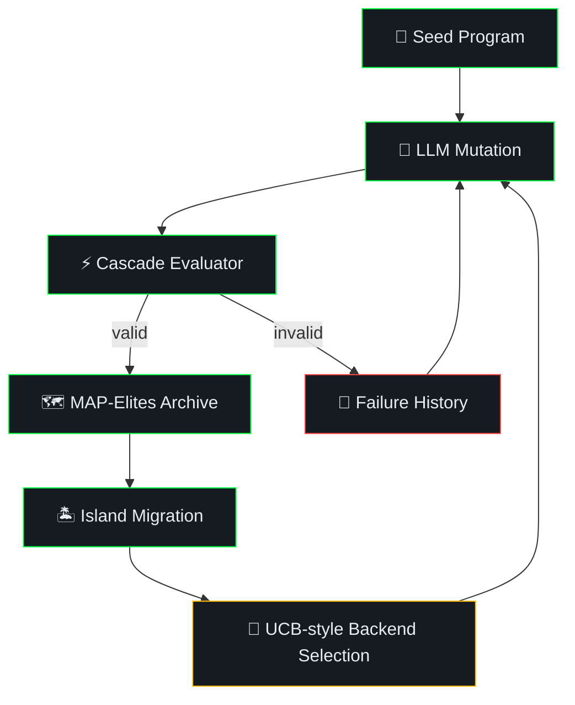

<p align="center">
  
</p>

<h1 align="center">LibreEvolve</h1>

<p align="center">
  <strong>Open-source framework for LLM-guided evolutionary program discovery</strong>
</p>

<p align="center">
  <a href="LICENSE"></a>
  
  <a href="https://github.com/romgenie/libreevolve/actions/workflows/tests.yml"></a>
  
  <a href="https://libreevolve.com"></a>
</p>

<br>

<p align="center">
  <em>Feed it a Python problem, seed program, and configured OpenAI/Anthropic/Ollama backend — it evolves candidate solutions automatically.</em>
</p>

<br>

LibreEvolve is an open-source Python framework for **automated algorithm discovery** and **code optimization** using large language models and evolutionary computation. It is inspired by [AlphaEvolve](https://arxiv.org/abs/2506.13131), [karpathy/autoresearch](https://github.com/karpathy/autoresearch), and related research on LLM-guided evolution, and evolves better programs through LLM-generated SEARCH/REPLACE diffs or full-block replacements evaluated in a cascade pipeline.

This repository is an independent implementation and is not affiliated with or endorsed by Google DeepMind, Andrej Karpathy, or the authors of the cited papers.

Works with **OpenAI** (Chat Completions by default; Responses API when `reasoning_effort` is configured), **Anthropic Claude**, and **local models via Ollama**. Model names in examples are provider-specific examples; LibreEvolve forwards them to the relevant SDK and does not validate current availability.

Built by [Timothy Gregg](https://complete.tech) at [CompleteTech](https://complete.tech) | [libreevolve.com](https://libreevolve.com)

## Documentation

- [Docs index](docs/README.md)
- [Roadmap](ROADMAP.md)
- [Architecture](docs/architecture.md)
- [Problem format](docs/problem-format.md)
- [Configuration](docs/configuration.md)
- [Plugins](docs/plugins.md)
- [Backends](docs/backends.md)
- [Run artifacts](docs/run-artifacts.md)
- [Development](docs/development.md)

## Key Features

| | Feature | Description |
|:---:|---|---|
| 🧠 | **Multi-LLM support** | OpenAI, Anthropic, and Ollama adapters with provider-specific model strings |
| 🗺️ | **MAP-Elites archive** | 3D quality-diversity grid mapping performance, complexity, and TF-IDF diversity |
| 🏝️ | **5-island migration** | Synchronous island archives with ring-topology migration (70% exploit / 30% explore) |
| 🎰 | **UCB-style ensemble** | Heuristic backend routing over observed fitness improvements |
| ⚡ | **Cascade evaluator** | Three-tier filtering (diff penalties → syntax → subprocess) — cheap rejects before expensive evals |
| 🔀 | **SEARCH/REPLACE diffs** | LLMs can propose targeted edits, with full-block/full-code mode available when configured |
| 📜 | **Failure memory** | Failed/rejected mutations are logged to `failure_history.jsonl` and bounded recent examples are shown in prompts |
| 🧾 | **Prompt programs** | Prompt templates are selected, scored, logged, and optionally mutated for meta-prompt evolution |
| 🧐 | **Optional LLM critique and feedback** | Configurable self-review and grader passes can revise mutations, add feedback metrics, or discard candidates |
| 🔌 | **Plugin system** | 4 lifecycle hooks with paper-inspired plugins |
| ✅ | **Focused test suite** | Unit coverage for the current prototype surface, including workspace candidates, candidate blocks, mutation modes, evaluator results, metrics, archives, and CLI behavior |

## Comparison to AlphaEvolve

| Feature | AlphaEvolve (Google DeepMind) | LibreEvolve |
|---------|-------------------------------|-------------|
| Source | Closed-source | **Open-source (MIT)** |
| LLM backends | Published experiments use Gemini Flash/Pro; paper describes existing/custom LLM choices | **OpenAI, Anthropic, Ollama backends** |
| Population model | Closed evolutionary database inspired by MAP-Elites/island models | **Small local MAP-Elites with 5-island migration** |
| LLM selection | Fast/deep model scheduling described | **UCB-style heuristic plus experimental throughput/depth metadata** |
| Evaluation | User-defined evaluators, optional cascades, feedback, and parallel execution | **Local subprocess evaluator with structured results, staged validator cascades, and optional synchronous LLM feedback** |
| Extensibility | Task API, evaluators, prompt/context customization, LLM choices, evolve blocks | **Python problem format, plugins, prompt templates, evolve blocks** |
| Local models | Published experiments use hosted Gemini models; local model use is not discussed | **Yes (Ollama)** |
| Research grounding | Published paper | **24-paper local cache and implementation-status docs** |

## Getting Started

### Installation

```bash
py -3.12 -m pip install -e ".[dev]"
```

### Configuration

Create a `.env` file with your API keys:

```
OPENAI_API_KEY=sk-...
ANTHROPIC_API_KEY=sk-ant-...
OLLAMA_HOST=http://localhost:11434
```

### Run Your First Evolution

```bash
# OpenAI GPT-4o-mini
py -3.12 -m libreevolve run libreevolve/problems/examples/circle_packing \
    --max-generations 15 --backends openai:gpt-4o-mini

# OpenAI reasoning models (GPT-5.4)
py -3.12 -m libreevolve run libreevolve/problems/examples/hello_world \
    --max-generations 5 --backends openai:gpt-5.4-nano --reasoning-effort high

# Anthropic Claude
py -3.12 -m libreevolve run libreevolve/problems/examples/sorting \
    --max-generations 10 --backends anthropic:claude-sonnet-4-6

# Local models via Ollama
py -3.12 -m libreevolve run libreevolve/problems/examples/hello_world \
    --max-generations 20 --backends ollama:llama3
```

### Inspect Results

If you ran one of the examples above, inspect the matching run directory under `runs/`:

```bash
py -3.12 -m libreevolve show runs/hello_world
```

Or inspect one of the checked-in example histories:

```bash
py -3.12 -m libreevolve show examples/runs/hello_world_ensemble
py -3.12 -m libreevolve show examples/runs/sorting_ttt_rl
```

These checked-in examples are legacy history fixtures. They are useful for
testing `show`, but they do not include the current full run-artifact set such
as `manifest.json`, `prompt_history.jsonl`, `failure_history.jsonl`, or
`best_workspace/`.

`show` is a compact history view. It selects the highest top-level fitness row
from `history.jsonl`, not a reconstructed archive-admitted best candidate; use
`best.py` and `best_workspace/` from the original run for the archived best
output.

```
Total programs: 11
Best fitness:   1.000000 (generation 0)

--- Best program ---

def greet(name):
    return f"Hello, {name}!"
```

## How LLM-Guided Evolution Works



<details>
<summary><b>Step-by-step breakdown</b></summary>

<br>

1. **Parent selection** — Sample a parent (70% exploit best, 30% explore random from MAP-Elites grid)
2. **Prompt construction** — Build a prompt with parent code, parent-excluding/deduplicated inspiration programs, and recent failure-memory hints
3. **LLM mutation** — LLM proposes a SEARCH/REPLACE diff by default, or full-block/full-code replacements when configured with `mutation_mode: full`
4. **Optional review** — Configured critique and feedback graders can revise mutations, add metrics, or discard candidates; malformed critique revisions fall back to the original mutation when it still applies cleanly.
5. **Cascade evaluation** — Score the result with structured stage outcomes, raw metrics, stdout/stderr, error, and elapsed time
6. **Archive update** — Valid programs enter the MAP-Elites archive; all programs are logged with metrics and evaluation details
7. **Failure memory** — Failed/rejected mutations are persisted with error causes, changed files, evaluator summaries, and bounded prompt-visible examples
8. **Backend reward** — UCB-style routing rewards the LLM backend based on fitness improvement
9. **Island migration** — Periodic migration spreads good solutions across islands
10. **Artifacts** — `best.py` preserves the primary-file compatibility view, and `best_workspace/` contains the complete best candidate file set

</details>

Prompt construction is not yet globally token-budgeted. Large workspaces,
context files, plugin context, and inspiration sets can exceed a backend's
effective context window until prompt packing/accounting is implemented.

LLM feedback graders receive bounded full-workspace context with file paths,
primary-file marking, basic secret redaction, truncation notices, and compact
evaluation diagnostics.

Mutation and critique prompts are different: the current run history stores
rendered prompts and critique prompts without a general redaction or
data-retention policy. Keep seeds, explicit context files, and plugin context
free of secrets unless you are comfortable sending and persisting that content.

Malformed LLM feedback responses and provider failures are recorded as
feedback-failure metadata and ignored for scoring. Grader config is
prevalidated at startup, but richer retry/penalty policies and score
calibration remain open.

Run history logs candidates, but archive cell/island state and migration events
are not persisted as replayable MAP-Elites state yet.
History records include per-candidate `metadata.archive_admission` events with
threshold status, island id, MAP-Elites cell coordinates/descriptors, previous
occupant ids, and elite-list effects.

For workspace candidates, MAP-Elites complexity and TF-IDF diversity descriptors
currently use the primary-file view, not the full candidate file set.
Those local descriptors are also normalized against evolving in-memory archive
state, so they are not stable, user-defined behavior dimensions yet.

## Example Runs

### Evolving a Greeting Function

Seed returns `"Hi {name}"` (0/3 tests). The checked-in `hello_world_ensemble` history reaches `f"Hello, {name}!"` in generation 0, then records several rejected variants:

```
gen  0  -0.10  def greet(name): return f"Hi {name}"                   <- seed (wrong format)
gen  0   1.00  def greet(name): return f"Hello, {name}!"              <- solved
gen  1  -0.10  def greet(name): return f"Hello, {name}! How are you today?"
gen  4  -0.10  def greet(name): return f"Hello, {name}!!!"
gen  7  -0.10  def greet(name): return f"Greetings, {name}!"          <- wrong word
gen  8  -0.10  def greet(name): return f"Hi there, {name}!"
```

### Evolving a Sort Algorithm

Seed is a bubble sort (already passes all 8 test cases). The checked-in `sorting_ttt_rl` history first produces a malformed `lst.sort()` edit, then explores multiple valid implementations:

```
gen  0   1.00  bubble sort (seed)                                     <- O(n^2)
gen  0  -0.20  malformed lst.sort() edit                              <- syntax error
gen  1   1.00  lst.sort()                                             <- builtin in-place
gen 13   1.00  lst = sorted(lst)                                      <- builtin new list
gen 16   1.00  lst.copy(); lst.sort()                                 <- copy variant
gen 31   1.00  return sorted(lst)                                     <- direct builtin
gen 46   1.00  lst.copy(); lst = sorted(lst)                          <- copy + sorted
```

### Circle Packing in a Unit Square

The `circle_packing` example is now closer to AlphaEvolve's circle-packing benchmark: pack exactly 26 circles in the unit square while maximizing the sum of radii.

The seed is intentionally suboptimal but structured: a centered 26-circle hex-style layout with equal radii. This gives evolution room to improve radii, spacing, and row structure while staying in the same fixed-`n`, variable-radius problem family as the paper.

## Supported LLM Backends

| Provider | Models | Features |
|----------|--------|----------|
| **OpenAI** | Provider-specific model IDs | Chat Completions by default; Responses API when `reasoning_effort` is configured |
| **Anthropic** | Claude Sonnet 4.6, Claude Opus 4.6, Claude Haiku 4.5 | Messages API |
| **Ollama** | Llama 3, Mistral, Qwen, any local model | Local inference, no API key needed |

Mix backends in a single run — the UCB-style router tracks observed fitness improvements for each backend:

```bash
py -3.12 -m libreevolve run my_problem/ \
    --backends openai:gpt-4o-mini \
    --backends anthropic:claude-sonnet-4-6 \
    --backends ollama:llama3
```

Per-call provider telemetry is not logged yet. Token usage, latency, retry
counts, response IDs, finish reasons, and API mode remain backend-provenance
work. Provider call failures are also not retried, routed to fallback backends,
or recorded as structured failed LLM-call attempts yet.

<details>
<summary><h2>Architecture</h2></summary>

```
libreevolve/
├── core/
│   ├── loop.py          # evolve() main loop + build_prompt()
│   ├── candidate.py     # workspace candidates, evolve-block markers + mutation modes
│   ├── feedback.py      # optional LLM critique and feedback graders
│   ├── prompt.py        # prompt sampler + context/stage-feedback rendering
│   ├── meta_prompt.py   # prompt-program DB, scoring, lineage, mutation
│   ├── evaluator.py     # Cascade evaluator (Tier 0/1/2)
│   ├── diff.py          # SEARCH/REPLACE diff engine
│   ├── database.py      # ProgramDatabase facade
│   └── config.py        # Config dataclass
├── llm/
│   ├── ensemble.py      # UCB-style LLM ensemble
│   ├── anthropic.py     # Claude backend
│   ├── openai.py        # OpenAI backend (+ Responses API when reasoning_effort is set)
│   └── ollama.py        # Ollama backend
├── population/
│   ├── program.py       # Program dataclass
│   ├── map_elites.py    # 3D MAP-Elites (TF-IDF char-4gram diversity)
│   └── islands.py       # 5-island ring migration (30% explore / 70% exploit)
├── plugins/
│   ├── base.py          # PluginBase ABC (4 lifecycle hooks)
│   ├── causal.py        # CausalEvolve-inspired outcome-factor guidance
│   ├── deep_research.py # DeepEvolve-inspired pluggable web search
│   ├── modular.py       # ImprovEvolve-inspired modular prompting
│   └── ttt_rl.py        # ThetaEvolve-inspired training data export
└── problems/
    ├── loader.py         # load_problem() + Problem dataclass
    └── examples/         # hello_world, circle_packing, sorting, matrix_multiplication, workspace_math
```

</details>

## Creating a Custom Problem

A problem is a directory with required files/directories and optional prompt
context:

```
my_problem/
├── task_description.txt          # What the LLM should optimize
├── metrics.yaml                  # Scoring metrics
├── validate.py                   # evaluate(code: str) -> dict
├── initial_programs/
│   ├── seed.py                   # Single-file starting program
│   └── workspace_seed/           # Optional multi-file starting program
│       ├── main.py
│       └── helper.py
└── context/
    └── optional_notes.md         # Optional explicit prompt context
```

**metrics.yaml:**
```yaml
metrics:
  - name: score
    direction: maximize
    primary: true
    bounds: [0.0, 1.0]
  - name: is_valid
    direction: maximize
    primary: false
```

**validate.py** must define `evaluate(code: str) -> dict` or
`evaluate(code: str, workspace_path: str) -> dict` returning a dict with all
metric names. It runs in a temporary local subprocess, and its raw metrics and
diagnostics are stored with each candidate.

Generated evaluator files are not collected yet. The candidate workspace is
temporary, so validators should summarize important plots, traces, or JSON
outputs through metrics/stdout/stderr until artifact collection is implemented.

That subprocess currently inherits the parent process environment. Provider
keys loaded from `.env` are not hidden from validators until validator
environment allowlisting is implemented.
Validator timeouts also do not yet guarantee cleanup of child processes spawned
by evaluator code; keep validators single-process or self-cleaning until
process-tree cleanup is implemented.
The pre-validator syntax check covers candidate `.py` files, but currently
reports only the first syntax error across a workspace.

`validate.py` is loaded by file path from a temporary runner. The validator's
directory is added to `sys.path`, so sibling helper modules in the problem
directory can be imported normally.

For multi-file candidates, `workspace_path` points at the materialized file set.
The validator subprocess runs with that candidate root as `cwd` and adds it to
`sys.path`, so candidate-local imports and relative file reads work by default.

Seed programs may mark evolvable regions while preserving surrounding skeleton code:

```python
# EVOLVE-BLOCK-START solve
def solve():
    return 1
# EVOLVE-BLOCK-END
```

Unmarked seed programs remain fully supported.
For current multi-file mutation prompts, `<<<FILE ... >>>FILE` paths are routed
through the same safety normalizer as candidate workspaces, including nested
paths, hyphens, spaces, Unicode filename characters, and Windows-style
backslashes. Collision checks are still incomplete: distinct input names that
normalize to the same relative path are rejected during candidate workspace
construction, but file-section collision policy and host-filesystem case
folding collisions are still incomplete.
File/block mutation envelopes are not represented as a complete mutation AST
yet, but unmatched, orphaned, nested, duplicate-name, empty-name, and
invalid-name envelopes now fail before partial edits are applied.
Workspace mutations can edit existing files and create new files in `full`
mode. They can also express file topology operations with command file
sections:

```text
<<<FILE DELETE old_helper.py
>>>FILE

<<<FILE MOVE old_module.py -> package/new_module.py
>>>FILE

<<<FILE PRIMARY package/new_module.py
>>>FILE
```

**Tip:** Make your seed program intentionally suboptimal. If the seed already scores perfectly, there's nothing to evolve.

## Plugin System

Plugins hook into 4 lifecycle events to extend LibreEvolve's behavior:

| Hook | When | Use case |
|------|------|----------|
| `on_generation_start(gen, db)` | Before each generation | Periodic web search, state setup |
| `build_extra_context(parent, inspirations)` | During prompt construction | Inject guidance into LLM prompt |
| `on_evaluated(program, score)` | After evaluation | Modify score, accumulate data |
| `on_generation_end(gen, best)` | After each generation | Logging, training data export |

Plugin score hooks can change final top-level fitness. Per-plugin before/after
score provenance is stored in `metadata.score_composition`, and archive
admission remains gated by evaluator/feedback validity.

Built-in plugins are paper-inspired approximations, not full reproductions:
- **CausalEvolve-inspired** — token-pattern outcome-factor guidance
- **DeepEvolve-inspired** — pluggable arXiv/web-search context
- **ImprovEvolve-inspired** — modular decomposition prompting
- **ThetaEvolve-inspired** — clipped-reward JSONL export, not training

The causal plugin's factor detector uses the shared diff parser, so compact
local SEARCH/REPLACE fences and canonical AlphaEvolve fences are both visible
to factor guidance. The plugin is still a lightweight token-pattern heuristic,
not CausalEvolve's causal scratchpad.

The DeepEvolve-inspired retrieval plugin injects best-effort live arXiv
summaries into prompts, but does not yet persist query/result provenance,
citations, source hashes, timestamps, or failure diagnostics in run artifacts.

The ImprovEvolve-inspired modular plugin is static prompt guidance. It does
not select, execute, or log a `generate_config`/`improve`/`perturb` operation
for each candidate, and plugin prompt-context attribution is not structured
outside the rendered prompt text yet.

The ThetaEvolve-inspired export writes `runs/grpo_data.jsonl` by default and
stores `reward = max(0.0, score)`. That side file is not yet scoped under the
active run directory, hashed in `manifest.json`, or a real GRPO/RL trainer.

```bash
py -3.12 -m libreevolve run my_problem/ --plugins causal --plugins deep_research
```

## CLI Reference

```
libreevolve run PROBLEM_DIR [OPTIONS]
  --max-generations, -g    Number of generations (default: 1000)
  --backends, -b           LLM backend as type:model (repeatable)
  --plugins, -p            Plugin name (repeatable)
  --reasoning-effort, -r   Reasoning effort for OpenAI reasoning models (low/medium/high/xhigh; omit to disable)
  --mutation-mode          Mutation mode: diff or full
  --explore-ratio, -e      Probability of exploration vs exploitation (default: 0.3)
  --run-name               Custom name for this run (default: problem directory name)
  --seed                   Random seed

libreevolve show RUN_DIR
  Inspect history.jsonl from a previous run
```

The seed controls local Python-random choices, but prompt variants currently
enter a prompt-program database whose initial untried selection is ordered by
UUID4 prompt-program ids rather than the seed. Persisted candidate/prompt IDs
and provider outputs are not fully replay-stable yet.

## Tests

```bash
# Unit tests
py -3.12 -m pytest tests/ -m "not integration" --tb=short

# Integration test (requires API key)
py -3.12 -m pytest tests/integration/ -m integration
```

<details>
<summary><h2>Benchmarks and Lessons from Live Testing</h2></summary>

<br>

**Model selection matters more than generation count:**
- The same benchmark can reward very different mutation styles: conservative constant tweaks, geometric row edits, or more aggressive rewrites.
- Fixed-`n` packing tasks are a good stress test for the evaluator because many plausible-looking layouts fail on boundary or overlap checks.

**Prompt engineering for LLM-guided evolution:**
- Models wrap diffs in markdown fences — the diff engine strips them automatically
- Models add comments that cause diff matching failures — the prompt instructs "no comments"
- Without stronger failed-proposal memory, models can repeat the same bad mutation many times
- A concrete diff example in the prompt prevents models from using angle-bracket placeholders literally

**Seeds determine the evolutionary landscape:**
- Suboptimal seeds (hello_world, circle_packing) produce rich evolutionary trajectories
- Already-optimal seeds (sorting's bubble sort) still evolve *different implementations* at the same fitness level

</details>

<details>
<summary><h2>Local Paper Cache (24)</h2></summary>

<br>

LibreEvolve is informed by a local cache of 24 papers on LLM-guided evolutionary computation, program synthesis, and quality-diversity optimization. The cache lives in `papers/` with download manifests; see `papers/README.md` for implementation status and benchmark coverage decisions.

**Core system papers:**

| Paper | Authors | Year | Role in LibreEvolve |
|-------|---------|:----:|---------------------|
| [**AlphaEvolve**](https://arxiv.org/abs/2506.13131) | Novikov et al. (Google DeepMind) | 2025 | Core architecture inspiration |
| [**GigaEvo**](https://arxiv.org/abs/2511.17592) | Khrulkov et al. | 2025 | Open-source framework patterns |
| [**CodeEvolve**](https://arxiv.org/abs/2510.14150) | Assumpção et al. | 2025 | Evolutionary coding agent design |
| [**ThetaEvolve**](https://arxiv.org/abs/2511.23473) | Wang et al. | 2025 | Inspiration for export/training boundary |
| [**ImprovEvolve**](https://arxiv.org/abs/2602.10233) | Kravatskiy et al. | 2026 | Inspiration for modular prompting |
| [**MadEvolve**](https://arxiv.org/abs/2602.15951) | Li, Zang & Münchmeyer | 2026 | Domain-specific evolution |
| [**CausalEvolve**](https://arxiv.org/abs/2603.14575) | Chen et al. | 2026 | Inspiration for causal guidance; not scratchpad-complete |
| [**DeepEvolve**](https://arxiv.org/abs/2510.06056) | Liu et al. | 2025 | Inspiration for retrieval context; not cross-file-debug-loop complete |

**Foundational algorithms:**

| Paper | Authors | Year | Role |
|-------|---------|:----:|------|
| **MAP-Elites** | Mouret & Clune | 2015 | Quality-diversity archive |
| **UCB1** | Auer, Cesa-Bianchi & Fischer | 2002 | Inspiration for heuristic backend routing |

The references above are summarized for context in this README. The codebase and
tests should be treated as the source of truth for current implementation
behavior.

</details>

## Contributing

Contributions welcome.

Before committing:

```bash
py -3.12 -m pip install -e ".[dev]"
py -3.12 -m pre_commit install
py -3.12 -m pre_commit run --all-files
```

Please also run `py -3.12 -m pytest tests/ -m "not integration" --tb=short` before submitting PRs.

## License

[MIT](LICENSE) — [Timothy Gregg](https://complete.tech) / [CompleteTech](https://complete.tech)
